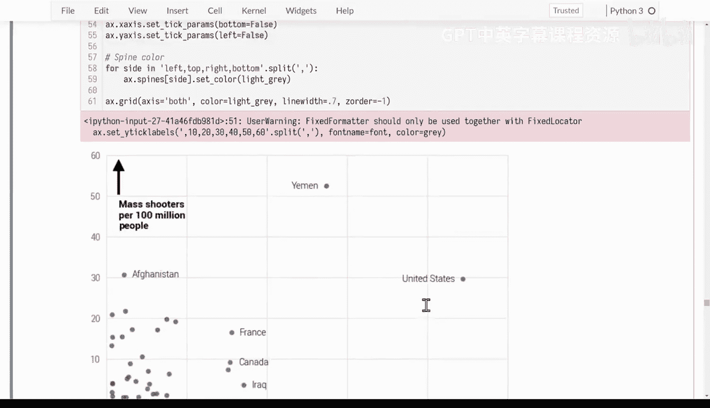

#  129：文本定制详解


在本节中，我们将学习如何定制Matplotlib图表中的文本，并深入理解定制文本时涉及的各项参数和概念。我们将通过一个枪支数据的可视化案例，逐一解析文本注释、坐标定位、字体样式等核心功能。

## 概述

文本是数据可视化图表中传递信息的关键元素。Matplotlib提供了强大的文本定制功能，允许我们精确控制文本的位置、样式和对齐方式。掌握这些功能，可以显著提升图表的可读性和专业性。

上一节我们介绍了基础图表的绘制，本节中我们来看看如何对图表中的文本进行精细化的控制。

## 文本定制核心：`annotate` 方法

我们首先关注图表中用箭头指向的加粗文本。这是通过 `annotate` 方法实现的。

以下是 `annotate` 方法的一个关键调用示例：
```python
ax.annotate('United States', xy=(0.03, 1), xytext=(0.03, 0.7), ...)
```

让我们分解这个调用中的参数：
*   **文本内容**：第一个参数是字符串 `'United States'`，即要显示的文本。
*   **箭头指向点 (xy)**：参数 `xy=(0.03, 1)` 定义了箭头所指的位置。
*   **文本位置 (xytext)**：参数 `xytext=(0.03, 0.7)` 定义了文本标签本身放置的位置。

## 理解坐标系统：轴分数坐标

你可能注意到 `xy` 和 `xytext` 的值是像 `(0.03, 1)` 这样的小数。这代表**轴分数坐标**。

它的含义是：
*   将图表的X轴和Y轴范围分别归一化为 0 到 1。
*   `(0, 0)` 对应坐标轴的左下角。
*   `(1, 1)` 对应坐标轴的右上角。
*   因此，`xy=(0.03, 1)` 表示箭头指向“从左边界开始3%的位置，Y轴顶部”的点。

我们通过 `transform` 参数来明确指定使用这种坐标系统：
```python
transform=ax.transAxes
# 或
xycoords='axes fraction'
```
虽然两者字符串形式不同，但都指示Matplotlib使用轴分数坐标系。

## 文本样式与对齐控制

在 `annotate` 调用中，我们还可以通过其他参数精细控制文本的样式。

以下是控制文本外观的关键参数示例：
```python
ha='left',         # 水平对齐方式：左对齐 (left)、居中 (center)、右对齐 (right)
fontsize=12,       # 字体大小
weight='bold',     # 字体粗细：加粗 (bold)
va='center',       # 垂直对齐方式：居中
arrowprops=dict()  # 用于控制箭头样式的字典
```
*   `ha='left'` 使得文本标签左对齐于 `xytext` 指定的位置。
*   `weight='bold'` 使文本显示为粗体。
*   `arrowprops` 是一个字典，用于定义箭头的颜色、宽度、样式等（更多细节可查阅Matplotlib文档）。

## 动态定位文本标签

在案例中，我们为每个数据点（国家）添加了名称标签。为了布局清晰，我们根据国家动态调整了标签位置。

以下是动态定位文本标签的逻辑代码片段：
```python
for country in countries:
    x = data[country]['x']
    y = data[country]['y']
    if country in ['United States', 'Yemen']:
        # 对于美国和也门，将文本放在数据点左侧并右对齐
        ax.text(x - x_offset, y, country, ha='right', va='center', weight='semibold')
    else:
        # 对于其他国家，将文本放在数据点右侧并使用默认的左对齐
        ax.text(x + x_offset, y, country, va='center', weight='semibold')
```
这个逻辑确保了标签不会相互重叠，美国和也门的标签因数值特殊而被特意放置在左侧。

## 刻度标签与全局字体

除了注释和标签，图表坐标轴上的刻度文本也可以定制。

我们使用以下方法来设置刻度标签的字体和颜色：
```python
ax.tick_params(axis='both', labelsize=10, labelcolor='gray')
# 或者通过设置全局字体属性影响刻度标签
plt.rcParams['font.sans-serif'] = ['SimHei']  # 设置中文字体
plt.rcParams['axes.unicode_minus'] = False    # 解决负号显示问题
```
通过 `tick_params` 可以统一调整刻度标签的大小和颜色。此外，修改 `rcParams` 配置可以设置全局的默认字体，这也会影响刻度标签。

## 总结



本节课中我们一起学习了Matplotlib中文本定制的核心技巧。我们详细探讨了：
1.  使用 `annotate` 方法添加带箭头的文本注释。
2.  理解并使用**轴分数坐标**来精确定位文本。
3.  通过参数控制文本的**样式**（大小、粗细）和**对齐方式**（水平、垂直）。
4.  实现逻辑判断，为不同数据点**动态调整**文本标签位置以避免重叠。
5.  定制**刻度标签**的样式以及设置全局字体。

你会发现，Matplotlib允许你对图表中几乎所有的文本元素进行深度定制。当你有特定需求时，查阅官方文档总是最有效的途径，你可以直接复制文档中的示例代码到Jupyter Notebook中运行和试验。