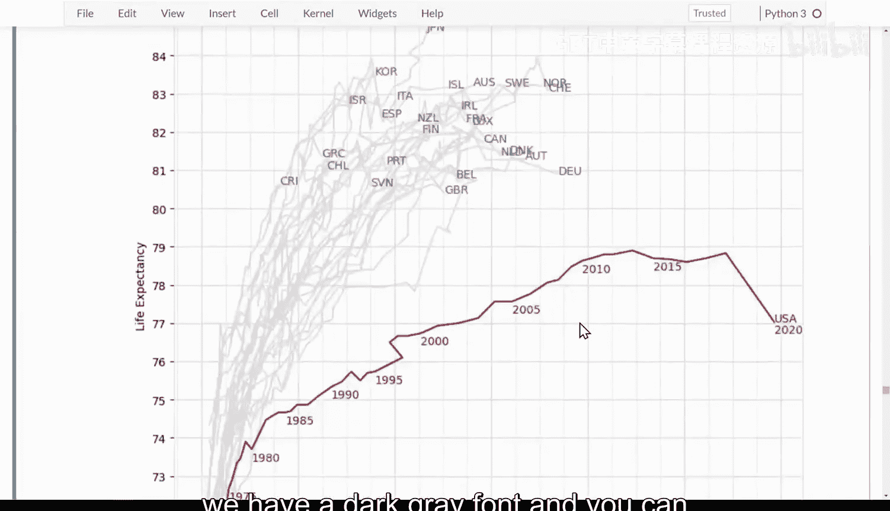

#  130：Matplotlib颜色定制


在本节中，我们将学习如何在Matplotlib中调整颜色，以增强图表的视觉效果和突出重点信息。

首先，我们加载数据并创建一个基础的折线图。从图中可以看到，我们使用了红色、灰色和深灰色等颜色。接下来，我们通过分析代码来理解这些颜色是如何被应用的。

## 颜色变量的定义与使用

在代码的开头部分，我们定义了三个颜色变量：`gray`、`dark_gray`和`red`。这些变量将在后续的绘图设置中被反复调用，以确保颜色风格的一致性。

以下是定义颜色变量的代码示例：
```python
gray = '#CCCCCC'
dark_gray = '#666666'
red = '#FF0000'
```

## 坐标轴与标签的颜色设置

上一节我们定义了颜色变量，本节中我们来看看如何将这些颜色应用到图表的各个元素上。

我们通过一个`for`循环，将X轴刻度颜色、Y轴刻度颜色以及坐标轴标签颜色都设置为`dark_gray`（深灰色）。这确保了图表中所有辅助性的文本和刻度线都使用统一的、不喧宾夺主的颜色。

以下是设置坐标轴颜色的代码：
```python
for spine in ['xtick.color', 'ytick.color', 'axes.labelcolor']:
    plt.rcParams[spine] = dark_gray
```

## 数据线与高亮点的颜色

在绘制数据线时，我们通过`plot`函数中的`c`参数为每条线指定颜色。这是Pandas绘图接口中指定线条颜色的方式。

同时，我们还有一个逻辑：如果数据点属于美国，我们会将每第五年的标记点设置为红色。这是一种有效的高亮重要数据点的方法。

以下是绘制数据线并高亮特定点的代码：
```python
ax.plot(data['year'], data['value'], c=country_color)
if country == 'US':
    # 高亮每第五年的数据点
    ax.scatter(data['year'][::5], data['value'][::5], c=red)
```

## 网格线与边框的颜色

为了使图表背景清晰且不干扰数据主体，我们将网格线颜色设置为浅灰色（`gray`）。同样，图表四周的边框（spines）也设置为相同的浅灰色。

以下是设置网格和边框颜色的代码：
```python
ax.grid(True, color=gray, linestyle='--', linewidth=0.5)
for spine in ax.spines.values():
    spine.set_color(gray)
```

## 文本注释的颜色

最后，图表底部的图例或注释文本也使用了我们定义的`dark_gray`颜色，以保持整体的视觉协调性。

## 颜色使用的核心原则

在Matplotlib中定制颜色时，需要牢记一个核心原则：**使用颜色来引导观众的视线聚焦于图表中最重要的信息**。

你可以通过一个简单的方法来检验颜色使用是否合理：眯起眼睛看你的图表。如果你的视线首先被吸引到的地方并非你想要强调的核心数据，那么你可能需要考虑削弱那些元素的颜色，或者直接移除它们。

**公式**： 有效的可视化 ≈ **突出主体** + **弱化背景**

---



本节课中我们一起学习了如何在Matplotlib中系统化地定制颜色。我们掌握了从定义颜色变量，到将其应用于坐标轴、数据线、网格、边框及文本的完整流程。最重要的是，我们理解了颜色在数据可视化中的核心作用——即引导注意力，并学会了通过“眯眼测试”来评估颜色方案的有效性。合理运用颜色，能让你的图表传达信息时更加清晰和有力。