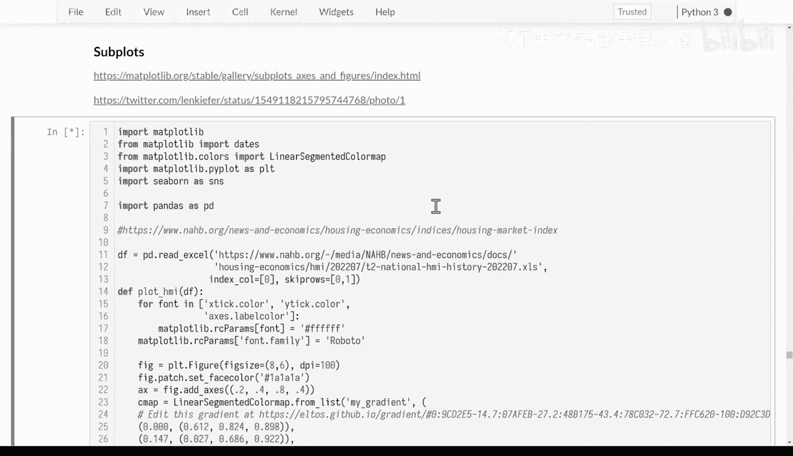
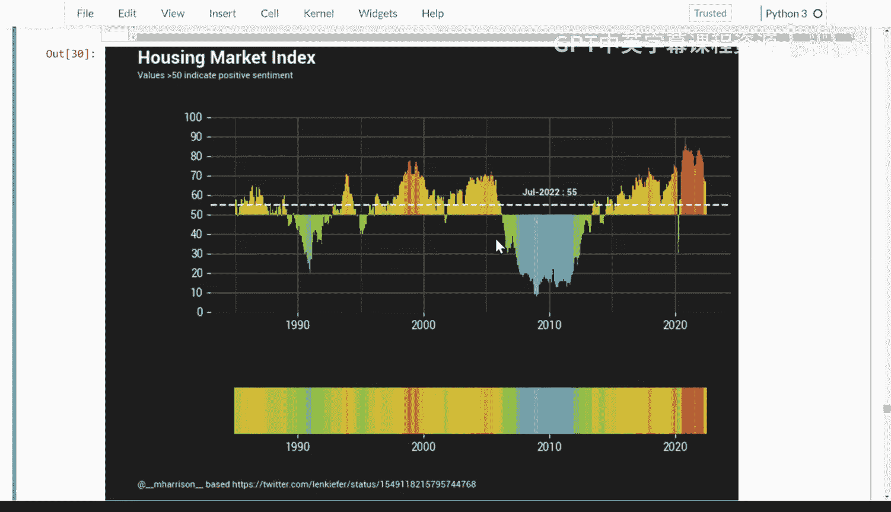
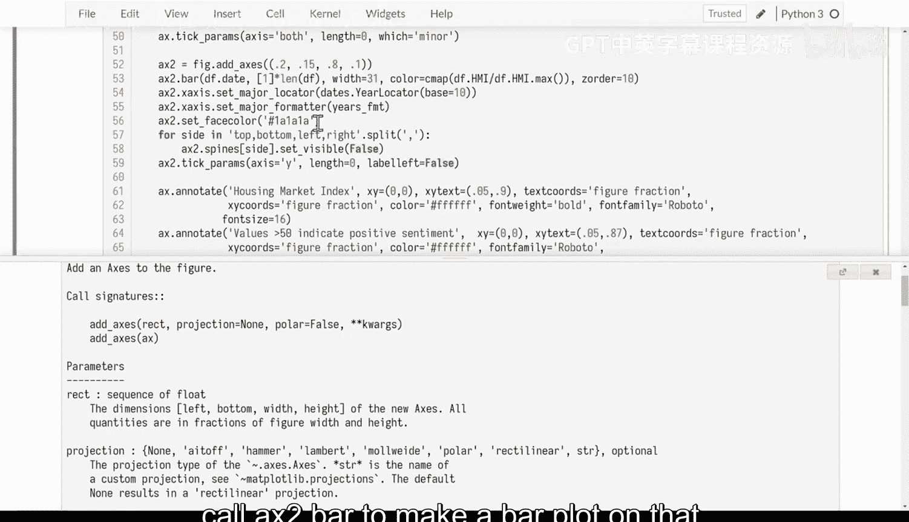

#  131：坐标轴定制与子图绘制


在本节课中，我们将学习Matplotlib中关于图形（Figure）和坐标轴（Axes）的核心概念，并重点掌握如何在一个图形中创建和定制多个坐标轴，即绘制子图。

理解子图的关键在于区分Matplotlib中的“图形”和“坐标轴”。我们可以将图形想象为绘制图表的“画纸”，而坐标轴则是画纸上一个个独立的“绘图区域”。通常，一张画纸上只有一个绘图区域，但它完全可以容纳多个。

上一节我们介绍了基础绘图，本节中我们来看看如何创建包含多个坐标轴的复杂图形。

## 核心概念：图形与坐标轴

以下是Matplotlib中创建图形和坐标轴的基本代码结构：

```python
import matplotlib.pyplot as plt

# 创建一个图形（画纸）
fig = plt.figure(figsize=(8, 6))

# 在图形上添加一个坐标轴（绘图区域）
# 参数格式：[左侧起始位置，底部起始位置，宽度，高度]，单位是图形尺寸的比例（0到1之间）
ax1 = fig.add_axes([0.2, 0.4, 0.8, 0.4])
```

这段代码创建了一个8英寸宽、6英寸高的图形，并在上面添加了一个坐标轴。该坐标轴的位置是：从图形左侧20%的位置开始，从底部40%的位置开始，宽度占图形的80%，高度占图形的40%。

## 多坐标轴示例：房地产市场指数图

为了更直观地理解，我们分析一个包含两个坐标轴的实际案例。下图展示了美国房地产市场指数，它实际上是一个图形包含两个坐标轴的成果。






这个图形包含两个坐标轴：
1.  上方是一个条形图，显示主要指数。
2.  下方是一个彩色条形图（视觉上像一条线），显示指数的月度变化。

以下是创建这个双坐标轴图形的关键代码步骤：

```python
# 创建图形
fig = plt.figure(figsize=(8, 6))

# 添加第一个坐标轴（上方的条形图）
ax1 = fig.add_axes([0.2, 0.4, 0.8, 0.4])  # 左20%， 底40%， 宽80%， 高40%
# 在ax1上绘制条形图
ax1.bar(...)

# 添加第二个坐标轴（下方的彩色条形图）
ax2 = fig.add_axes([0.2, 0.15, 0.8, 0.1])  # 左20%， 底15%， 宽80%， 高10%
# 在ax2上绘制另一个条形图
ax2.bar(...)
```

通过调整 `add_axes` 方法中的四个比例参数，我们可以精确控制每个坐标轴在图形中的位置和大小。这为我们自由组合图表布局提供了极大的灵活性。

## 更多子图创建方法

除了使用 `add_axes` 手动指定位置，Matplotlib还提供了其他更便捷的方法来创建规则排列的子图。



以下是创建子图的几种常用方式：

*   **`plt.subplots`**： 这是最常用的方法，可以快速创建网格状排列的子图。例如，`fig, axes = plt.subplots(2, 3)` 会创建一个2行3列共6个子图的图形。
*   **`GridSpec`**： 提供了比 `subplots` 更灵活的网格划分方式，允许子图跨越多行或多列。
*   **在坐标轴内嵌套子坐标轴**： 使用 `inset_axes` 方法可以在一个主坐标轴内部再添加一个小的坐标轴，用于放置插图或放大细节。

如果你对创建更复杂的图表布局感兴趣，建议查阅Matplotlib官方文档中关于“Subplots”和“GridSpec”的章节，那里有更详细的说明和示例。

本节课中我们一起学习了Matplotlib中图形与坐标轴的关系，并掌握了通过 `add_axes` 方法手动创建和定位多个坐标轴的技术。我们还了解到，除了手动布局，Matplotlib还提供了 `subplots`、`GridSpec` 等工具来高效创建规则子图。理解这些概念是进行复杂数据可视化的基础。