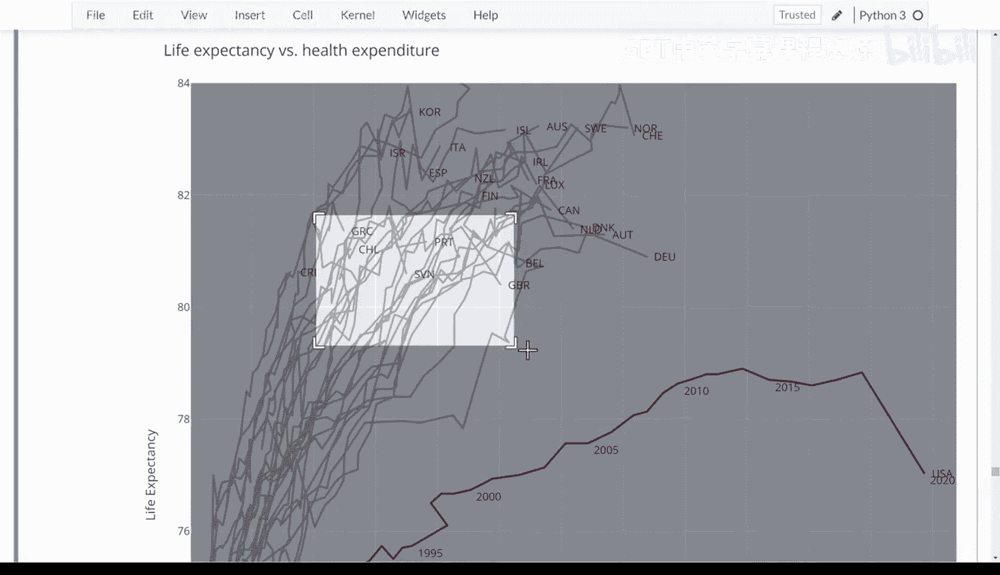

#  133：使用Plotly创建折线图 📈


在本节课中，我们将学习如何使用Plotly库来创建交互式折线图。我们将从设置绘图后端开始，逐步构建一个图表，并学习如何自定义其外观以增强可读性和信息传达。

## 概述

默认情况下，Pandas使用Matplotlib作为其绘图后端。如果我们希望使用Plotly来创建图表，则需要将绘图后端设置为Plotly。本教程将演示这一过程，并创建一个展示人均健康支出与预期寿命关系的折线图。

## 设置Plotly后端

首先，我们需要将Pandas的绘图后端从默认的Matplotlib更改为Plotly。请注意，本教程使用的是Plotly库的5.9版本。

```python
import pandas as pd
pd.options.plotting.backend = "plotly"
```

## 加载数据并创建基础图表

上一节我们介绍了如何设置后端，本节中我们来看看如何加载数据并创建基础图表。我们加载数据，并尝试创建一个与之前用Matplotlib制作的、展示预期寿命与支出关系的类似图表。

运行代码后，因为我们已经将后端设置为Plotly，生成的图表界面看起来与之前相似，但底层已改用Plotly进行渲染。

这个图表的一个优点是具有交互性：你可以将鼠标悬停在数据点上查看具体信息。

然而，这个图表是否完美地讲述了数据故事？可能还不是。接下来，让我们看看如何清理和美化它。

## 自定义和美化图表

以下是用于清理和美化图表的代码。运行后，图表看起来与上面的基础版本更相似，但增加了悬停显示信息点的功能。

让我们快速浏览一下这段代码，了解其中进行的操作：

1.  **颜色映射**：我们创建了一个名为 `is_US` 的布尔列，用于标识数据点是否属于美国。然后，我们使用 `color_discrete_map` 参数进行颜色映射：如果 `is_US` 为真（即美国的数据），则使用红色；否则使用灰色（`#AAA`）。
2.  **设置标签和尺寸**：我们为坐标轴设置了标签（“预期寿命”和“人均健康支出”），并定义了图表的宽度和高度。
3.  **隐藏图例与调整坐标轴**：我们选择不显示图例，并调整了Y轴的范围。
4.  **添加注释**：通过循环，我们为每个国家的数据线添加了国家名称的注释。请注意，这里的接口与Matplotlib不同，因为Plotly并非基于Matplotlib构建，它拥有自己的一套API。
5.  **标记年份**：另一个循环用于在美国的数据点上标记出对应的年份。
6.  **添加标题和刻度**：最后，我们为图表添加了标题，并设置了X轴的刻度值。

最终得到的图表在视觉上相似，但由于使用了不同的库，其创建方式有所不同。

Plotly图表的一个突出优点是交互性。例如，我可以放大图表的特定区域，仔细查看这些单独的数据点。

## 总结

本节课中，我们一起学习了如何使用Plotly制作折线图。关键步骤包括：
*   将Pandas的绘图后端设置为Plotly。
*   创建基础图表的方法与使用Pandas和Matplotlib时相同。
*   当需要自定义图表时，需要使用Plotly特有的接口进行调整，例如通过 `color_discrete_map` 映射颜色、添加交互式注释等。



通过Plotly，我们能够创建具有丰富交互功能的可视化图表，从而更深入地探索和展示数据。