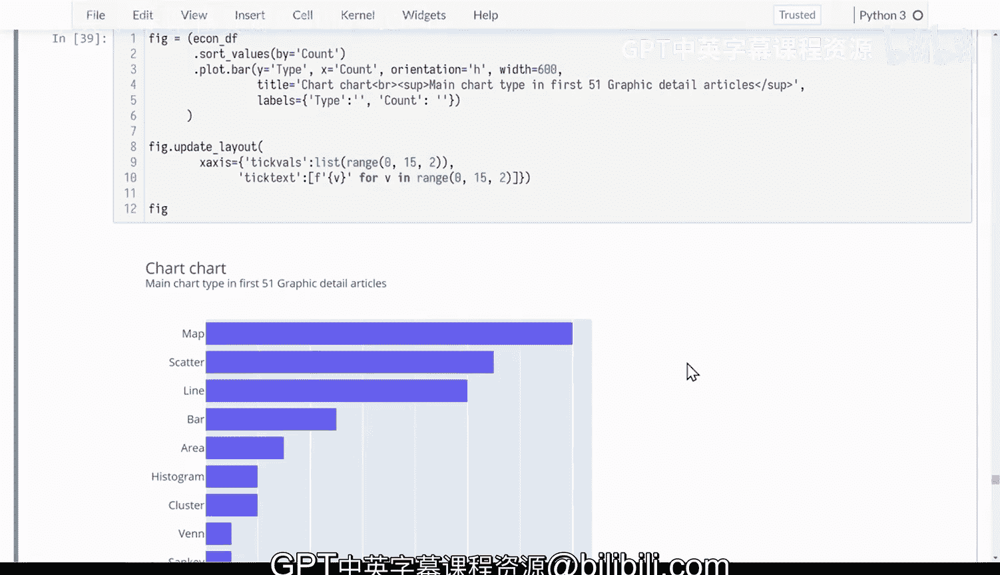

#  134：使用Plotly创建条形图 📊

在本节中，我们将学习如何使用Plotly库创建条形图。我们将从加载数据开始，逐步构建一个基础条形图，然后探索如何自定义图表，例如将其转换为水平条形图并调整坐标轴标签。


## 概述

我们将使用Plotly的`plotly.express`模块来创建条形图。首先加载经济数据集，然后使用`px.bar`函数生成图表。之后，我们会介绍如何通过修改参数来自定义图表的外观，包括调整方向、标题和坐标轴标签。

## 创建基础条形图

首先，我们需要加载数据并创建一个基础的条形图。以下是实现这一步骤的代码：

```python
import plotly.express as px

# 假设df是包含经济数据的DataFrame
fig = px.bar(df, x='type', y='count')
fig.show()
```

执行上述代码后，我们将看到一个垂直条形图，其中X轴代表“type”，Y轴代表“count”。

## 自定义条形图

在创建基础条形图后，我们可以进一步自定义它。例如，我们可以将条形图的方向从垂直改为水平，并调整标题和坐标轴标签。

以下是自定义图表的代码示例：

```python
fig = px.bar(df, x='count', y='type', orientation='h')
fig.update_layout(
    title='经济数据统计<br>副标题',
    xaxis_title='',
    yaxis_title='',
    xaxis=dict(tickvals=[], ticktext=[]),
    yaxis=dict(tickvals=[], ticktext=[])
)
fig.show()
```

在这段代码中，我们通过设置`orientation='h'`将条形图改为水平方向。同时，我们使用HTML标签`<br>`在标题中插入换行，以添加副标题。为了去除X轴和Y轴的标签，我们将`xaxis_title`和`yaxis_title`设置为空字符串。此外，通过更新`tickvals`和`ticktext`，我们隐藏了坐标轴上的刻度值，以避免干扰。

## 总结



在本节课中，我们一起学习了如何使用Plotly库创建和自定义条形图。我们从加载数据开始，创建了一个基础的垂直条形图，然后通过调整参数将其转换为水平条形图，并自定义了标题和坐标轴标签。这些步骤帮助我们更好地展示和理解数据。