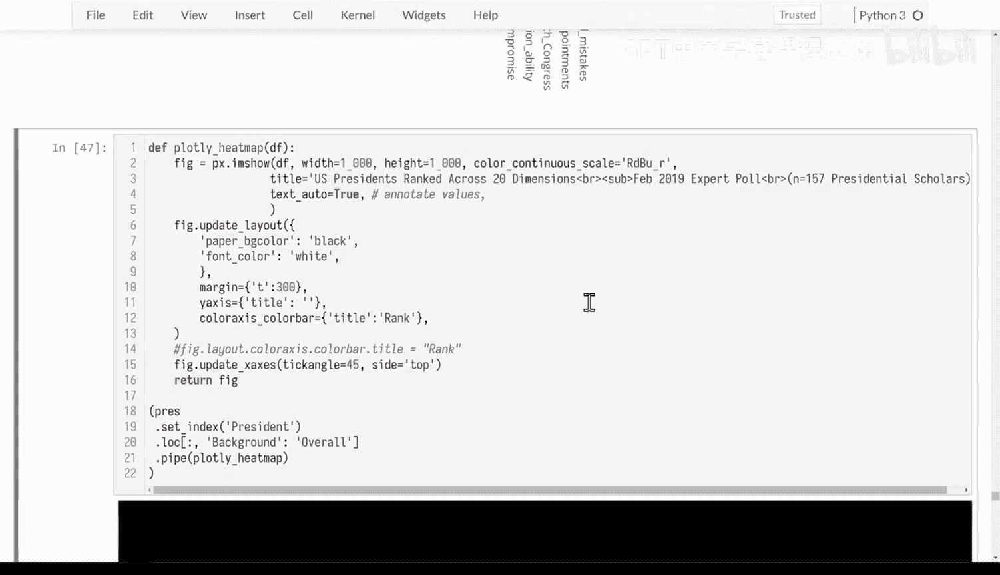
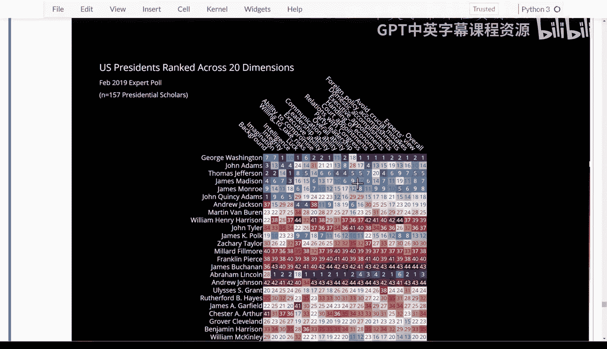
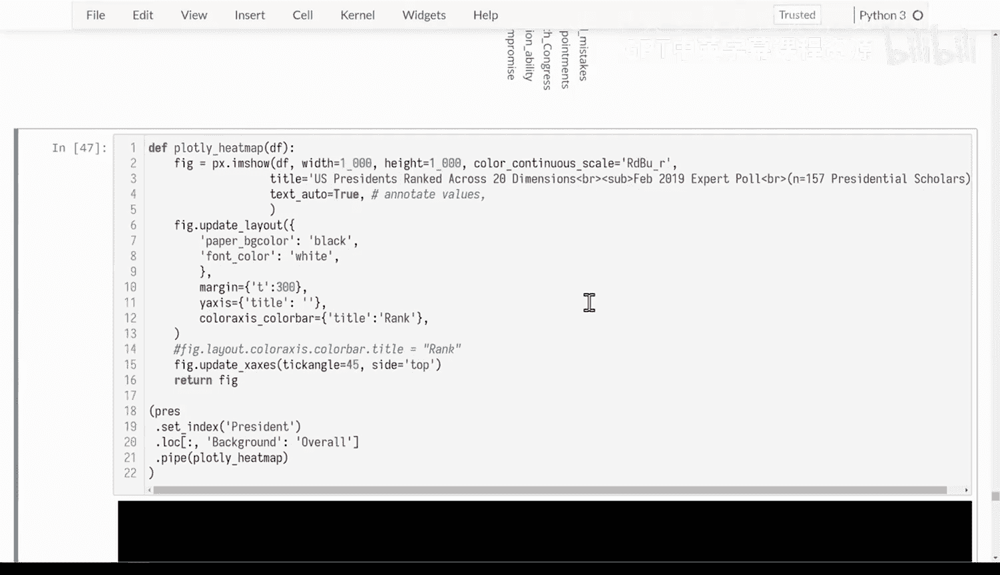

#  136：使用Plotly创建热力图 📊


在本节课中，我们将学习如何使用Plotly库来创建交互式热力图。我们将加载美国总统的数据集，并生成一个可以悬停查看详细信息、缩放以及自定义样式的热力图。与Matplotlib相比，Plotly提供了更流畅的交互体验。

## 概述

上一节我们介绍了使用Matplotlib和Seaborn创建静态图表。本节中，我们来看看如何使用Plotly创建交互式热力图。Plotly的优势在于其丰富的交互功能，例如悬停信息提示和流畅的缩放操作，这些在Matplotlib中实现起来较为复杂。

## 加载数据与创建基础热力图

首先，我们需要加载数据并调用Plotly的`imshow`函数来创建基础热力图。这个函数与Matplotlib中的`imshow`功能相似，但Plotly版本支持交互。

```python
import plotly.graph_objects as go
import pandas as pd

# 假设df是包含总统数据的DataFrame
fig = go.Figure(data=go.Heatmap(z=df.values))
fig.show()
```

运行上述代码会生成一个基础热力图。将鼠标悬停在热力图的单元格上，可以查看该位置的具体数值。当数据具有大量行和列时，这种交互功能尤其有用，因为它允许用户通过悬停和缩放来探索数据细节。

## 自定义热力图样式

为了使热力图更符合我们的展示需求，我们可以对其进行一系列自定义设置。这包括调整颜色映射、添加标题、在单元格内显示数值以及修改背景和字体颜色。

以下是自定义样式的步骤：

1.  使用`color_continuous_scale`参数设置颜色映射。
2.  通过`title`参数为图表添加标题。
3.  设置`text_auto=True`以在热力图单元格内显示数值。
4.  修改布局属性，如背景色、字体颜色和边距。



```python
fig.update_layout(
    title='总统数据热力图',
    plot_bgcolor='black',
    paper_bgcolor='black',
    font_color='white',
    margin=dict(l=300)  # 设置左侧边距为300像素
)
fig.update_traces(text_auto=True)  # 在单元格内显示数值
fig.update_yaxes(title_text='排名')  # 设置Y轴标题
fig.show()
```



## 最终效果与总结

运行完整的自定义代码后，我们将得到一个样式美观、功能丰富的交互式热力图。它不仅在视觉上与我们之前用其他库创建的图表相似，而且在易用性和交互性上更胜一筹。



本节课中，我们一起学习了使用Plotly创建和自定义交互式热力图。我们了解了如何加载数据、生成基础图表，以及通过调整颜色、文本和布局来优化可视化效果。Plotly为数据探索提供了强大的交互工具，是数据工程和可视化项目中一个非常有价值的库。