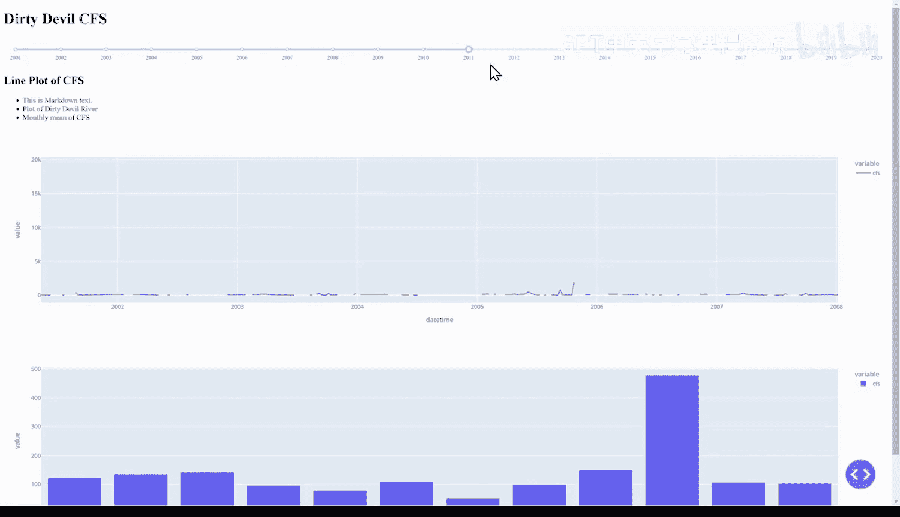

#  140：使用Dash创建交互式条形图 📊


在本节课中，我们将学习如何使用Plotly和Dash创建一个带有交互式滑块的条形图。我们将看到如何将Dash组件（如滑块）与图表连接起来，从而实现数据的动态可视化更新。

---

## 概述与准备工作

上一节我们介绍了Dash应用的基本结构。本节中，我们来看看如何添加交互式控件，并让图表根据控件的值动态变化。

首先，我们需要导入必要的库。除了Dash和Plotly的核心组件，我们还需要从`dash`导入`Input`组件来创建滑块控件。

```python
import dash
from dash import dcc, html, Input, Output
import plotly.express as px
import pandas as pd
```

接着，我们初始化Dash应用，并设置Pandas的绘图后端。

```python
app = dash.Dash(__name__)
pd.options.plotting.backend = "plotly"
```

---

## 创建静态图表

在添加交互功能之前，我们先创建两个静态图表：一个折线图和一个条形图。以下是创建图表的代码。

```python
# 假设df是一个包含年份('year')和数值('value')列的DataFrame
fig_line = px.line(df, x='year', y='value', title='年度趋势折线图')
fig_bar = px.bar(df, x='year', y='value', title='年度数据条形图')
```

---

## 构建应用布局与添加滑块

现在，我们来构建应用的网页布局。布局的核心是添加一个滑块控件，用户可以通过它选择年份。

以下是定义应用布局的代码。我们使用`html.H1`添加标题，用`html.Br`添加换行，并用`dcc.Slider`创建滑块。

```python
app.layout = html.Div([
    html.H1('交互式数据仪表板'),
    html.Br(),
    dcc.Slider(
        id='year-slider',
        min=df['year'].min(),
        max=df['year'].max(),
        value=df['year'].max(),
        marks={str(year): str(year) for year in df['year'].unique()},
        step=1
    ),
    html.Br(),
    dcc.Markdown('''
        ## 图表说明
        上方滑块控制下方两个图表显示的年份范围。
    '''),
    dcc.Graph(id='line-graph', figure=fig_line),
    dcc.Graph(id='bar-graph', figure=fig_bar)
])
```

**代码解释**：
*   `id='year-slider'`：为滑块设置一个唯一ID，用于后续的回调函数连接。
*   `min`/`max`：将滑块的最小值和最大值设置为数据中的最小和最大年份。
*   `value`：设置滑块的初始值为最大年份。
*   `marks`：在滑块上显示刻度标签。
*   `step=1`：设置滑块每次移动的增量为1（年）。

---

## 实现交互：回调函数

为了让滑块能够控制图表，我们需要使用**回调函数**。回调函数是一个在输入组件值发生变化时自动被调用的函数。

我们首先创建一个更新折线图的回调函数。

```python
@app.callback(
    Output('line-graph', 'figure'),
    Input('year-slider', 'value')
)
def update_line_figure(selected_year):
    # 根据选中的年份过滤数据
    filtered_df = df[df['year'] <= selected_year]
    # 用过滤后的数据创建新的折线图
    new_fig = px.line(filtered_df, x='year', y='value', title=f'截至 {selected_year} 年的趋势')
    return new_fig
```

**回调机制解析**：
1.  `@app.callback`：这是一个装饰器，它定义了函数的触发条件。
2.  `Output('line-graph', 'figure')`：指定回调函数的输出目标是ID为`line-graph`的组件的`figure`属性。
3.  `Input('year-slider', 'value')`：指定回调函数的输入来源是ID为`year-slider`的滑块的`value`属性。
4.  当滑块的值（`selected_year`）改变时，`update_line_figure`函数被调用。
5.  函数根据传入的`selected_year`过滤数据，生成新的图表，并返回。Dash会自动用这个新图表更新页面上的`line-graph`组件。

同理，我们创建另一个回调函数来更新条形图。

```python
@app.callback(
    Output('bar-graph', 'figure'),
    Input('year-slider', 'value')
)
def update_bar_figure(selected_year):
    filtered_df = df[df['year'] <= selected_year]
    new_fig = px.bar(filtered_df, x='year', y='value', title=f'截至 {selected_year} 年的数据')
    return new_fig
```

通过这两个回调函数，一个滑块就能同时控制两个图表的动态更新。

---

## 运行应用

最后，我们添加运行服务器的代码。这通常是Dash脚本的最后一部分。

```python
if __name__ == '__main__':
    app.run_server(debug=True)
```

运行上述代码后，会在本地启动一个Web服务器。打开浏览器访问提供的地址（通常是 `http://127.0.0.1:8050`），你将看到一个包含标题、滑块、说明文字和两个图表的页面。

拖动滑块时，折线图和条形图都会实时更新，只显示从起始年份到所选年份的数据。

---

## 总结

本节课中我们一起学习了如何使用Dash创建交互式数据可视化应用。我们主要完成了以下步骤：



1.  **导入库**：引入了Dash、Plotly等必要组件。
2.  **创建静态图表**：使用Plotly Express生成了初始的折线图和条形图。
3.  **构建布局**：设计了网页布局，并加入了关键的滑块(`dcc.Slider`)控件。
4.  **实现交互**：通过`@app.callback`装饰器创建了回调函数，将滑块的输入与两个图表的输出动态绑定。

通过本教程，你掌握了将Dash控件与Plotly图表连接的核心方法，可以创建出能根据用户输入实时响应的数据仪表板。