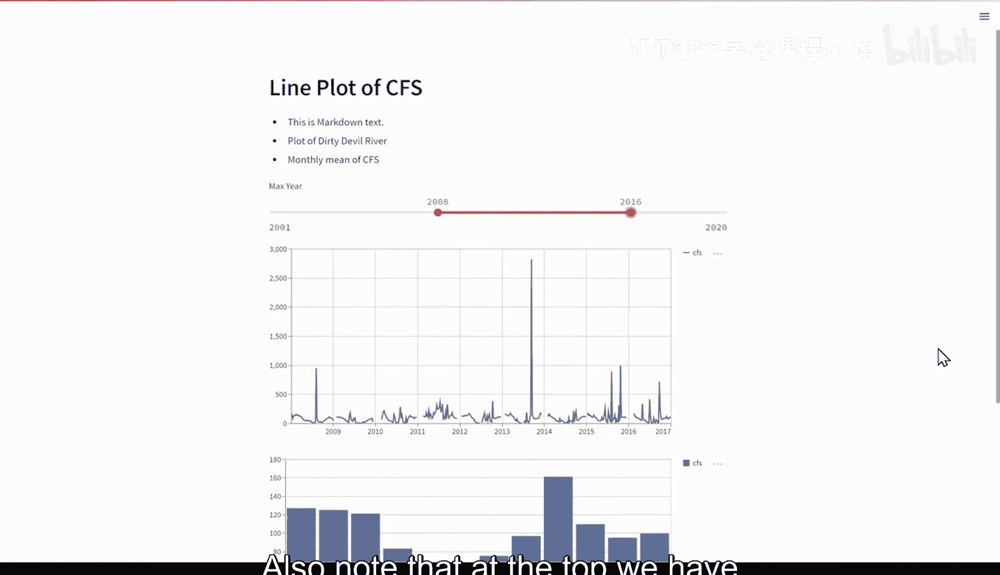
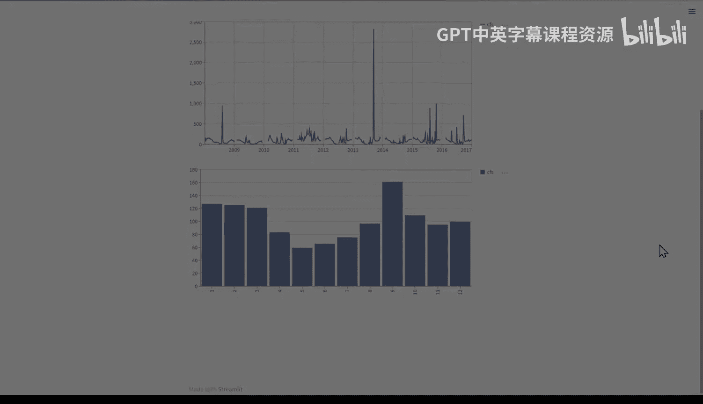

#  145：在Streamlit中连接控件与图表 📊

在本节课中，我们将学习如何在Streamlit应用中，将交互式控件（如滑块）与图表（如折线图和柱状图）连接起来，实现数据的动态可视化。


## 概述

我们将通过一个具体的代码示例，演示如何创建一个包含年份范围滑块的Streamlit应用。当用户调整滑块时，应用中的折线图和柱状图会根据选定的年份范围实时更新。这展示了Streamlit如何简化交互式数据应用的开发流程。

## 代码结构与导入

首先，我们来看一下代码的基本结构。代码的开头部分导入了必要的库，并在底部定义了数据处理逻辑。

```python
import streamlit as st
import pandas as pd
# 其他可能的导入...
```

## 数据处理与初始设置

上一节我们介绍了代码的导入部分，本节中我们来看看数据处理和初始值的设定。代码底部使用Pandas进行数据加载和计算，以确定数据集中年份的最小值和最大值。

```python
# 假设的Pandas数据处理代码
# df = pd.read_csv(‘data.csv’)
# min_year = df[‘year’].min()
# max_year = df[‘year’].max()
```

## 添加交互式滑块控件

接下来，我们将利用计算出的最小和最大年份，在应用中添加一个滑块控件。这个滑块允许用户选择一个年份范围。

```python
min_year = 2000  # 示例最小值
max_year = 2023  # 示例最大值

year_range = st.slider(
    ‘选择年份范围：’,
    min_value=min_year,
    max_value=max_year,
    value=(min_year, max_year)  # 设置初始值为整个范围
)
```

这个滑块的一个优点是，它提供了左右两个手柄，允许用户灵活地选择起始和结束年份。

## 将控件与图表连接

现在，我们已经有了一个可以交互的滑块。本节中，我们将看看如何利用滑块返回的数值来动态更新图表。

我们使用滑块返回的 `year_range` 元组（包含选定的起始和结束年份）来过滤数据，并绘制相应的图表。之前绘制静态图表的代码已被注释掉。

以下是更新后的图表绘制代码：

```python
# 根据选定的年份范围过滤数据
# filtered_df = df[(df[‘year’] >= year_range[0]) & (df[‘year’] <= year_range[1])]

# 绘制折线图
st.line_chart(filtered_data)  # 使用过滤后的数据

# 绘制柱状图
st.bar_chart(filtered_data)  # 使用过滤后的数据
```

## 应用效果展示

让我们运行应用，看看最终效果。应用界面上方会显示渲染为HTML的Markdown文本。

界面中有一个年份范围滑块，我们可以拖动滑块的两端来调整选定的年份范围。与此同时，下方的折线图和柱状图会立即更新，只显示选定年份范围内的数据。



## 总结

本节课中我们一起学习了如何在Streamlit中创建交互式数据可视化应用。关键步骤包括：
1.  导入必要的库。
2.  计算并设置控件的参数（如最小/最大年份）。
3.  添加交互式控件（如双柄滑块）。
4.  将控件的返回值作为参数，动态过滤数据并更新图表。



通过这种方式，我们可以轻松构建出响应用户输入的动态数据仪表盘。