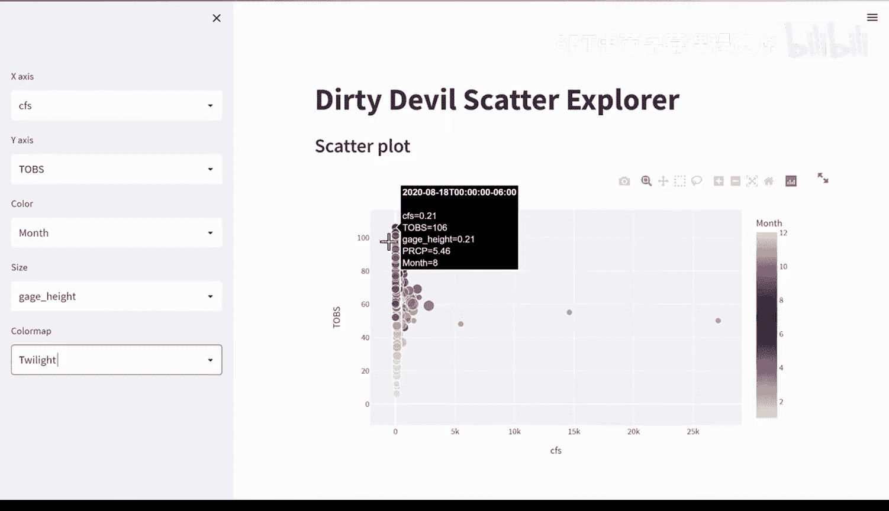

#  146：使用Streamlit创建交互式散点图 📊

在本节课中，我们将学习如何使用Streamlit库创建一个交互式散点图。我们将看到如何通过侧边栏的小部件（如选择框）动态控制图表的外观，例如颜色映射和显示的数据维度。


---

## 导入库与数据缓存

首先，我们需要导入必要的库。在本例中，我们使用Plotly作为绘图后端。Streamlit的一个优点是允许用户灵活选择绘图工具。

```python
import streamlit as st
import pandas as pd
import plotly.express as px
```

为了提升应用性能，特别是当数据加载操作频繁但数据内容不变时，我们使用Streamlit的缓存装饰器 `@st.cache_data`。这可以避免每次交互都重新读取和计算数据。

```python
@st.cache_data
def load_data():
    # 此处是加载和预处理数据的pandas代码
    # 例如：data = pd.read_csv(‘path/to/data.csv‘)
    # 返回处理好的DataFrame
    return data

git_data = load_data()
```

---

## 构建散点图生成函数

上一节我们设置了数据缓存，本节中我们来看看如何创建一个可配置的散点图生成函数。这个函数接收多个参数，用于控制散点图的X轴、Y轴、颜色等属性。

以下是定义该函数的代码：

```python
def get_scatter_plot(data, x_axis, y_axis, color_by, color_map):
    """
    根据给定的参数生成一个Plotly散点图。
    参数:
        data: 包含数据的DataFrame。
        x_axis: 用于X轴的数据列名。
        y_axis: 用于Y轴的数据列名。
        color_by: 用于颜色编码的数据列名。
        color_map: 颜色映射的名称。
    返回:
        一个Plotly图形对象。
    """
    fig = px.scatter(
        data_frame=data,
        x=x_axis,
        y=y_axis,
        color=color_by,
        color_continuous_scale=color_map
    )
    return fig
```

---

## 创建用户界面与小部件

现在，我们开始构建Streamlit应用的用户界面。我们将使用Markdown添加标题，并在侧边栏创建一系列选择框小部件，让用户可以交互式地选择图表参数。

```python
st.markdown(‘# 交互式散点图探索‘)

# 在侧边栏创建选择控件
with st.sidebar:
    st.header(‘图表配置‘)
    # 假设git_data DataFrame中有‘col1‘, ‘col2‘, ‘col3‘等列
    x_axis_select = st.selectbox(‘选择X轴数据:‘, options=[‘col1‘, ‘col2‘, ‘col3‘])
    y_axis_select = st.selectbox(‘选择Y轴数据:‘, options=[‘col1‘, ‘col2‘, ‘col3‘])
    color_select = st.selectbox(‘按此列着色:‘, options=[‘col1‘, ‘col2‘, ‘col3‘])
    cmap_select = st.selectbox(‘选择颜色映射:‘, options=[‘viridis‘, ‘plasma‘, ‘twilight‘, ‘rainbow‘])
```

---

## 生成并显示交互式图表

在配置好所有参数后，我们可以调用之前定义的函数来生成散点图，并使用 `st.subheader` 和 `st.plotly_chart` 将其显示在应用主区域。

```python
st.subheader(‘生成的散点图‘)

# 调用函数生成图表
scatter_fig = get_scatter_plot(git_data, x_axis_select, y_axis_select, color_select, cmap_select)

# 在Streamlit中显示Plotly图表
st.plotly_chart(scatter_fig, use_container_width=True)
```

运行此应用后，你将看到一个交互式散点图。因为使用了Plotly后端，你可以对图表进行缩放、平移等操作。通过侧边栏的小部件，你可以实时更改绘制的数据维度和颜色主题。例如，将颜色映射改为‘twilight‘会得到一个循环式的颜色效果，帮助你从不同角度观察数据模式。



---

## 总结

本节课中我们一起学习了如何使用Streamlit和Plotly创建交互式散点图。关键步骤包括：
1.  **导入库并缓存数据**以提升效率。
2.  **定义可配置的绘图函数**，将数据与视觉参数分离。
3.  **利用Streamlit小部件**构建动态控制面板。
4.  **生成并渲染交互式图表**，利用Plotly的丰富功能进行数据探索。


通过结合Streamlit的简洁界面和Plotly的强大交互性，你可以快速构建用于数据分析和可视化的工具。