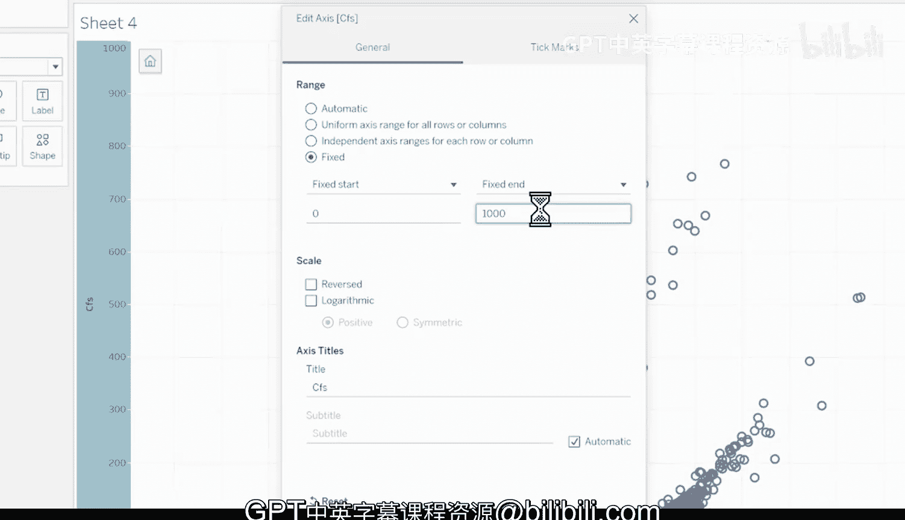

#  150：使用Tableau创建散点图

在本节课中，我们将学习如何在Tableau中创建一个散点图。散点图是一种用于展示两个连续变量之间关系的有效图表。我们将通过一个具体的例子，演示如何将数据字段从“度量”转换为“维度”，并调整坐标轴范围，以生成清晰、准确的散点图。

## 创建新工作表与添加字段

首先，我们需要在Tableau中创建一个新的工作表。创建完成后，我们将开始构建散点图。

以下是构建散点图的第一步操作：
*   将“Gauge Height”（测量高度）字段拖拽到“列”功能区。
*   将“CFS”（流量，立方英尺/秒）字段拖拽到“行”功能区。

完成上述步骤后，视图区域可能不会立即显示为预期的散点图样式。

## 调整字段类型以生成散点图

上一节我们添加了字段，但图表并未正确显示。这是因为Tableau默认对拖入的数值字段进行聚合计算（如求和、平均值），而散点图需要的是每个独立的数据点。

此时，我们可以尝试点击视图区上方的“散点图”图表类型按钮，但图表可能依然不正确。核心问题在于字段的聚合状态。

为了解决这个问题，我们需要进行以下操作：
*   点击“列”功能区上“Gauge Height”字段右侧的下拉箭头（或边缘）。
*   在弹出的菜单中，选择“维度”，将该字段从“度量”转换为“维度”。
*   对“行”功能区上的“CFS”字段执行相同的操作，也将其转换为“维度”。

完成字段类型的转换后，视图区将正确显示为散点图，其中每个点代表一个独立的观测值。

## 编辑坐标轴范围

现在我们已经得到了散点图的基本形态。为了使数据分布更加清晰，我们可以手动调整坐标轴的范围。

接下来，我们将对Y轴（CFS）的范围进行设置：
*   在散点图的Y轴（CFS轴）上右键单击。
*   从上下文菜单中选择“编辑轴...”。
*   在弹出的“编辑轴”对话框中，找到“范围”选项。
*   选择“固定”模式。
*   将固定范围的起始值设置为 **0**，结束值设置为 **21000**。

通过固定坐标轴范围，我们可以确保视图聚焦在特定的数据区间内，避免因个别极端值导致图表缩放失衡，从而更准确地观察核心数据分布。

本节课中我们一起学习了在Tableau中创建散点图的完整流程。关键步骤包括：创建新工作表并放置字段、将数值字段从“度量”转换为“维度”以禁用聚合、以及通过编辑坐标轴固定范围来优化图表视图。掌握这些操作，你就能有效地利用散点图探索两个连续变量之间的关系。