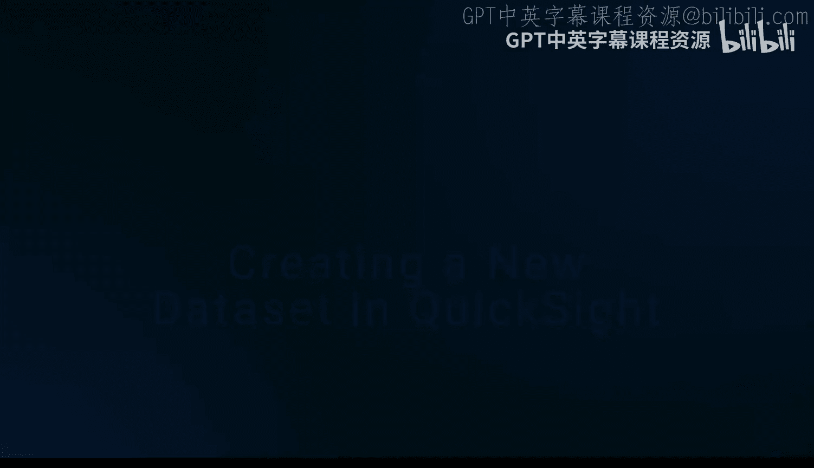
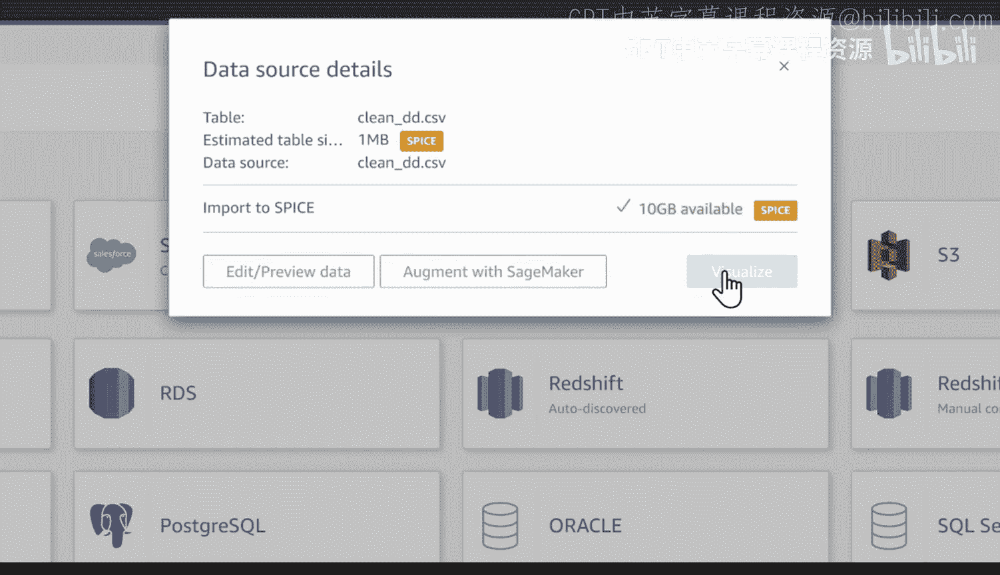
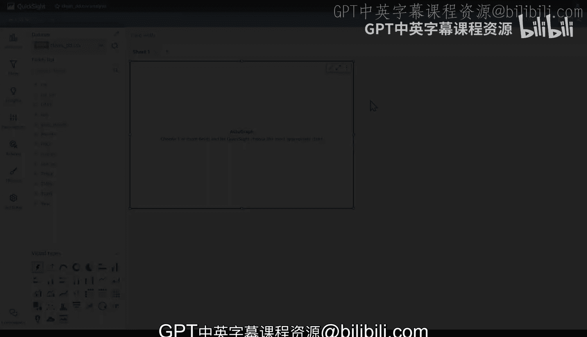

#  155：在QuickSight中创建新数据集 🚀

在本节课中，我们将学习如何在亚马逊AWS的QuickSight服务中创建一个新的数据集。我们将从登录AWS开始，逐步完成数据上传和可视化的初始步骤。

## 概述

首先，登录到您的AWS管理控制台。登录成功后，您需要启用QuickSight服务。启用后，即可进入您的主文件夹开始操作。

## 创建新数据集

上一节我们完成了登录和启用服务，本节中我们来看看如何创建数据集。

在QuickSight界面中，找到并点击“数据”相关选项。以下是具体操作步骤：

1.  定位到“数据”区域。
2.  选择“新建数据集”选项。

## 上传数据文件

创建新数据集后，下一步是上传包含数据的具体文件。

我们选择通过上传文件的方式添加数据。确认文件格式无误后，即可进行上传。

## 数据验证与可视化

数据上传完成后，我们需要验证数据是否已被成功导入系统。

点击“可视化”按钮，系统将加载并显示我们刚刚上传的数据集内容。界面显示数据已被成功读取。

## 总结

本节课中我们一起学习了在AWS QuickSight中创建新数据集的完整流程。我们从登录AWS和启用QuickSight开始，逐步完成了创建数据集、上传数据文件以及进行初步数据验证和可视化的操作。