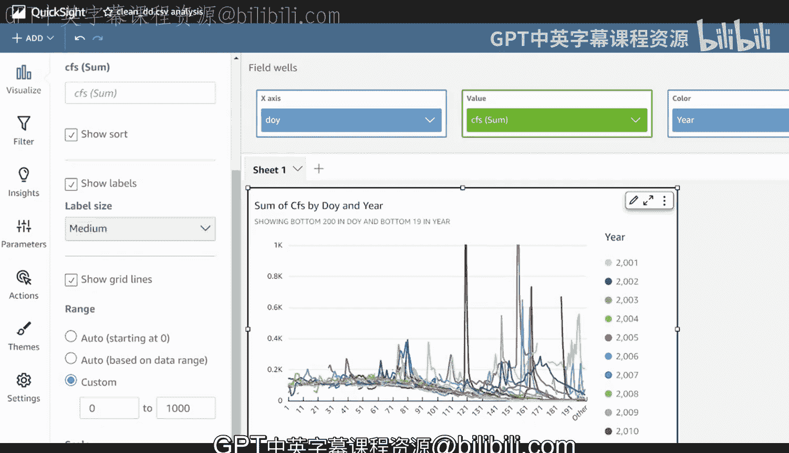

#  156：使用QuickSight创建折线图 📈

在本节课中，我们将学习如何在亚马逊QuickSight中创建一个折线图。我们将使用“Dirty Devil”数据集，来可视化每年中每日的立方英尺每秒流量数据。

## 概述

上一节我们介绍了QuickSight的基本界面。本节中，我们来看看如何创建一个具体的折线图可视化。我们将通过几个步骤来配置图表，包括选择正确的视觉类型、设置坐标轴、调整数据排序以及优化显示范围。

## 创建折线图

首先，我们需要在QuickSight的分析界面中添加一个新的视觉对象。

以下是创建折线图的具体步骤：

1.  在界面顶部找到“添加”按钮，点击并选择“添加视觉对象”。
2.  在弹出的视觉类型选择面板中，找到并点击“折线图”图标。
3.  选择折线图后，界面右侧会显示字段井，其中包含“X轴”、“值”和“颜色”等区域。

## 配置图表字段

现在，我们需要将数据集中的字段拖放到对应的区域，以定义图表的结构。

以下是配置字段的步骤：

*   **X轴**：将“一年中的第几天”字段拖放到“X轴”区域。这决定了图表水平方向的数据点。
*   **值**：将“立方英尺每秒”字段拖放到“值”区域。这决定了图表垂直方向，即折线的高度。
*   **颜色**：将“年份”字段拖放到“颜色”区域。这会让不同年份的数据以不同颜色的折线显示。

完成初步配置后，图表已基本成型，但X轴的顺序可能不正确。

## 调整坐标轴与排序

观察图表，我们发现X轴（日期）的顺序有些混乱。为了解决这个问题，我们需要对X轴数据进行排序。

操作方法是点击X轴标签旁的“DOY”字段，在弹出的菜单中选择“按DOY排序”。执行此操作后，X轴上的日期将按数字顺序正确排列。

然而，图表中可能存在一些异常高的数值，导致Y轴刻度范围过大，使得主要数据区域的折线变化不明显。

## 优化Y轴显示范围

为了让图表更清晰地显示主要数据趋势，我们需要手动调整Y轴的范围。

以下是优化Y轴范围的步骤：

1.  点击图表右上角的“铅笔”编辑图标。
2.  在侧边栏的设置面板中，点击“Y轴”选项。
3.  在Y轴设置中，找到“范围”部分，将选项从“自动”更改为“自定义范围”。
4.  在最小值输入框中填入 `0`，在最大值输入框中填入 `1000`。

经过以上调整，图表的Y轴将固定在0到1000的范围内，异常值不再影响整体视图，每条折线代表一年中每日流量的变化趋势将变得清晰可见。

## 总结

本节课中，我们一起学习了在QuickSight中创建折线图的完整流程。我们从添加视觉对象开始，逐步配置了X轴、值序列和颜色分组字段。接着，我们解决了X轴排序问题，并通过自定义Y轴范围优化了图表的可读性。最终，我们成功创建了一个能够清晰展示“Dirty Devil”数据集中每年日流量趋势的折线图。