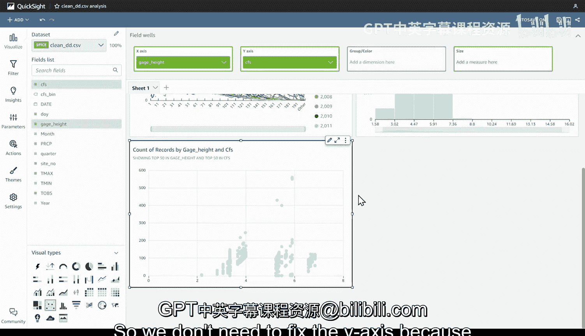

#  158：使用QuickSight创建散点图 📊

在本节课程中，我们将学习如何使用亚马逊QuickSight服务创建一个散点图。我们将以“流量（立方英尺/秒）”与“水位高度”之间的关系为例，演示从添加可视化组件到配置坐标轴的完整流程。

上一节我们介绍了数据可视化工具的基本概念，本节中我们来看看如何在QuickSight中具体创建一个散点图。

## 创建散点图

首先，我们需要在QuickSight界面中添加一个可视化组件。具体操作是点击“添加”按钮，然后选择“添加视觉对象”。

以下是添加视觉对象的步骤：
1.  在可视化类型中选择“散点图”。
2.  将“水位高度”字段拖拽至X轴区域。
3.  将“立方英尺/秒”字段拖拽至Y轴区域。

完成上述步骤后，散点图便会初步生成。此时可以观察到，图表已经根据数据自动进行了一些筛选。

## 理解数据筛选

生成的图表显示，它默认只展示了“立方英尺/秒”和“水位高度”两个字段中排名前50的数据点。这是一种自动的数据限制，有助于快速呈现主要的数据趋势。

因此，我们目前不需要手动调整Y轴的显示范围，因为系统已经进行了初步的筛选处理。

---

本节课中我们一起学习了在Amazon QuickSight中创建散点图的方法。我们掌握了添加散点图视觉对象、配置X轴与Y轴数据字段的流程，并了解了工具自动进行的数据筛选机制。