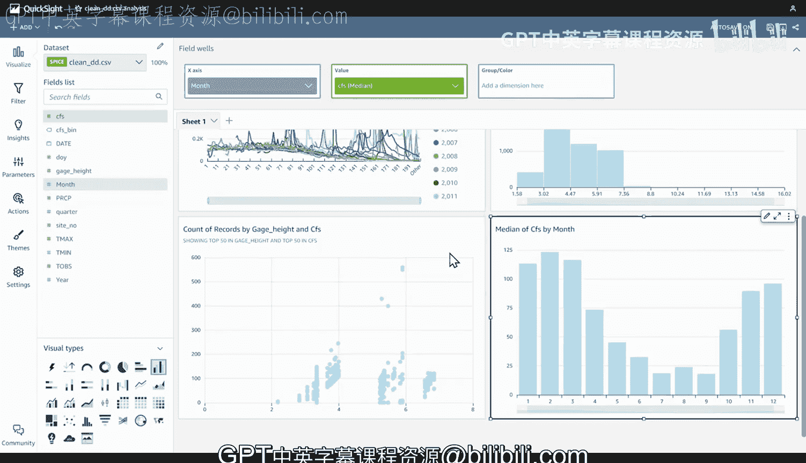

#  159：使用Amazon QuickSight创建条形图 📊

在本节课程中，我们将学习如何在Amazon QuickSight中创建一个条形图。我们将使用月份作为X轴，并以中位数汇总“立方英尺每秒”的数据值。

---

## 概述

首先，我们需要在QuickSight中添加一个可视化组件。我们选择添加一个条形图作为我们的视觉呈现方式。

## 添加并配置条形图

点击“添加”按钮以添加一个新的可视化图表。在弹出的图表类型中，我们选择“条形图”。

接下来，我们需要为图表配置数据字段。通常，当数据包含“每...”的概念时，例如“每月”，我们会将其放置在X轴上。

因此，我们将“月份”字段拖放至X轴区域。

Y轴则用于表示我们想要汇总的数值。在本例中，这个数值是“立方英尺每秒”。将其拖放至“值”区域。此时，一个基础的条形图已经生成。

为了得到更有意义的摘要数据，我们需要更改值的聚合方式。默认的聚合方式可能是求和，但我们需要的是中位数。

点击Y轴数值字段旁的聚合方式选项（通常显示为“总和”），从下拉菜单中选择“中位数”。

此外，我们注意到图表的排序方式。当前条形可能按数值大小降序排列。为了按时间顺序查看，我们需要调整排序。

点击X轴“月份”字段旁的选项，选择“按月份排序”，将图表调整为按月份升序排列。

---

## 总结

本节课中，我们一起学习了在Amazon QuickSight中创建条形图的完整步骤。关键操作包括：添加条形图视觉对象、将“月份”字段分配至X轴、将“立方英尺每秒”字段分配至Y轴并将其聚合方式改为**中位数**，最后将图表排序调整为按月份顺序。这个过程能帮助我们清晰地展示数据随时间变化的趋势。