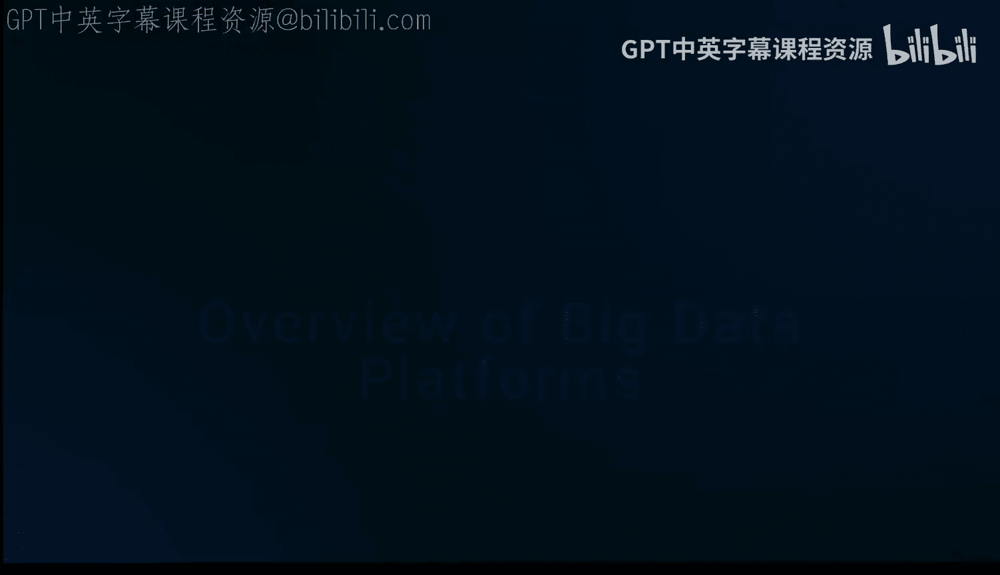
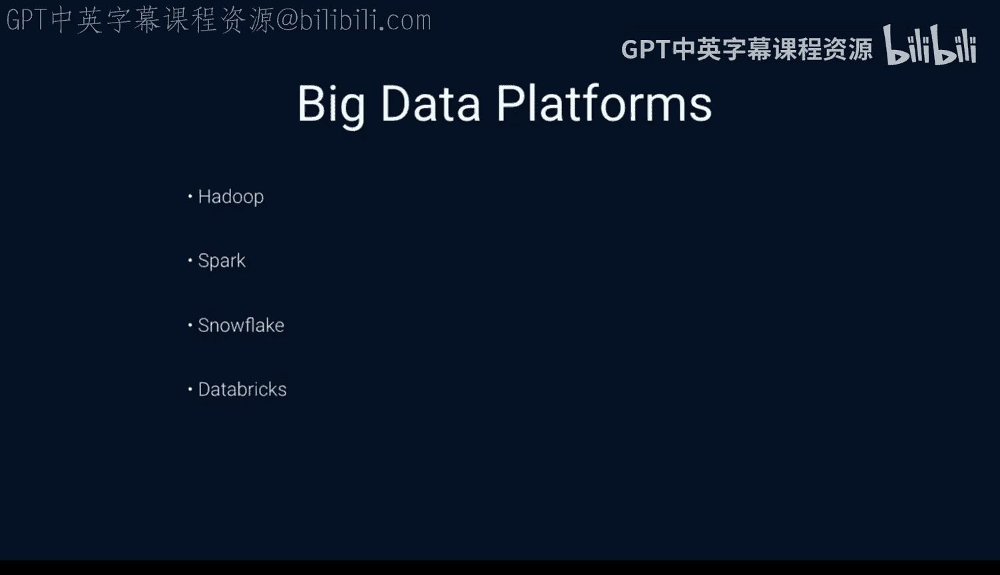

# 杜克大学《应用Python数据工程（3课全）｜Applied Python Data Engineering》中英字幕 p03 03_01_01_大数据平台概述.zh_en -BV1nz421i7KP_p3-

In this lesson。We'll introduce Apache Hadoop。Discuss the map produced data flow。And introduce Spark。

As well as spark concepts。In this course， we're going to be dealing with platforms that handle big data problems。

 I'm sure you've heard the term big data。 It's thrown around a lot these days。

 but defining it requires。Thinking about the changing technologies we deal with。

What was considered big data a couple decades ago would be something I can process on my phone now。

So when we think about big data， we should think about data。It's too big to fit on a single machine。

The solutions for this center around。Distributed data storage。

That is data that's stored across multiple machines。And distributed data processing。

 So being able to process data that won't fit in the memory of a single machine。

There are a lot of big data platforms out there， some oriented more towards storage and some oriented more towards processing。

In this course， we'll be looking at Hadoop。Whi is both a specific implementation of the Mareduce algorithm and also a platform for big data processing。

Including distributed storage。As well as other tools。We'll look at Spark。

 which is a data processing engine that's very popular now for handling big data problems。

We'll look at Snowflake， which began as a distributed storage solution。

 but is evolving to also include data processing solutions。And finally， we'll look at data bricks。

 which began more on the processing side， but also involves storage。

