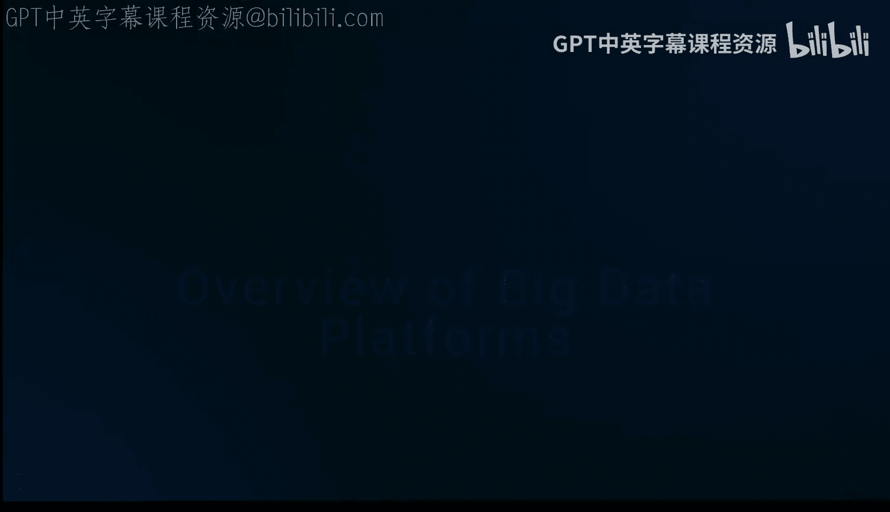
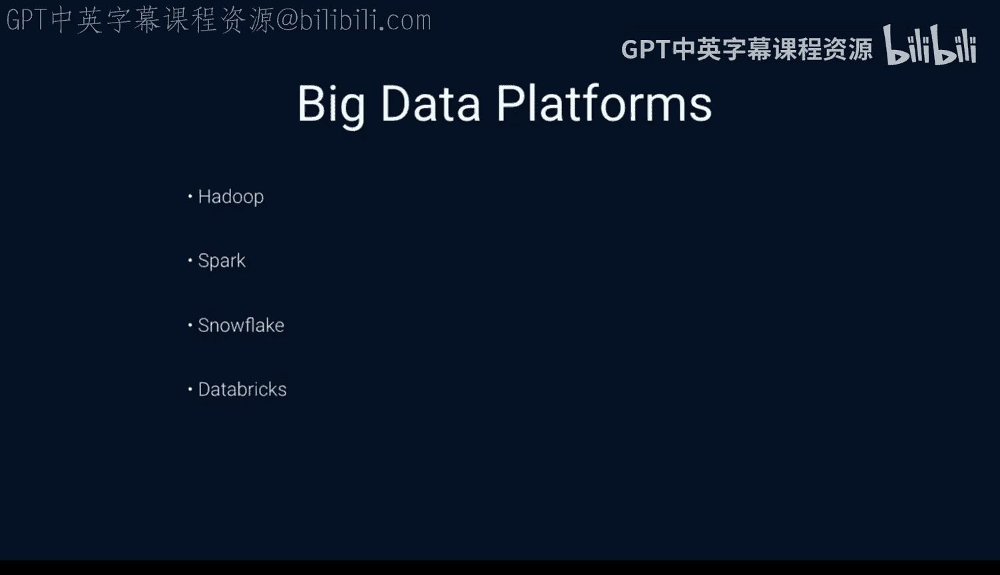

# 应用Python数据工程：03：大数据平台概述 🚀

在本节课中，我们将介绍Apache Hadoop，讨论MapReduce数据处理流程，并引入Spark及其核心概念。我们将探讨用于处理大数据问题的平台。

## 什么是大数据？ 📊

“大数据”是一个被广泛使用的术语。定义它需要考虑我们处理的技术在不断变化。几十年前被认为是大数据的东西，现在可能在一部手机上就能处理。

因此，当我们思考大数据时，应该考虑那些**数据量过大，无法在单台机器上存储或处理**的情况。

针对此问题的解决方案主要围绕两个方面：
*   **分布式数据存储**：数据存储在多个机器上。
*   **分布式数据处理**：能够处理无法放入单台机器内存的数据。

市面上有许多大数据平台，有些更侧重于存储，有些更侧重于处理。

## 本课程将涉及的主要平台 🛠️

在本课程中，我们将关注以下几个主要平台：

以下是本课程将重点介绍的几个平台：

1.  **Hadoop**：它既是MapReduce算法的具体实现，也是一个包含分布式存储（如HDFS）和其他工具的大数据处理平台。
2.  **Spark**：这是一个当前非常流行的数据处理引擎，用于解决大数据问题。
3.  **Snowflake**：它最初是一个分布式存储解决方案，但正在演变为也包含数据处理解决方案。
4.  **Databricks**：它最初更侧重于处理，但也涉及存储。

## 总结 📝

本节课我们一起学习了大数据的基本概念，即数据量超出单机处理能力。我们介绍了解决此问题的两大支柱：分布式存储和分布式处理。最后，我们概述了本课程将要深入学习的四个主要大数据平台：Hadoop、Spark、Snowflake和Databricks。在接下来的章节中，我们将逐一探索它们的工作原理和应用。