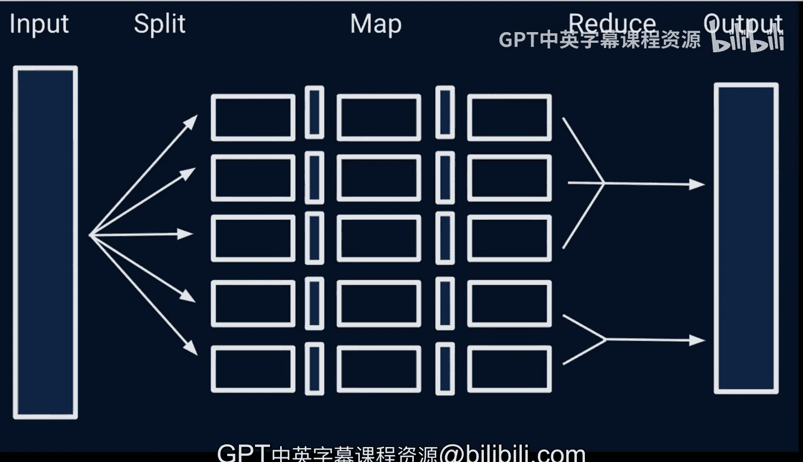
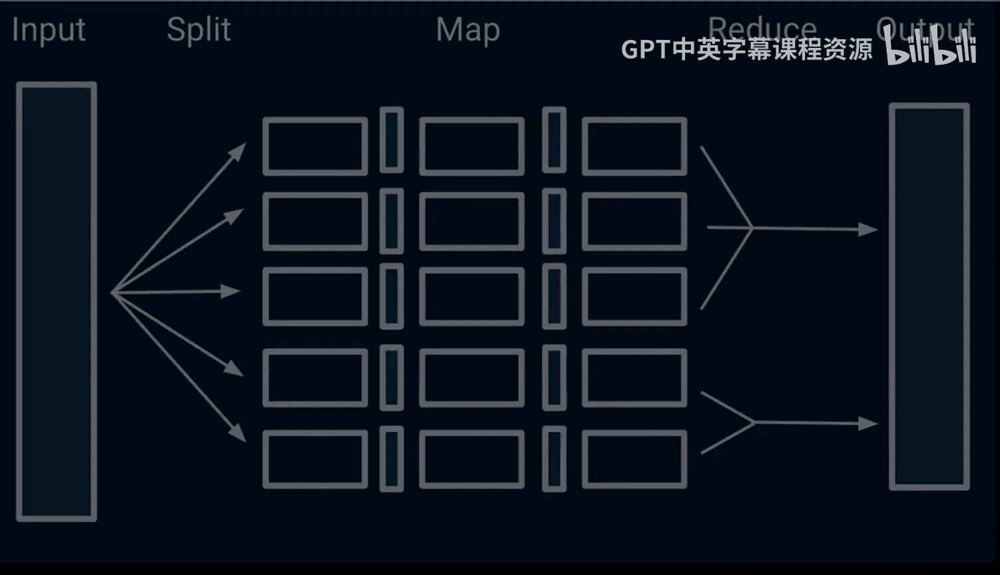

# 杜克大学《应用Python数据工程（3课全）｜Applied Python Data Engineering》中英字幕 p04 04_01_02_Hadoop入门.zh_en -BV1nz421i7KP_p4-

Now， let's talk about Apache Hadoop。pache Hadoop is a platform for processing big data。

 It is also an implementation of the map produced programming model。The term Hadoop。

Refers to both the Hadoop implementation of the Mareduce program model。

And tools in the Hadoop ecosystem， Hadoop distributes work across multiple machines。

Referred to as nodes in a cluster， it writes intermediate data to disk as a strategy for dealing with large data that can't all sit in memory。

 So if we have our input files on disk and we're going to use Hadoop to process them。

The first step is to split the files into partitions。

We then run various transformations on these partitions in what's known as the map phase in between each transformation。

Intermediate files are written to disk。And then the next transformation step reads from these files on disk。

Finally， the data is combined to produce the final output。

This final combination is referred to as the reduced phase。

