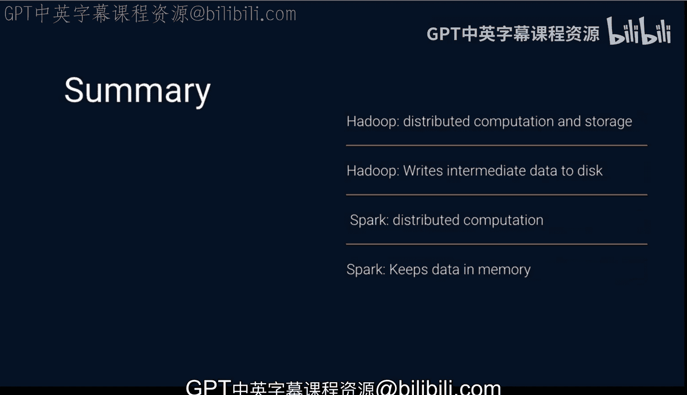

# 杜克大学《应用Python数据工程（3课全）｜Applied Python Data Engineering》中英字幕 p05 05_01_04_Spark入门.zh_en -BV1nz421i7KP_p5-

Patache Spark， which sits on top of Hadoop， is also a big data analytics engine or platform。

 It keeps as much of the data and memory as possible。

 This means that it's generally faster than Hadoop， especially for iterative work。

Such as running machine learning algorithms。 These are the algorithms for which it was originally designed。

 Unlike Hadoop， Spark does not come with its own cluster management system。

 but attaches to a number of pre existing ones。Including Hadoop's yarn system， also unlike Hadoop。

 Spark does not have its own distributed data store。But once again。

 can attach to a number of existing data stores， I the one supplied into Hadoop。

 Let's talk about some spark concepts。 In Spark， there's a driver。

Which sends jobs to various executors。 The jobs are divided to stages， and the data is perditioned。

 with tasks running in parallel per partition。Though not always in parallel。

 but in parallel whenever possible at the heart of Spark is the resilient。

 distributed data set or R D D。In summary。Haadoop is distributed computation and storage。

Hoop use rights。To disk， to store intermediate data in between transformations。

 Spark is distributed computation， but relies on other technologies for distributed storage。

 and Spark keeps data in memory。Which， in general allows it to perform faster than Hadoop for many problem sets。

