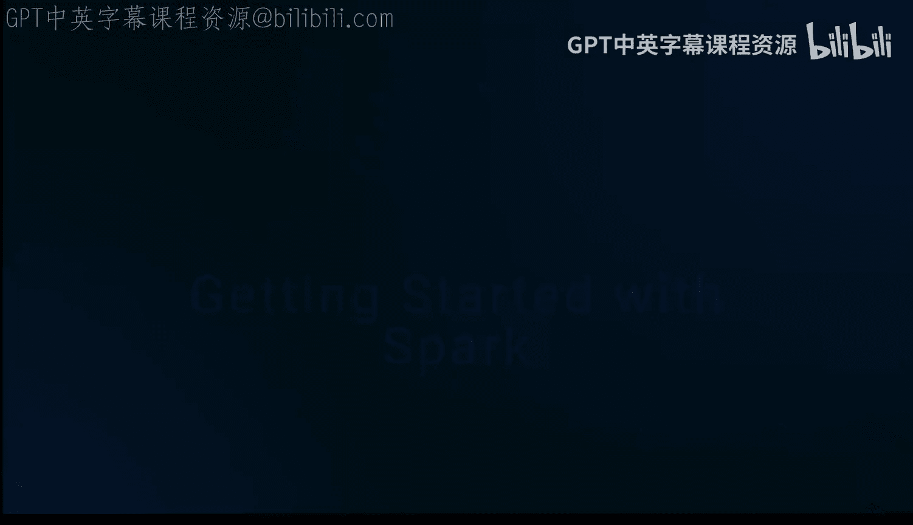
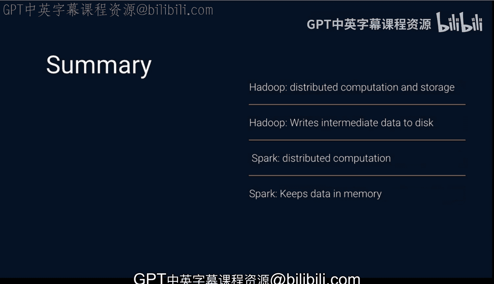

# 大数据技术入门：05：Spark入门 🚀



在本节课中，我们将学习Apache Spark的基本概念，了解它与Hadoop的区别，并掌握其核心架构和数据处理模型。

---

## 概述

Apache Spark是一个构建在Hadoop之上的大数据分析引擎或平台。它旨在将尽可能多的数据保存在内存中，这通常使其在处理速度上优于Hadoop，特别是在需要迭代计算（如运行机器学习算法）的场景中。与Hadoop不同，Spark自身不提供集群管理系统或分布式数据存储，而是能够与多种现有系统（如Hadoop YARN和HDFS）集成。

---

## Spark与Hadoop的对比

上一节我们提到了大数据处理的基本背景，本节中我们来看看Spark与Hadoop的核心区别。

*   **Hadoop**：它是一个**分布式计算和存储**的框架。其核心是MapReduce计算模型和HDFS分布式文件系统。在数据处理过程中，Hadoop会将中间结果**写入磁盘**。
*   **Spark**：它是一个**分布式计算**引擎，但**依赖其他技术**（如HDFS）来实现分布式存储。Spark的显著特点是**将数据保存在内存中**进行计算，这使得它对许多类型的问题处理速度更快。

---

## Spark核心架构

理解了Spark的定位后，我们来深入其内部架构。以下是Spark运行时的几个关键组件：

*   **Driver（驱动程序）**：这是Spark应用的主控程序，负责将用户代码解析、优化并分发给集群。
*   **Executor（执行器）**：在集群的工作节点上运行的进程，负责执行Driver分配的具体计算任务，并将数据或状态返回给Driver。
*   **Job（作业）**：一个由多个阶段（Stage）组成的完整计算任务，通常由用户的一个行动操作（Action）触发。
*   **Stage（阶段）**：Job被划分成的更小的执行单元。阶段之间通常存在数据依赖（如Shuffle）。
*   **Partition（分区）**与**Task（任务）**：数据被切分成多个分区，每个分区会生成一个任务。任务在Executor上**并行运行**，以充分利用集群资源。

---

## 核心概念：弹性分布式数据集（RDD）

在Spark架构的核心，有一个名为**弹性分布式数据集**的基础抽象。它是Spark最初设计时用于支持机器学习等迭代算法的主要数据结构。

**RDD（Resilient Distributed Dataset）** 是一个不可变的、可分区的、并行操作的数据集合。它具有容错性，能够自动从节点故障中恢复。

其核心特性可以用以下伪代码概念来描述：
```python
# RDD是一个抽象的逻辑数据集合，在物理上被分区存储在不同节点上
RDD = [Partition_1, Partition_2, ..., Partition_N]
# 对RDD的转换操作（如map、filter）会生成新的RDD，形成血缘关系（Lineage）
New_RDD = Old_RDD.map(function)
# 血缘关系记录了数据的衍生过程，用于在故障时重建丢失的分区，从而实现容错。
```

---

## 总结



本节课中我们一起学习了Apache Spark的基础知识。我们了解到Spark是一个基于内存计算的大数据分析引擎，通常比Hadoop MapReduce速度更快。它通过Driver和Executor的架构来协调任务，并将计算过程划分为Job、Stage和Task。其核心数据抽象RDD提供了容错的并行计算能力。记住，Spark专注于分布式计算，而将存储交由HDFS等外部系统负责，这是它与Hadoop一体化架构的主要区别。