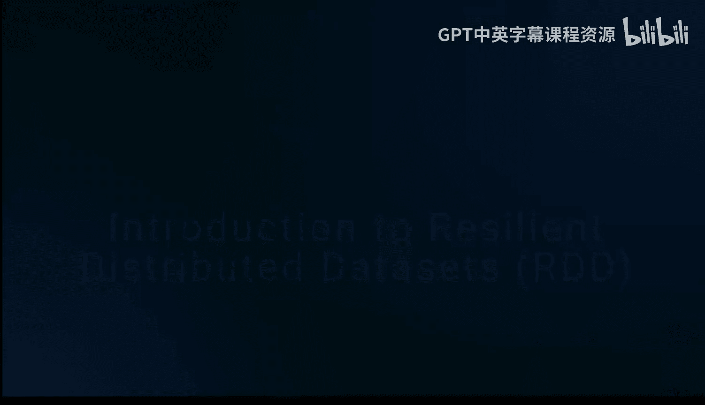
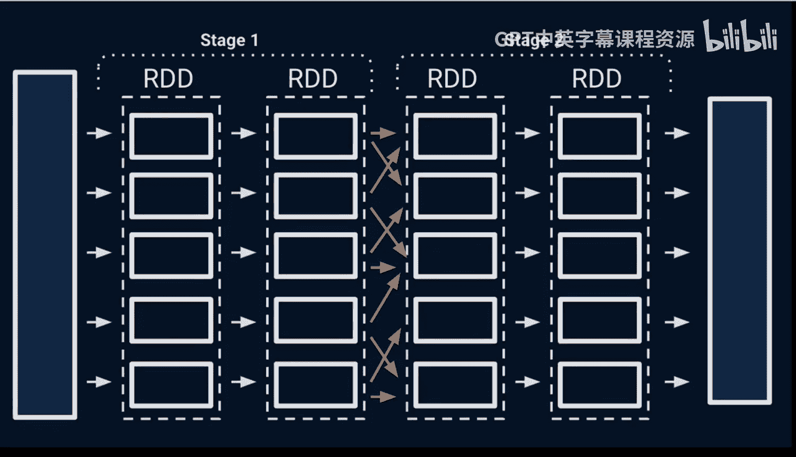

# 杜克大学《应用Python数据工程（3课全）｜Applied Python Data Engineering》中英字幕 p06 06_01_01_弹性分布式数据集(RDD)简介.zh_en -BV1nz421i7KP_p6-

In this lesson， we'll introduce resilient distributed data sets or RDDs。

We'll talk about the data flow when RDDs are used。And we'll show you how to create and manipulate an R DD。

 The resilient distributed data set is an abstraction of data and tasks partitioned across nodes。

 There's two type of operations that are associated with resilient distributed data sets。

 first is transformations， which are lazy。 The other are actions， which return computation。

 resilient distributed data sets are resilient because if a node fails。

 they are able to recover and recompute the data that would have been computed on that node。

On an alternative note， the work on a resilient distributed data set is grouped into stages。

 so once again， we start with some data on disk， let's say when we call a transform on the data。

A resilient distributed data set or R DD is created， and the data is partitioned within this R DD。

The partitioning is done automatically， by Spark。But there are some controls if you want to manually tune it。

 So typically in a job， well， a few transformations。Each transformation created an RDD。And also。

 some actions。Each action also created an R DD。 And as mentioned before， the transformations。

Art actually applied to the data until an action is run。

 So when we run an action at the end of these transformations。

 it causes the actual transformations of the data to happen until finally。

 the final computation from the action。Is done， and the output is produced。

 Now some transformations need the data to be reppartitioned。

This might be something that say reorders the data or does some other movement of data across partitions。

 these operations are known as shuffle operations and are more expensive than other operations During shuffle operations。

 data is written to disk。So this is a point at which data can be recovered in terms of a failure。

 Cheuffle operations also define。The borders between stages。

 So non shuffle operations will happen in a stage until a shuffle operation happens。

 and that that will be the end of the stage。

