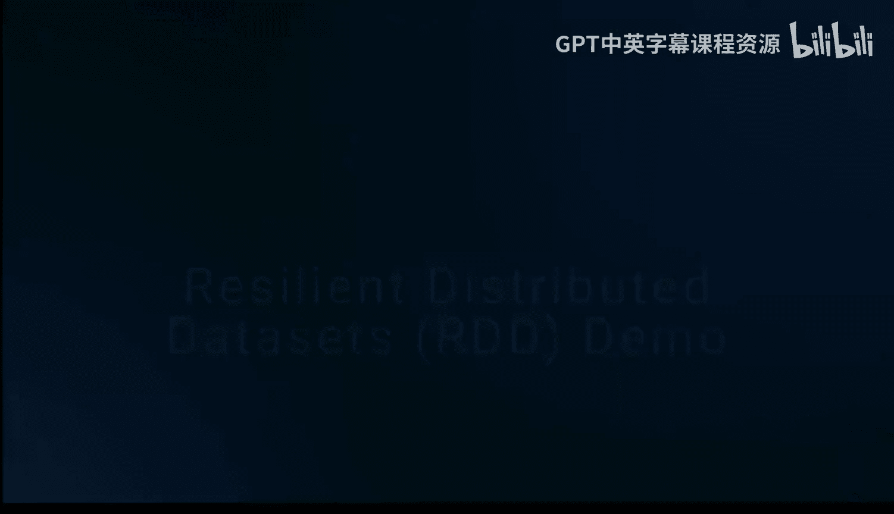
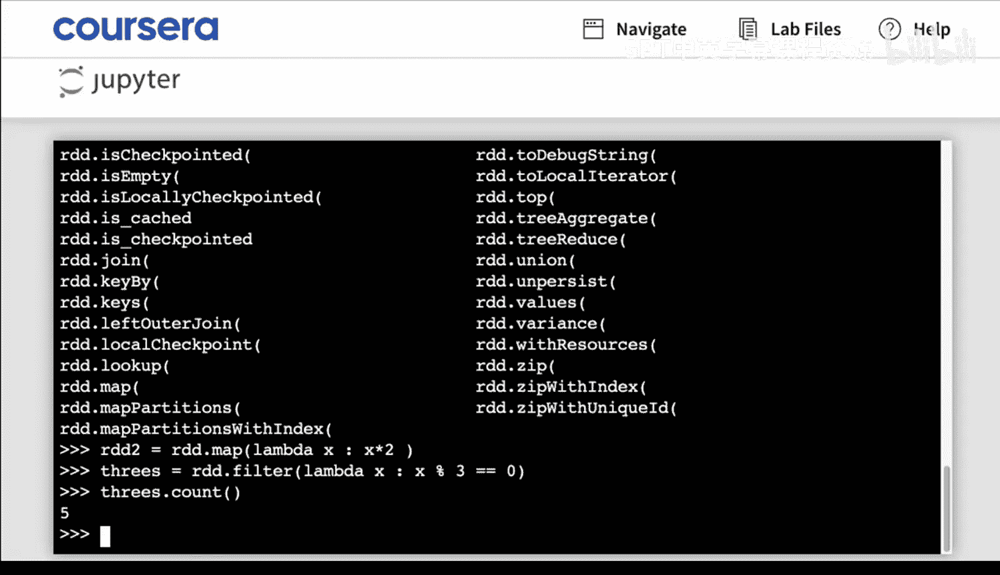
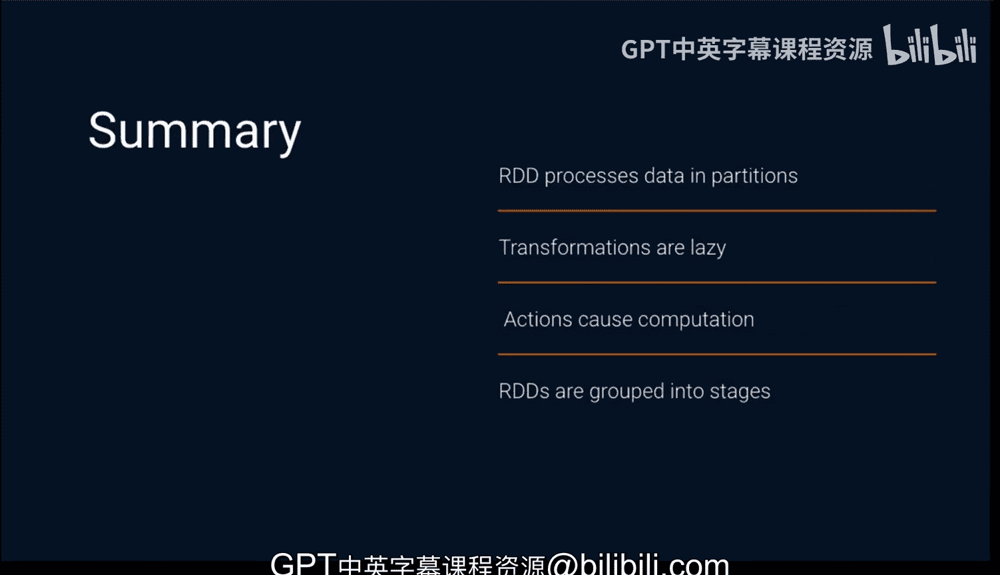

# 杜克大学《应用Python数据工程（3课全）｜Applied Python Data Engineering》中英字幕 p07 07_01_03_弹性分布式数据集(RDD)演示.zh_en -BV1nz421i7KP_p7-

Now， let's look at an R DD in an interactive Piyspar shell。

 Piyspar can be installed by normal Python tools such as Pip or Anaticconda。 Once it's installed。

 assuming that there is a appropriate version of Java also installed。

We can start up a Pi spark shell。By just typing Pi Spk on the command line。Now， we can see。

With the shell。Supplies us with a spark context and a spark session。Normally。

 when writing spark jobs outside of this interactive shell。

 we would have to set up the context and or session。With code。

 session is the more modern way to interact with Sparan and is the current recommended way。However。

 to look at RDDs。The context is still the tool to use。So let's create a simple RDD。First。

Let's make a list of numbers。You can see we have a list of numbers from 0 to 14。Next。

 we'll create an RDD using this list as input。Create an RDD。Call the parallel lies method。

On the context。And you can see the object returned as an R ED。Now this RDD。

As a number of built in methods。These methods。Include methods that represent transformations and actions。

So let's call a map method on this RDD。And as an argument to the map method。

 we'll give it a Lada function。And what this function simply does， is multiplied。Every value by two。

Next， we'll use the filter。Transformation。What we'll do here is we'll go able to Lambda。

 which will return to Boolean。So this boolean， this lambda。

Will return true whenever x is divisible by 3。And false otherwise。

And you can see here by calling count， which is in action。

We actually caused the transformations to happen， and we can see theres。5 items left at this point。

In summary。RDDs process data in partitions。RDDs have two types of operations， transformations。

 which are lazy。And actions， which cause computation。

Our disease themselves are then grouped into stages。

