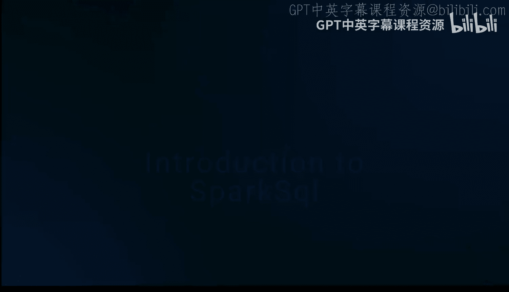
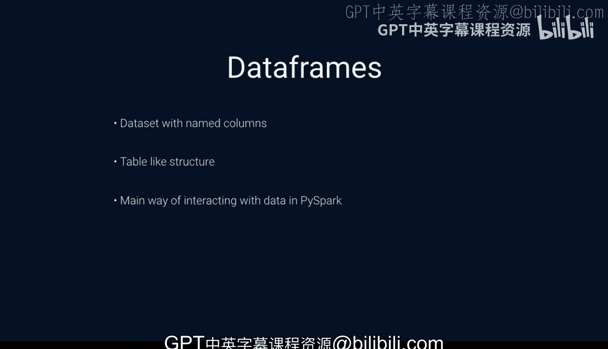

# 杜克大学《应用Python数据工程（3课全）｜Applied Python Data Engineering》中英字幕 p08 08_01_01_Spark SQL简介.zh_en -BV1nz421i7KP_p8-

In this lesson， we'll introduce the Spark SQL module。We'll introduce data sets and data frames。

And we'll show you how to create and manipulate Pipark data frames。

While the R DD is still at the heart of the way Sp works。A more modern module known as Spar sequel。

 has been added， and is generally the way that we interact with Spark now。

SparkSQL is a module for structured data processing。

It uses information about the data structure and the specific computations to create optimized operations。

These optimizations make it faster and more efficient than using straight RDDs。It has APIs。

 both for SQL and what's known as a data set。In pipar the data set will show up as a data frame in the scholar version。

 there is a differentiation between a data set and a data frame and the Python version。

 there's only a data frame。But because of Python's interactive nature。

 we get all of the benefits of the data set as well， so a spark SQL data set。

It's a distributed collection of data。It has the benefits of an RDD。

 along with the optimized Spar SQL engine。It's available in Java and Sca。The data frame。

Is a data set with named columns。Greating a table like structure that might be familiar if you think about data frames and other。

Packages such as pandas。But it's a bit different。And it's the main way of interacting with data in Pipark。

