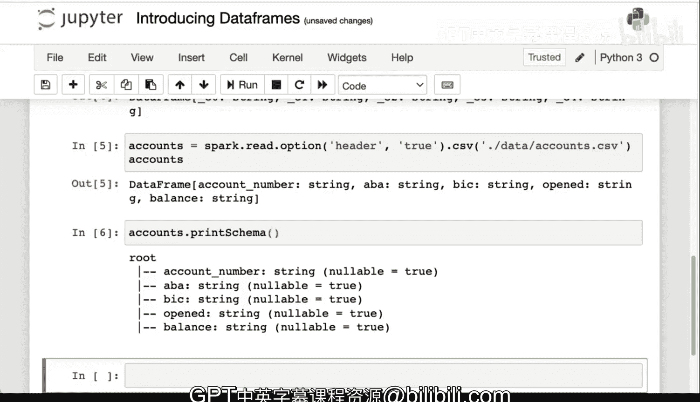
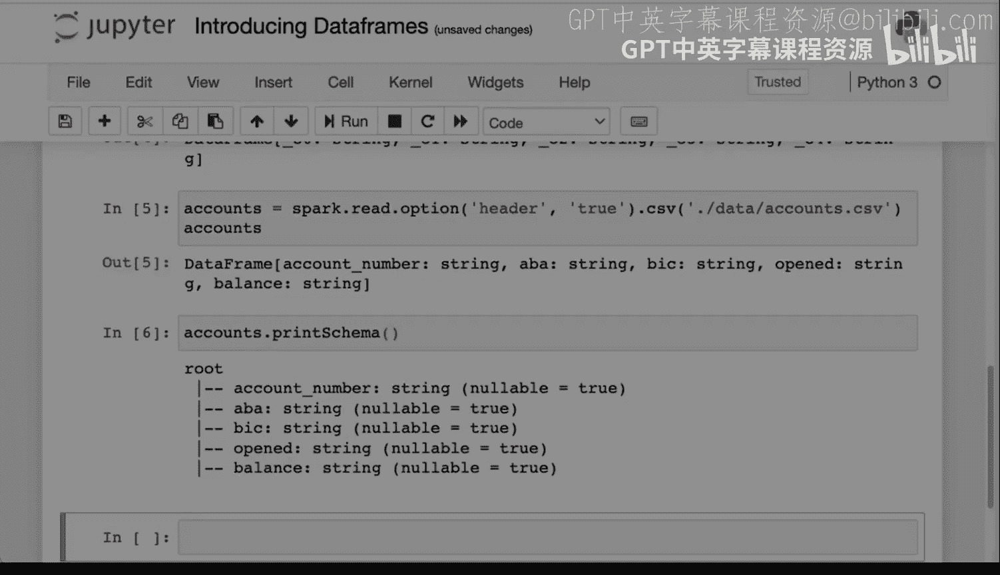

# 杜克大学《应用Python数据工程（3课全）｜Applied Python Data Engineering》中英字幕 p09 09_01_04_PySpark DataFrame演示第一部分.zh_en -BV1nz421i7KP_p9-

Let's look at some Pipar data frames。First thing， since we're not running in the interactive shell。

So we need to create a Sp session。So here we've imported Spark session from Pi SparkX SQL。

And then created a session object。Named Picepark example。Once our session is created。

You can take a look at it。And we can see here that it has the app name we gave it up above。

It's versioners 3。3。And it's a spark session in memory。Next。

Let's create a data frame by reading a file。WellFirst， we'll read the file。As his。

So we're going to use the read CSV to read a CSV file。And can see， we've created a data frame。

Notice in our data frame。That the columns are give the names。Underscore C0， under C1， under C 2。

 etc cea。This is because we haven't instructed Spk to read。The header in the file。

 which would define the column names。 So let's read it again。This time， we're going to use the。

Option。To tell it， to read the headers。You can see now。The column names or account number。A B， A， B。

 IC。Opened in balance。We might want to understand more about the layout of this particular data frame。

And we can use the print schema。Method on our data frame。

You can see it gives us information about this schema。

