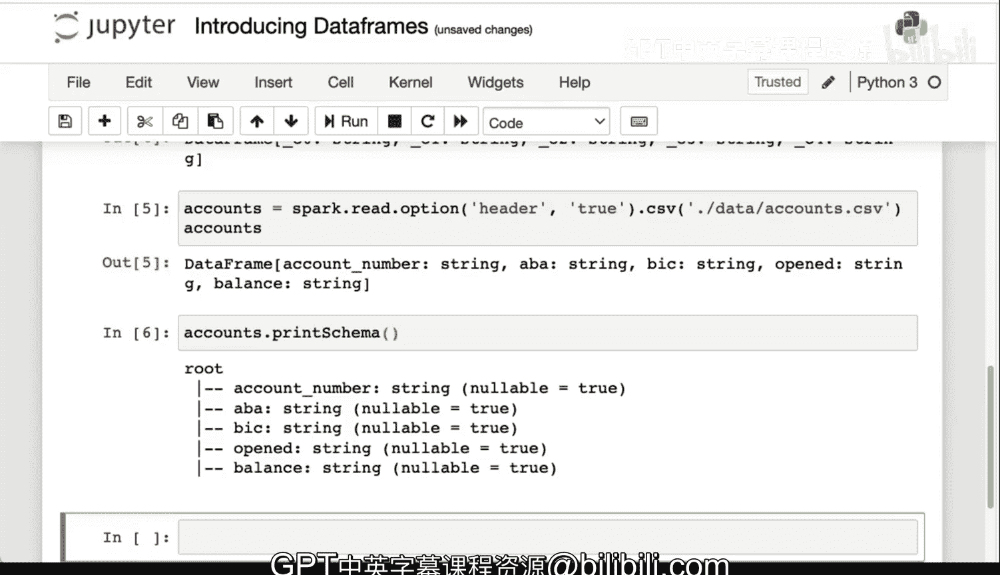
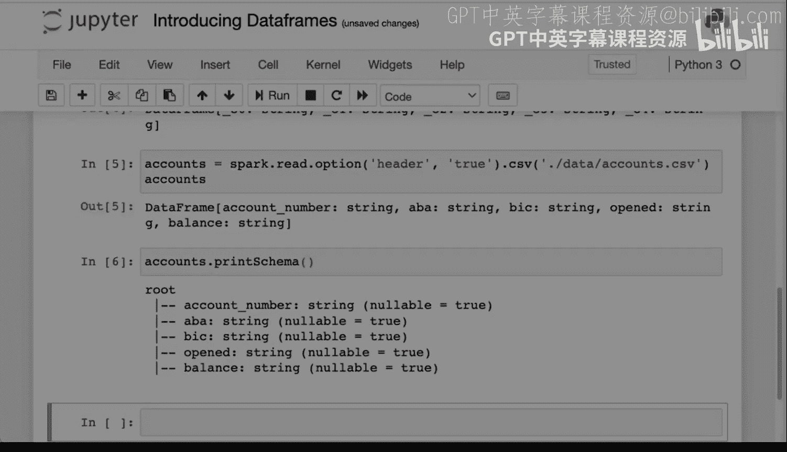

# 应用Python数据工程：09：PySpark DataFrame演示第一部分 🚀


在本节课中，我们将学习如何创建和初步探索PySpark DataFrame。我们将从创建一个Spark会话开始，然后通过读取CSV文件来创建DataFrame，并了解如何查看其结构和内容。

## 创建Spark会话

首先，由于我们不是在交互式shell中运行，所以需要创建一个Spark会话。以下是创建会话的步骤：

```python
from pyspark.sql import SparkSession

spark = SparkSession.builder.appName("PysparkExample").getOrCreate()
```

一旦会话创建完成，我们可以查看它。可以看到，它拥有我们之前指定的应用名称，版本是3.3，并且是一个内存中的Spark会话。

## 读取CSV文件创建DataFrame

接下来，让我们通过读取一个文件来创建一个DataFrame。我们将使用`read.csv`方法来读取一个CSV文件。

```python
df = spark.read.csv("path/to/your/file.csv")
```

在创建的DataFrame中，列名被自动命名为`_c0`、`_c1`、`_c2`等。这是因为我们没有指示Spark读取文件中的标题行，而标题行通常会定义列名。

## 读取包含标题的CSV文件

现在，让我们再次读取同一个文件，但这次我们将使用`option`方法来告诉Spark读取标题行。

```python
df_with_header = spark.read.option("header", "true").csv("path/to/your/file.csv")
```

现在可以看到，列名已经变成了`account number`、`A B`、`A B`、`IC`、`Opened`和`balance`。这样，DataFrame的列名就与文件中的标题行对应起来了。

## 查看DataFrame的结构

为了更好地理解这个特定DataFrame的布局，我们可以使用`printSchema`方法来查看其结构。

```python
df_with_header.printSchema()
```

这个方法会输出DataFrame的模式信息，包括列名、数据类型以及是否允许空值。通过查看模式，我们可以更清楚地了解数据的组织方式。



## 总结



在本节课中，我们一起学习了如何创建Spark会话，以及如何通过读取CSV文件来创建PySpark DataFrame。我们还了解了如何读取包含标题的文件，并查看DataFrame的结构。这些基本操作是进行数据工程和分析的重要第一步。