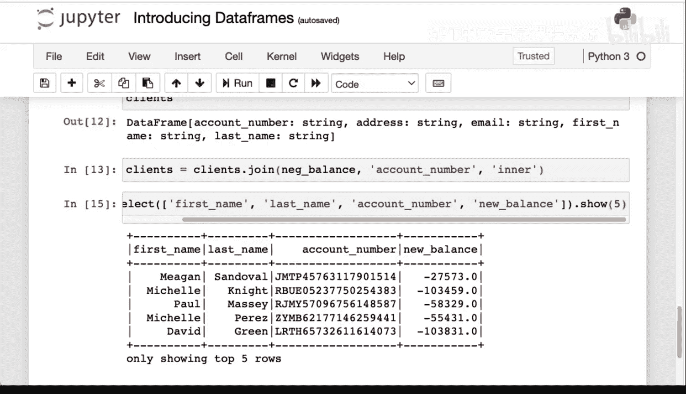
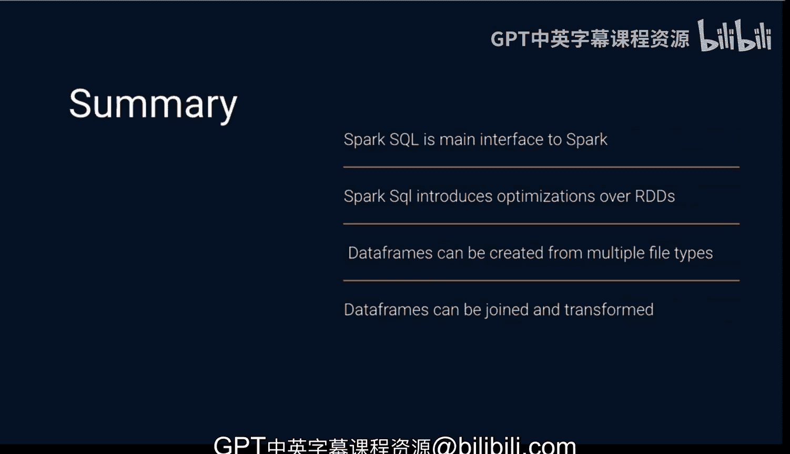

# 杜克大学《应用Python数据工程（3课全）｜Applied Python Data Engineering》中英字幕 p10 10_01_05_PySpark DataFrame演示第二部分.zh_en -BV1nz421i7KP_p10-

Now let's read another file。So you can see we're still using the Spark read。

 we're setting the options for headerres true， but this time we're reading a parquet file。

Instead of a CSsv。Spark has read options for quite a few different file formats。On the data frame。

 we can count the number of records。Let's do some transformations on our data。So first。

 we're going to do a group by in the account number。And some， the results of this。Next。

We're going to join。The accounts and transactions。Together。Based on the account number。

So this will give us account numbers joined with the sum that's the result of the group by。

This one's a little more complex。But， basically。We're taking。The with sum data frame。

 which are created here。We're adding a column to it named New Balance。And setting the value。

Of that column。To the sum。Of the initial balance。And the column named sum an out。

 which is the name of the column generated by the group by function。

We print schema in our accounts now。We can see there's a new column here named New Balance。

Now let's say what we really want to get out of this is accountsworth the。The account is overdrawn。

We'll do this。By using the。Filter method on the data frame accounts。So the filter method。

Requires a condition。Which will determine a boolean。So， our filter method here。

As we want all the rows。Where the column new balance is less than zero。And。

The filter to return a new data frame， which her naming as negative balance。Next。

 let's read a different file type。This time we're going to read a JSON file。

NowJSON files don't have a header， so we can't add an option to read that。And we can see。InThis file。

 the data has an account number， as well as an address， an email， first name and a last name。Now。

 we've already identified accounts who have a negative balance。Let's join these。

With the client information for these accounts。So we'll join them with the negative balance data frame。

Join them on the account number。And do an inner joy。So that we only get rows that match。

Both data frames。Now， we've identified the clients who have negative balances。

 and we've joined them with those negative balances so we can see those。Let's use the。

Select function on the data frame to select some individual columns。

Do this by passing a list of columns。Let's get the。First and last name。The account number。

And the balance of the account。That。啊。So this is return to data frame。What we should do then。

If you want to see the results。Is used the show method on the return date frame。

So show takes an optional argument which tells how many rows to show。

We're only going to show five in this case。And because we've asked it the show， which is an action。

It now is taking the time to do all the calculations required to get this result。

 That's why I took much longer to do the show than it did anything else。But， we can see。

That as a result， we've started with information in three different data sources。

And using joins and filters and selects。We now have a data frame， that has the。

Clients whose accounts have negative balances。

So in summary。Spark Sequel。Is generally the main interface to using Spk。

SparkSQL introduces optimizations over RDDs。Data frames can be created from multiple file types。

And data frames can be joined and transformed to create new data frames。

