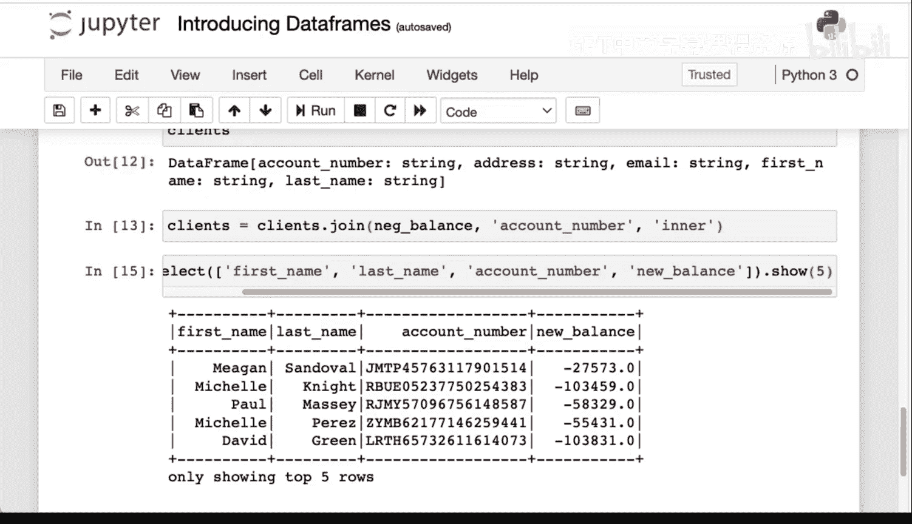
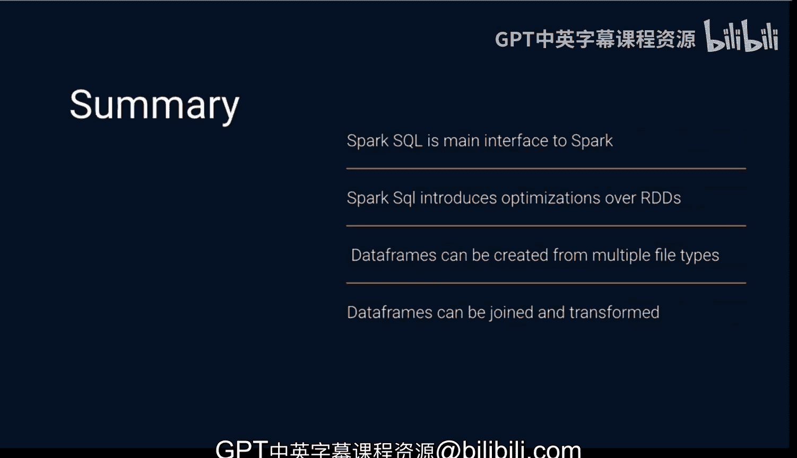

# 应用Python数据工程：3.2：PySpark DataFrame演示第二部分


在本节课中，我们将继续学习PySpark DataFrame的操作，包括读取不同格式的文件、进行数据转换（如分组、聚合、添加列）、数据过滤以及多表连接。通过这些操作，我们将从多个数据源中提取并整合出有价值的信息。

---

上一节我们介绍了如何读取CSV文件并查看数据。本节中，我们来看看如何读取其他格式的文件并进行更复杂的数据处理。

现在，让我们读取另一个文件。可以看到，我们仍然使用 `Spark.read` 方法，并将 `header` 选项设置为 `true`。但这次我们读取的是一个Parquet文件，而不是CSV文件。Spark的读取功能支持多种不同的文件格式。

```python
# 读取Parquet文件
df_parquet = spark.read.option("header", "true").parquet("path/to/file.parquet")
```

在DataFrame上，我们可以统计记录的数量。

```python
# 统计记录数
record_count = df_parquet.count()
```

接下来，让我们对数据进行一些转换操作。

首先，我们将根据账户号码进行分组，并对结果进行求和。

```python
# 按账户号码分组并求和
grouped_df = df_parquet.groupBy("account_number").sum()
```

然后，我们将账户信息和交易记录基于账户号码进行连接。

```python
# 连接账户和交易数据
joined_df = accounts_df.join(grouped_df, "account_number")
```

这个操作会得到一个将账户号码与分组求和结果连接起来的新DataFrame。

以下是一个稍复杂的操作。我们为上面创建的求和DataFrame添加一个名为“New Balance”的新列。该列的值是初始余额与分组求和函数生成的名为“sum_amount”的列的总和。

```python
# 添加新列
accounts_with_new_balance = joined_df.withColumn("New Balance", col("initial_balance") + col("sum_amount"))
```

打印当前账户DataFrame的结构，可以看到这里多了一个名为“New Balance”的新列。

```python
# 打印结构
accounts_with_new_balance.printSchema()
```

现在，假设我们真正想从中获取的是那些账户透支（即余额为负）的账户信息。

我们将通过对DataFrame使用 `filter` 方法来实现。`filter` 方法需要一个能返回布尔值的条件。

```python
# 过滤出余额为负的账户
negative_balance_df = accounts_with_new_balance.filter(col("New Balance") < 0)
```

我们的过滤条件是：选择“New Balance”列小于零的所有行。`filter` 方法会返回一个新的DataFrame，我们将其命名为 `negative_balance`。

---

接下来，让我们读取另一种文件类型。这次我们将读取一个JSON文件。

JSON文件没有表头，因此我们无法像之前那样添加读取表头的选项。

```python
# 读取JSON文件
clients_df = spark.read.json("path/to/file.json")
```

在这个文件中，数据包含账户号码、地址、电子邮件、名字和姓氏。

---

我们已经识别出那些余额为负的账户。现在，让我们将这些账户与对应的客户信息连接起来。

我们将把客户信息DataFrame与上面得到的负余额DataFrame进行连接，连接键是账户号码，并使用内连接，这样我们只会得到两个DataFrame中都匹配的行。

```python
# 连接客户信息与负余额账户
result_df = clients_df.join(negative_balance_df, "account_number", "inner")
```

现在，我们已经识别出拥有负余额的客户，并将他们与具体的负余额信息关联了起来。

---

为了更清晰地查看结果，让我们在DataFrame上使用 `select` 函数来选择特定的列。我们通过传递一个列名列表来实现。

以下是需要选择的列：名字、姓氏、账户号码以及账户余额。

```python
# 选择特定列
final_df = result_df.select(["first_name", "last_name", "account_number", "New Balance"])
```

这个操作会返回一个新的DataFrame。如果我们想查看结果，应该对这个返回的DataFrame使用 `show` 方法。

`show` 方法接受一个可选参数，用于指定要显示的行数。在这个例子中，我们只显示5行。

```python
# 显示结果（前5行）
final_df.show(5)
```

因为 `show` 是一个触发计算的动作，所以现在它需要花费时间来执行所有必要的计算以得到最终结果。这就是为什么执行 `show` 操作比之前的转换操作耗时更长的原因。



我们可以看到，通过从三个不同的数据源开始，并使用连接、过滤和选择操作，我们现在得到了一个包含账户余额为负的客户信息的DataFrame。

---

## 总结

本节课中我们一起学习了PySpark DataFrame的核心操作。



*   **Spark SQL** 通常是使用Spark的主要接口，它在RDD之上引入了优化。
*   **DataFrame** 可以从多种文件类型（如CSV、Parquet、JSON）创建。
*   通过使用 **分组**、**连接**、**添加列**、**过滤** 和 **选择** 等转换操作，DataFrame可以被灵活地处理和组合，以创建出满足特定分析需求的新DataFrame。