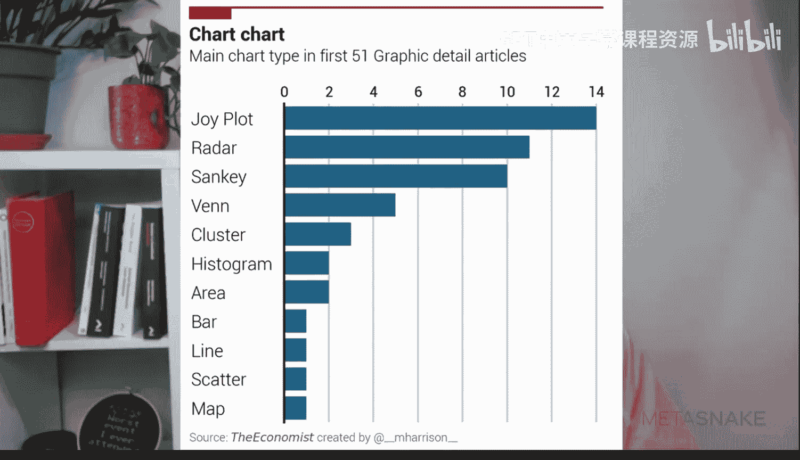

# 杜克大学《应用Python数据工程（3课全）｜Applied Python Data Engineering》中英字幕 p100 01_01_03_数据可视化入门.zh_en -BV1nz421i7KP_p100-

So let's talk about some of the first steps you'll want to consider when you are thinking about visualizing something。

First of all， you want to think about the story that you want to tell。 And so in order to do that。

 you need to gather some data Where do you get that data， Is the data at hand useful。

 Does it have the information you need， Is it missing data。

What story do you want to tell with the data， What outcomes are you looking for。

 You'll want to consider the outcomes that you looking for before you start making your visualization。

 because that can lead you down the path to choosing the correct visualization。

When you've created a visualization， you'll want to consider whether the visualization tells the story that you want to tell。

 you might want to tweak some aspects of it to highlight certain points or add annotations to assist in that or change color schemes to emphasize certain parts of the visualization。

A final thing that will really clean up your data is looking at this notion of the data to ink ratio that is how much of your visualization is actually necessary to telling the story and how much is background information。

 generally you want to mute or remove background information if possible。

 following this process of thinking about the story you want to tell collecting your data coming up with the correct visualization and then focusing on making sure that you're telling a story with your visualization will lead you to making compelling visualizations。

One of the things you need to consider is the type of data you have。 If you have numeric data。

 you're going to want to make different visualizations than you would make if you have categoric data。

 So let's look at some examples of numeric story tellingling with data。

 One common plot that you might want to make is a line plot。 If you have data that goes over time。

 a great way to visualize that is with a line plot。 Now， if you have just a column of data。

 and you want to understand that。 you might want to look at the distribution of that。

 great way to visualize and understand the distribution of that is to use what's called a histogram。

If you have two different columns of data， common way to look at the relationship between them is to use what's called a scatter plot that can quickly let you visualize whether the relationship goes in a positive direction or a negative direction or if there is no relationship between them。

 Understanding what type of data you have can lead you to choose the correct plots。

For categorical data， you'll also want to make sure you're using the correct plots。 General。

 when I'm using categoric data， Im looking at counts of categories。

 and a bar plot is a great way to understand that。 That's my go to plot for categoric data。

 Sometimes you might even want to facet that bar plot。

 If you have multiple categories that you want to look across multiple categories。

Another common way to understand data is to summarize it。

 I like to tell my students that your boss generally doesn't want to know the needty greedy details。

 General， they want a quick story and a great way to get a quick story is to summarize data。

 For example， you might want to understand the central tendency of your data。

 A couple ways to do that are to calculate either the mean or the median by understanding that single point of data that can often let you understand a bunch of data。

If you want to understand the spread of the data， one way to understand that with a single value is to look at something like the standard deviation。

 And if you have multiple columns， you might want to consider the relationship between those。

 that can be summarized as well， with a correlation。Also。

 if you want to look at the relationship between two columns or the percentage relationship between them。

 consider using a ratio to do that。By summarizing your data。

 you're going to be able to tell your story quicker and be more effective in your storytelling。

