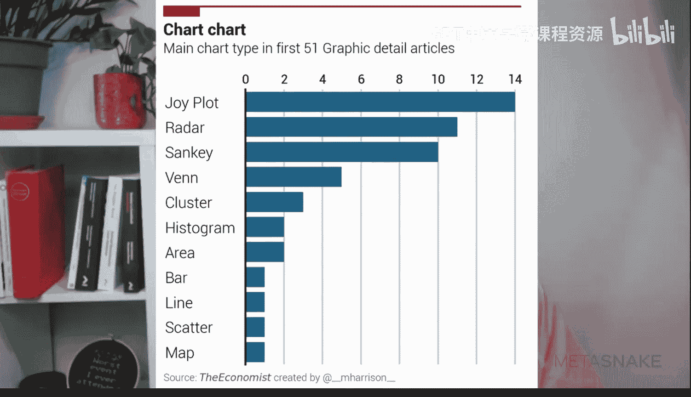

# 应用Python数据工程：01：数据可视化入门 📊

在本节课中，我们将要学习数据可视化的基础步骤和核心概念。我们将探讨如何从明确目标开始，到选择正确的图表类型，再到优化可视化效果，最终有效地讲述数据背后的故事。

---

## 明确故事与收集数据

首先，你需要思考你想要讲述的故事。为了做到这一点，你需要收集一些数据。

以下是开始前需要考虑的几个关键问题：
*   数据从哪里获取？
*   手头的数据是否有用？
*   数据是否包含你需要的信息？
*   数据是否有缺失？
*   你想用数据讲述什么故事？
*   你期望得到什么结果？

在开始制作可视化图表之前，你需要考虑期望的结果，因为这能引导你选择正确的可视化方式。

---

## 优化与提炼可视化

当你创建了一个可视化图表后，你需要考虑它是否有效地讲述了你想要的故事。

以下是优化可视化的几个方法：
*   调整某些方面以突出特定要点。
*   添加注释来辅助说明。
*   更改配色方案以强调图表的某些部分。

一个能真正清理你数据的概念是“数据墨水比”，即你的可视化图表中有多少部分是讲述故事所必需的，有多少是背景信息。通常，如果可能，你应该弱化或移除背景信息。

遵循这个过程——思考要讲述的故事、收集数据、构思正确的可视化方式，然后专注于确保你的可视化在讲述一个故事——将引导你制作出引人注目的可视化图表。

---

## 根据数据类型选择图表

你需要考虑的一个因素是所拥有的数据类型。如果你有数值型数据，你将需要制作与分类数据不同的可视化图表。

让我们看一些用数值数据讲故事的例子。

**线图**：如果你有随时间变化的数据，用线图来可视化是一个很好的方法。

**直方图**：如果你只有一列数据，并且想理解它，你可能需要查看其分布。可视化和理解数据分布的一个好方法是使用直方图。

**散点图**：如果你有两列不同的数据，查看它们之间关系的常用方法是使用散点图。这可以让你快速可视化关系是正向、负向，还是不存在关系。

理解你拥有的数据类型可以帮助你选择正确的图表。

对于分类数据，你也需要确保使用正确的图表。通常，当我使用分类数据时，我关注的是类别的计数，而条形图是理解这一点的好方法。这是我处理分类数据的首选图表。有时，你甚至可能需要对条形图进行分面处理，如果你有多个类别需要跨多个维度查看。

---

## 通过数据摘要快速理解

另一种理解数据的常见方法是进行总结。我喜欢告诉我的学生，你的老板通常不想知道琐碎的细节。一般来说，他们想要一个快速的故事，而获取快速故事的好方法就是总结数据。

以下是几种常见的数据摘要方法：

**集中趋势**：例如，你可能想理解数据的集中趋势。实现这一点的几种方法是计算均值或中位数。通过理解这个单一的数据点，你通常可以理解大量数据。

**离散程度**：如果你想理解数据的离散程度，用一个单一值来理解的方法是查看标准差之类的指标。

**关系**：如果你有多列数据，你可能需要考虑它们之间的关系。这也可以通过相关性来总结。

**比率**：如果你想查看两列数据之间的关系或它们之间的百分比关系，可以考虑使用比率。

通过总结你的数据，你将能够更快地讲述你的故事，并在叙事中更加有效。

---

本节课中，我们一起学习了数据可视化的完整流程：从明确目标和收集数据开始，根据数据类型（数值型或分类型）选择合适的图表（如线图、直方图、散点图、条形图），并通过优化“数据墨水比”来提升图表效果。最后，我们还探讨了如何使用均值、中位数、标准差和相关性等统计量来快速总结数据，从而更高效地传达核心信息。掌握这些基础步骤，是迈向有效数据沟通的第一步。