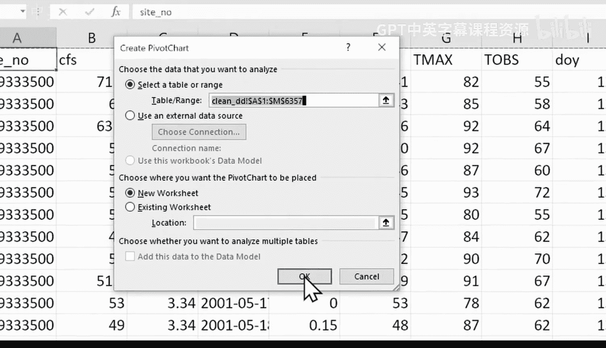
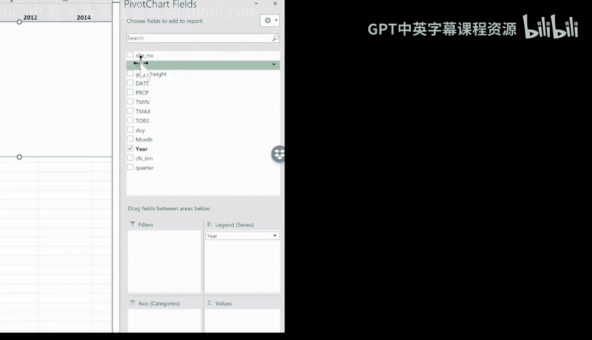
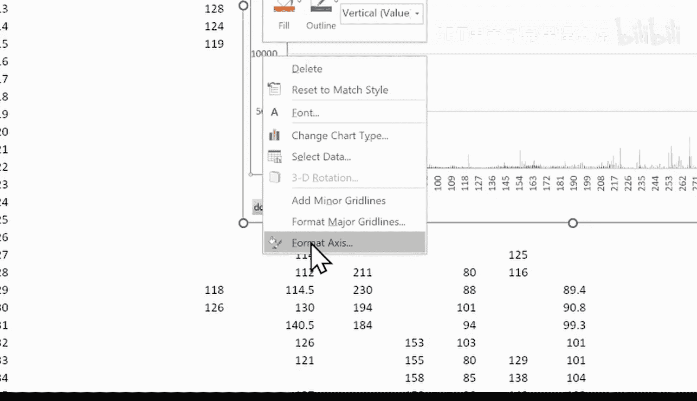
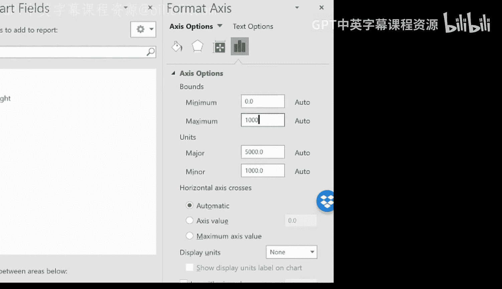
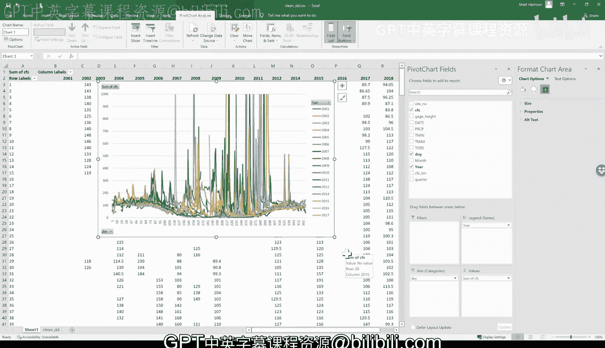

# 杜克大学《应用Python数据工程（3课全）｜Applied Python Data Engineering》中英字幕 p102 03_01_03_在Excel中创建折线图.zh_en -BV1nz421i7KP_p102-

In this section， we're going to look at creating a line plot with Excel。

 We're going to be using this dirty devil data set to make a line plot of the cubic feet per second over the years。

 I've loaded up the data here。 And so what we want to do first is we want to。Create a pivot table。

 because we want to look at these values by year。 And I've got multiple years in here。

 and we want to look at each of those values。 So let's create the pivot table first。

 I'm going to go to the insert tab here。And then I'm going to click on。

Insert a pivot chart so we can just go directly to the pivot chart。

 We're going to use our data from this。

And over here， we have our fields and we can drag them in。 So what do we want to do here。

 We want to put in years into our legend。 drag years into the legend。

And then our values is a cubic feet per second。

That creates a summary of the sum of the cuic feet per second by year。

 but we want to make a line plot to create a line plot we need to drop day of the year into categories。

Now， this plot is a little bit hard to read。 That's because we do have some outliers。

 Let's make it a little bit larger。If we want to zoom into the data that doesn't have the outliers。

 what I'm going to do is I'm going to click on over here on my Y axis。

 and I'm going to click format access down here。

And let's change the minimum and the maximum values， so the minimum value is okay at zero。

 let's change the maximum to 1000。

Okay， that's looking pretty good， but this is looking like it's more of a bar chart。

 Let's right click on this。And say change series chart type here。

What I'm going to click on is the line chart and we'll click OK。

 so this is similar to what we had with pandas where we aggregated the data here we're looking at by each year the cubic feet per second for each day。

