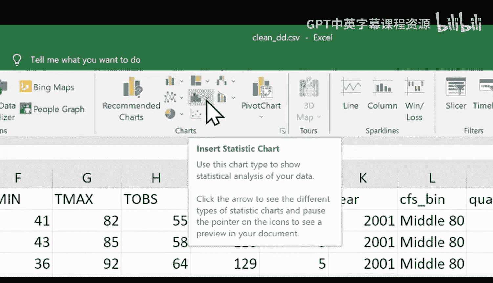

# 杜克大学《应用Python数据工程（3课全）｜Applied Python Data Engineering》中英字幕 p103 04_01_04_在Excel中创建直方图.zh_en -BV1nz421i7KP_p103-

In this example， we're going to use Excel to make a histogram。

 We want to make a histogram of the gauge height。 So what we're going to do is we're going to highlight that column。

 we're going to go over here into insert。 You can click on histogram here under Staistic chart。

 and there is a basic chartAlternativelyly， you can click on this。

Click on recommended charts here。 This gives various recommendations。 Again。

 I would choose the histogram right here as the recommended chart for viewing this。 This， let's。

 let's see that the cubic feet per second， the most common value for that is between 3。1 and 3。4。

We can also see that there are some outliers up there at 15。

