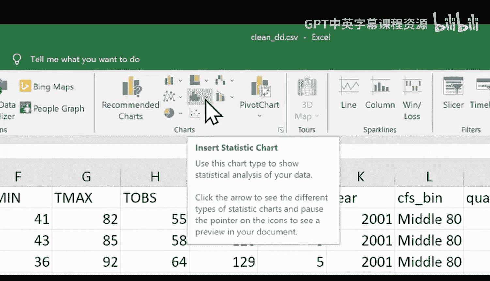

# 数据可视化入门：04_01_04：在Excel中创建直方图 📊

在本节课中，我们将学习如何使用Excel软件，基于一组数据来创建直方图。直方图是一种强大的图表，能够直观地展示数据的分布情况，帮助我们快速识别数据的集中趋势和异常值。

上一节我们介绍了数据可视化的基本概念，本节中我们来看看如何利用Excel这一常用工具来制作直方图。

## 创建直方图

我们将以“水位计高度”这组数据为例，演示创建直方图的完整步骤。

以下是创建直方图的具体操作流程：

1.  **选择数据**：首先，用鼠标选中包含“水位计高度”数据的整列。
2.  **插入图表**：接着，点击Excel顶部菜单栏的“插入”选项卡。
3.  **选择图表类型**：在“图表”区域，你可以直接点击“统计图表”下的“直方图”图标。或者，你也可以点击“推荐的图表”按钮。

点击“推荐的图表”后，Excel会根据所选数据提供多种图表建议。对于当前的数据，我们依然选择直方图作为查看数据分布的最佳推荐图表。

## 解读直方图

生成的直方图能够清晰地展示数据的分布特征。

从图中我们可以看出，以“立方英尺每秒”为单位的水流量，其最常见的数值范围集中在**3.1到3.4**之间。同时，我们也能直观地发现，在数值**15**附近存在一些明显的**异常值**。

本节课中我们一起学习了在Excel中创建和解读直方图的方法。通过这个简单的工具，我们可以快速将一列数据转化为直观的分布图表，从而有效地分析数据的集中区域并识别出可能的异常点。