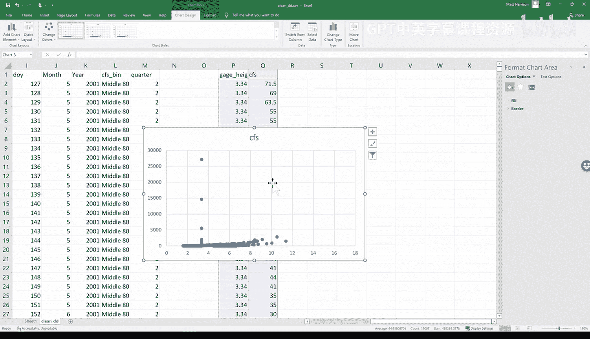

# 杜克大学《应用Python数据工程（3课全）｜Applied Python Data Engineering》中英字幕 p104 05_01_05_在Excel中创建散点图.zh_en -BV1nz421i7KP_p104-

In this example， we're going to make a scatter plot in Excel。

 we are going to scatter the cubic feet per second against the gauge height。

So what I'm going to do is I'm going to come over here。 I'm going to select these two。Columns。

 I'm going to copy them， and I'm going to paste them over here because I want gauge height to be in the X axis。

 I need that column to be first。 So I'm going to cut this one。

 and I'm going to change the order of them。 Okay， at this point。

 I should be able to select both of these。 Let's go over to insert。

 and we're going to insert a chart。 We want a scatter chart。

There we go there is our basic scatter chart again we've got outliers。

 so I'm going to come over here right click on this and say format access。

Let's change the maximum here to 1000。And you can see that that tells a different story than having the outliers there。

 Again， there is some interesting things going on here。 We have this value here around 3。4。

 where we've got a vertical line。 This plot brings that to our tension quite clearly。

 this would be something that you would want to dig into and see what's going on。

