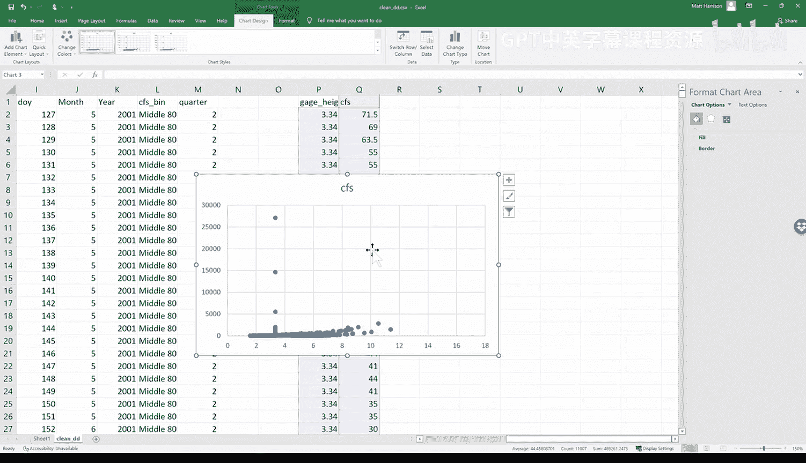

# 应用Python数据工程：3.1.5：在Excel中创建散点图 📊

在本节课程中，我们将学习如何在Excel中创建一个散点图。我们将使用“立方英尺每秒”和“测量高度”这两列数据，通过调整图表设置来更清晰地展示数据关系，并识别其中的异常值。

## 概述

我们将从复制和调整数据列的顺序开始，以确保正确的数据被分配到图表的X轴和Y轴。接着，我们会插入一个基本的散点图，并通过格式化坐标轴来优化图表的可读性，特别是处理数据中的异常值。

## 数据准备与图表创建

首先，我们需要准备数据。目标是创建一个散点图，其中X轴代表“测量高度”，Y轴代表“立方英尺每秒”。

以下是操作步骤：
1.  选择“立方英尺每秒”和“测量高度”这两列数据。
2.  复制这两列数据，并将它们粘贴到工作表的另一个区域。
3.  调整列的顺序，确保“测量高度”这一列位于第一列，因为我们将把它用作X轴的数据。

完成数据准备后，我们就可以创建图表了。

1.  选中调整好顺序的两列数据。
2.  转到Excel的“插入”选项卡。
3.  在图表区域选择“散点图”。

这样，一个基本的散点图就生成了。

## 优化图表与解读数据

上一节我们创建了基本的散点图，本节中我们来看看如何通过调整坐标轴来优化它，并解读图表揭示的信息。

生成的初始图表中可能包含一些异常值，这些值会使大部分数据点聚集在图表的一个小区域内，不利于观察主要的数据趋势。

为了更清晰地展示核心数据分布，我们需要调整Y轴（值轴）的范围。操作方法是：右键点击Y轴，选择“设置坐标轴格式”。在弹出的窗格中，将最大值修改为一个更合理的数值，例如 **`1000`**。

调整坐标轴范围后，图表讲述了一个与包含异常值时完全不同的数据故事。数据点的分布模式变得更加清晰可见。

此外，图表还清晰地揭示了一些有趣的现象。例如，在X轴（测量高度）值约为 **`3.4`** 的位置，数据点形成了一条垂直的线。这个散点图将这一现象突出地展示出来，这可能是需要进一步深入分析的数据点。

## 总结

本节课中我们一起学习了在Excel中创建和优化散点图的完整流程。我们首先通过调整数据列顺序来正确分配坐标轴，然后插入散点图。接着，通过格式化坐标轴、调整最大值来排除异常值的干扰，从而让主要的数据关系和潜在问题（如特定测量高度下的数据聚集）得以清晰呈现。这个过程是进行初步数据探索和可视化的有效方法。