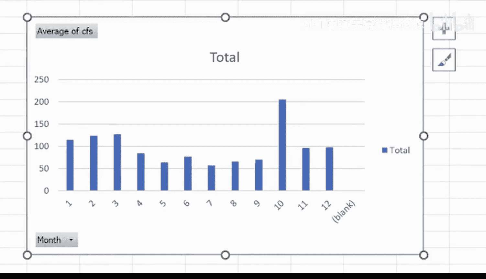

# 杜克大学《应用Python数据工程（3课全）｜Applied Python Data Engineering》中英字幕 p105 06_01_06_在Excel中创建条形图.zh_en -BV1nz421i7KP_p105-

In this example， we are going to look at creating a bar plot with Excel。

 This plot is going to plot the median cubic feet per second per month。

 So we're going to do this with a pivot chart。Going to get rid of these。Columns over here。

That we have from our previous。Example here。I'm going to hold down shift and select the columns that I want。

 and then I'm going to come up here to pivot chart。 And because I've selected that data。

 that's the data that I want to use that will bring up our fields selector over here and then we just need to figure out which fields go into which areas。

 So because we want this categorized by month。 we're going to drop month into categories right here。

 the value that we want is the cubic feet per second。 Let's drop that into values。

That looks like we are now getting the sum of that。 If we want to change that to the median value。

 we can come up here and go to value field settings。And we can search for median in here。 Sadly。

 there is no median in here。 The closest we can get is the average。 so we'll click that instead。

This chart makes it clear that in October is when we get the most average cubic feet per second and pretty clear that in July is when it is the lowest。

