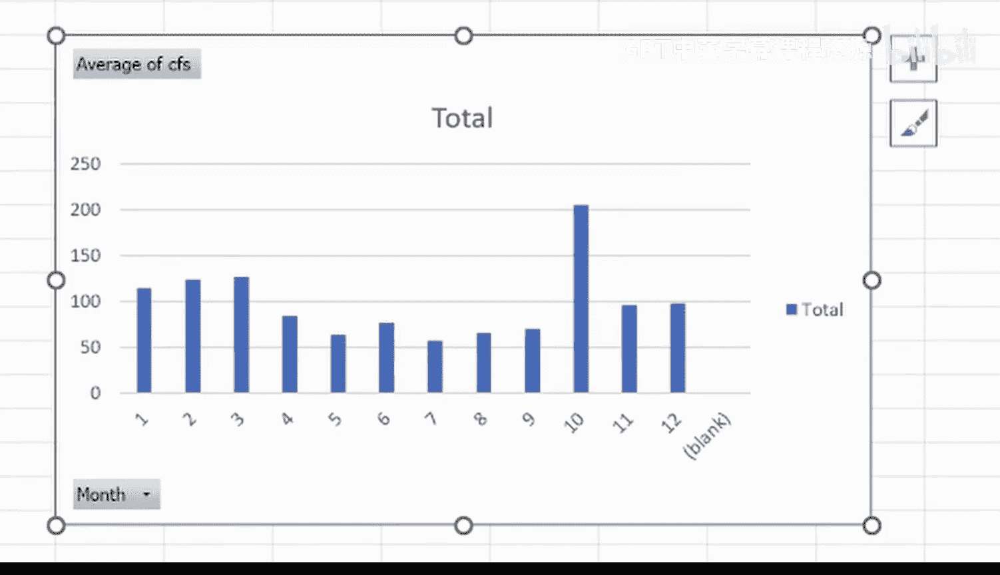

# 数据可视化：06_01_06：在Excel中创建条形图 📊

在本节课程中，我们将学习如何在Excel中创建一个条形图，用于可视化每月流量的中位数（立方英尺/秒）。我们将使用数据透视表功能来快速生成图表。

上一节我们介绍了数据的基本处理，本节中我们来看看如何利用Excel的图表功能进行数据可视化。

---

首先，我们需要准备用于创建图表的数据。在本例中，我们将使用每月流量数据。

我将按住Shift键，选择我需要的列数据。

选择数据后，点击菜单栏的“数据透视表”功能。由于我们已经选定了数据范围，Excel会自动将其作为数据源，并在界面右侧弹出字段选择器。

接下来，我们需要确定各个字段应放置在数据透视表的哪个区域。

因为我们希望按月份对数据进行分类，所以将“Month”（月份）字段拖放至“行”（或“分类”）区域。

我们想要展示的值是“Cubic Feet per Second”（立方英尺/秒）。将此字段拖放至“值”区域。

此时，图表默认显示的是该值的总和。如果我们想将其改为中位数，可以进行以下操作。

点击值区域的字段，选择“值字段设置”。

在弹出的对话框中，我们可以搜索并选择不同的汇总方式。遗憾的是，Excel数据透视表默认的汇总选项中没有“中位数”。

最接近的选项是“平均值”。因此，我们点击选择“平均值”。

完成设置后，条形图便生成了。从图表中可以清晰地看出，十月份的平均立方英尺/秒流量最高。

同样明显的是，七月份的流量是最低的。

---

以下是创建条形图的关键步骤总结：

1.  **选择数据**：按住Shift键，选择包含月份和流量值的所有相关数据列。
2.  **插入数据透视表**：在菜单栏选择“插入”->“数据透视表”，使用选定的数据范围。
3.  **配置字段**：
    *   将“月份”字段拖至“行”区域，作为分类依据。
    *   将“流量值”字段拖至“值”区域，作为计算数值。
4.  **更改计算方式**：点击值字段，在“值字段设置”中将计算方式从“求和”改为“平均值”（因无“中位数”选项）。
5.  **生成图表**：Excel会自动根据数据透视表生成对应的条形图。

---

本节课中我们一起学习了在Excel中利用数据透视表创建条形图的方法。我们掌握了从选择数据、配置字段到更改值计算方式的完整流程，并成功生成了展示月平均流量变化的可视化图表。通过这个图表，我们可以直观地比较不同月份的数据差异。