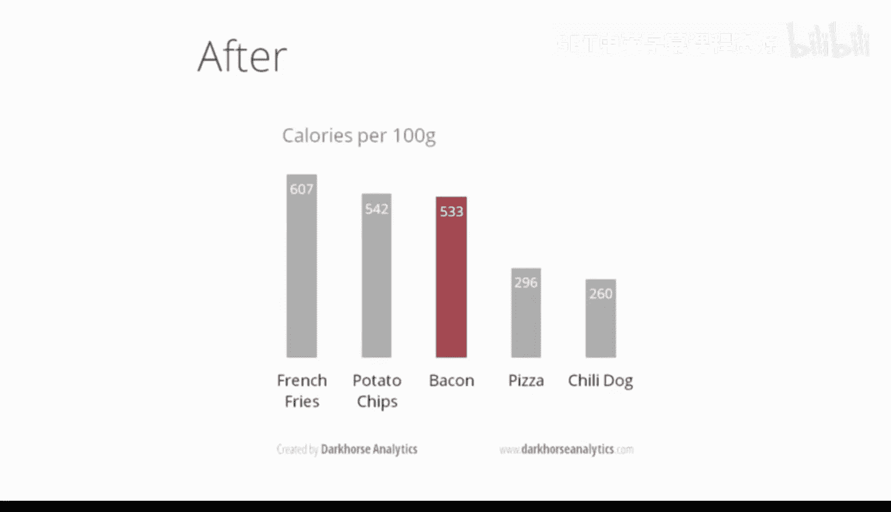

# 杜克大学《应用Python数据工程（3课全）｜Applied Python Data Engineering》中英字幕 p106 07_01_07_最小化可视化中的杂乱元素.zh_en -BV1nz421i7KP_p106-

One of the things that we want to do when we're creating charts is to avoid clutter。

And one of the ways to do that is to， when you look at a chart。

 consider everything that is on the chart and ask yourself。

 is this contributing to the story or removing from it。

 What is the story that you want to tell and is this contributing or removing from it。

 I'm going to show a commonly seen Giff from dark horse analytics that illustrates this pretty clearly。

The initial plot here is a little bit over the top。

 but you can see that they're just considering every point that is on this plot and essentially removing it。

Getting rid of it， lightning it， reducing the impact of it， getting rid of any special effects。

Making everything very simple and then drawing attention to what we want in this case。

 it looks like they want to draw attention to bacon and the calories per bacon。

If you look at the initial chart and the last one， you can see that there is quite a difference there and your eyes are drawn directly to the bacon。

Now there's a lot going on in that animation。And I think that the initial plot is a little bit over the top。

 But the point stands， you want your plot or your chart to tell a story and you want to remove distractions from it。

 The more you can tell that story and focus on it， the more effective your plots will be。

 So consider just going through this process with your own plots。

 I'm not going to go through every step of cleaning up every plot with all the different tools we have。

 But a lot of these tools will have options for manipulating。

 changing the look and fill of your plots， cleaning them up， but changing the colors， etc ce。

 So as someone who's trying to tell a story， make sure that your chart is compelling and tells a story that you want to tell。

