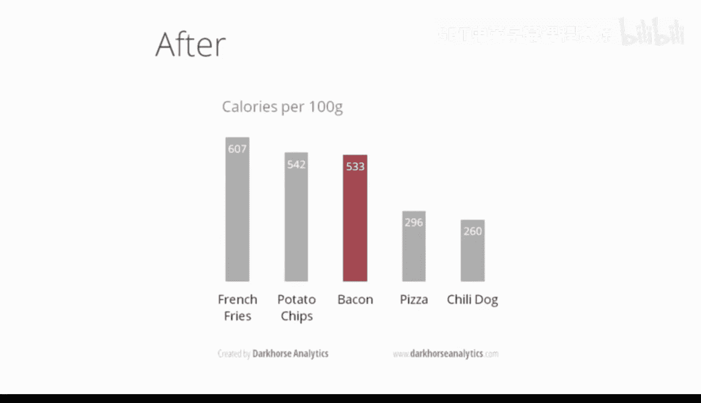

# 数据可视化：07：最小化可视化中的杂乱元素

在本节课中，我们将学习如何通过减少图表中的杂乱元素，使数据故事更加清晰和有力。核心目标是识别并移除所有分散注意力的元素，让观众能立刻聚焦于你想传达的关键信息。

## 避免图表杂乱

创建图表时，我们的目标之一是避免杂乱。实现这一目标的方法之一是，在审视图表时，考虑图表上的每一个元素，并问自己：这个元素是在增强故事性，还是在削弱它？你想讲述的故事是什么，当前元素是在贡献还是削弱这个故事？

接下来，我将展示一个来自Dark Horse Analytics的常见动图，它能清晰地说明这一点。

## 简化过程示例

以下是图表简化的一个典型过程。初始图表的设计可能有些夸张，但你可以看到，他们只是考虑了图表上的每个点，并逐步将其移除。

这个过程包括：去掉不必要的元素、淡化次要信息、减少其视觉冲击力、消除任何特殊效果。最终使一切变得非常简单，然后将观众的注意力引导到我们想要强调的地方。在这个例子中，他们似乎想将注意力引向“培根”及其对应的卡路里数值。

对比初始图表和最终图表，你会发现两者差异显著，而你的视线会直接被“培根”所吸引。

## 核心原则与应用

上述动画中包含了许多步骤。虽然初始图表可能有些极端，但核心原则是成立的：你希望你的图表能讲述一个故事，并且需要移除其中的干扰因素。你越是能清晰地讲述并聚焦于这个故事，你的图表效果就越好。

因此，建议你对自己的图表也进行这样的审视和简化过程。我不会在这里使用我们所有的不同工具来演示清理图表的每一个步骤。但许多可视化工具都提供了操作选项，用于调整和改变图表的外观、填充、颜色等，以达到清理和优化的目的。

作为一名数据故事的讲述者，请确保你的图表具有吸引力，并能准确传达你想要讲述的故事。

## 总结

本节课中，我们一起学习了如何通过最小化图表中的杂乱元素来提升数据可视化的效果。关键在于识别并移除所有与核心故事无关的干扰项，使用简洁的设计将观众的注意力直接引导至关键数据点上。记住，一个有效的图表应该像一个好故事一样，焦点明确、叙述清晰。