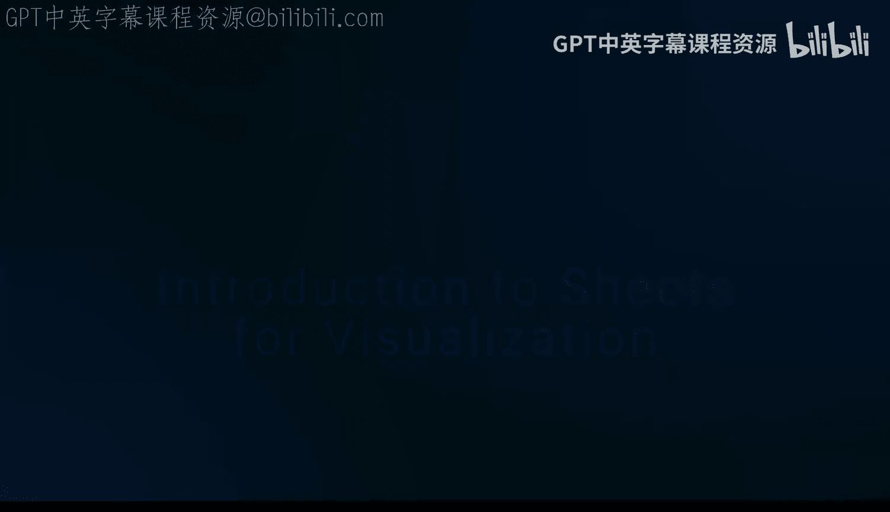

# 杜克大学《应用Python数据工程（3课全）｜Applied Python Data Engineering》中英字幕 p107 08_01_02_Sheets可视化简介.zh_en -BV1nz421i7KP_p107-

In this session， we're going to look at plotting with Google sheetets。

 Google Sheets is a web based spreadsheet。 It has a lot of the functionality of Excel。

 and we'll see that most of these plots that we did with Excel we can do with Google sheetets as well。

