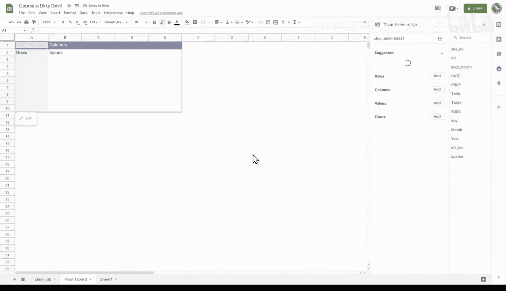
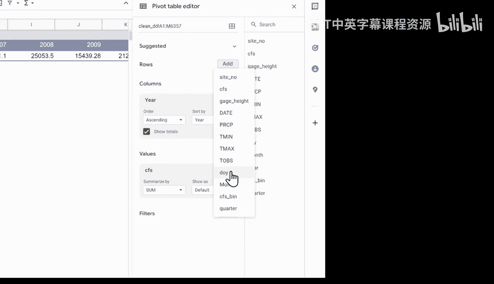
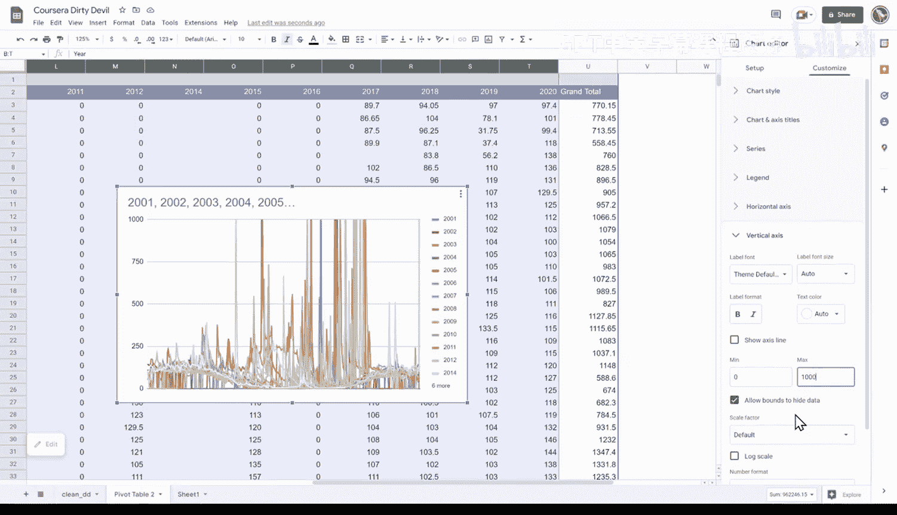

# 杜克大学《应用Python数据工程（3课全）｜Applied Python Data Engineering》中英字幕 p108 09_01_03_在Sheets中创建折线图.zh_en -BV1nz421i7KP_p108-

The first plot that we're going to do with Google Sheets is a line chart。

 remember what we're going to do is we're going to plot each year。

 we're going to summarize the cubic feet per second。

 the daily cubic feet per second for each year on its own line。Okay。

 to do this in Google Sheets here， we're going to come up here to insert and we need to create a pivot table first because we need to pivot that table。

 we'll make this on a new sheet。

And we need to figure out what goes where Now， generally， each line， each column will be a line。

 So we want the columns to be year。 So I'm going to come up here to columns。

 and I'm going to say year because I want each year to be its own line。 and then。

The values for the values we want the cubic feet per second。And we can summarize those as the sum。

And for the rows， we're going to do the day of the year。

Okay at this point we're going to select the columns that we want to chart。

 we're going to select the year columns we're going to get rid of the first one and we're going to get rid of the grand total as well I'll hold down shift and click there to select those columns this point we're going to come back up here to insert and we're going to say insert chart。

And here is our chart。Again， we do have those outliers here。 Let's click on the Y access。

I'm going to right click on this， go up here to access and say vertical access。

Over here on vertical access， we've got a minimum value。

 Let's set that minimum value to 0 and the maximum value to 1000。There we go。

 there is our line chart summarizing daily cubic feet per second for each year。

