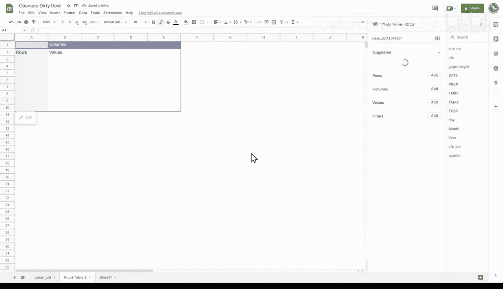
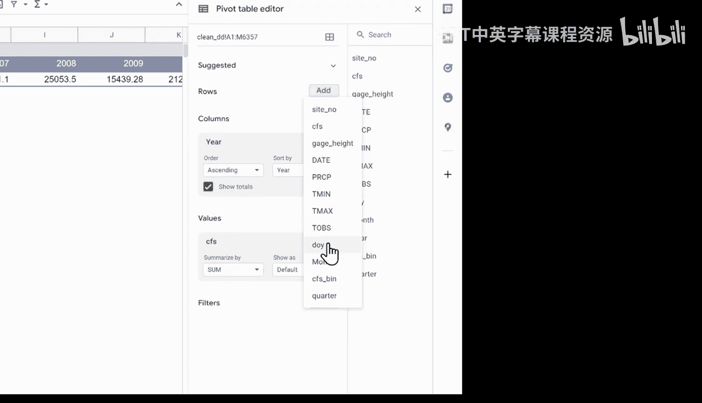
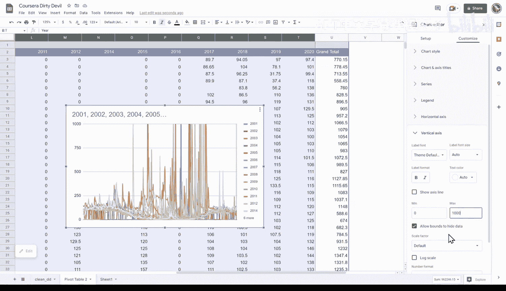

# 应用Python数据工程：3.1.3：在Google Sheets中创建折线图 📈

在本节课中，我们将学习如何在Google Sheets中创建折线图，以可视化每年每日的立方英尺每秒流量数据。我们将通过创建数据透视表来整理数据，并据此生成图表。

## 概述

我们将使用Google Sheets的数据透视功能来汇总数据，然后基于汇总结果创建折线图。目标是让每年的流量数据成为图表中的一条独立折线。

## 创建数据透视表

首先，我们需要创建一个数据透视表来整理原始数据。数据透视表能帮助我们按年份和一年中的天数来汇总流量值。

以下是创建数据透视表的步骤：

1.  在Google Sheets中，点击菜单栏的 **插入**。
2.  从下拉菜单中选择 **数据透视表**。
3.  在弹出的对话框中，选择 **新工作表** 作为数据透视表的放置位置。

## 配置数据透视表字段

创建数据透视表后，我们需要配置其行、列和值字段，以正确汇总数据。

上一节我们创建了数据透视表，本节中我们来看看如何配置字段以生成我们需要的汇总视图。

以下是配置数据透视表的具体字段：

*   **列**： 将 **年份** 字段拖入列区域。这样，每个年份将成为图表中的一条独立折线。
*   **值**： 将 **立方英尺每秒** 字段拖入值区域。汇总方式选择 **求和**，以计算每日流量的总和。
*   **行**： 将 **一年中的天数** 字段拖入行区域。这将在X轴上按时间顺序排列数据点。

配置完成后，数据透视表将按天显示每年的流量总和。

## 生成折线图

数据整理完毕后，我们可以基于数据透视表的结果创建折线图。

现在我们已经有了整理好的数据，接下来看看如何将其转换为直观的折线图。

以下是生成折线图的步骤：

1.  在数据透视表中，选中所有代表年份数据的列。**注意**：请排除第一列（行标签列）和最后的“总计”列。可以按住 `Shift` 键进行多选。
2.  再次点击菜单栏的 **插入**，然后选择 **图表**。
3.  Google Sheets会自动根据选中的数据生成一个图表。

## 调整图表坐标轴

生成的初始图表可能因为数据中的极值（异常值）而导致比例尺不合适，使得主要数据趋势不明显。我们需要调整Y轴的范围。

图表生成后，为了使数据趋势更清晰，我们需要对坐标轴进行一些调整。

以下是调整Y轴范围的步骤：

1.  在图表上，右键点击Y轴（垂直轴）。
2.  从右键菜单中选择 **设置坐标轴**。
3.  在右侧出现的编辑器中，找到 **垂直轴** 设置部分。
4.  将 **最小值** 手动设置为 `0`。
5.  将 **最大值** 手动设置为 `1000`。

经过调整，图表将能更清晰地展示每年每日立方英尺每秒流量的变化趋势。

## 总结

本节课中我们一起学习了在Google Sheets中创建折线图的完整流程。我们首先通过插入数据透视表来汇总和整理数据，然后基于整理好的数据插入图表，最后通过调整Y轴范围来优化图表的可读性。这个方法可以有效地将时间序列数据按不同类别（如年份）进行可视化对比。