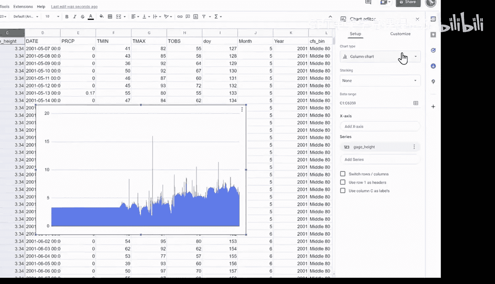
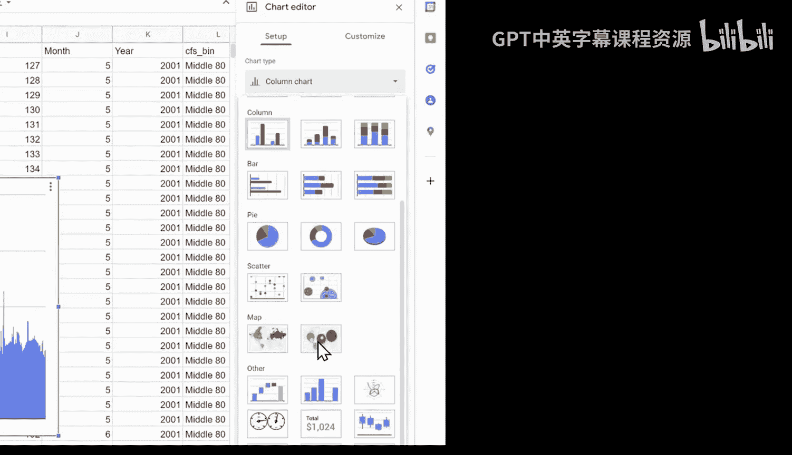
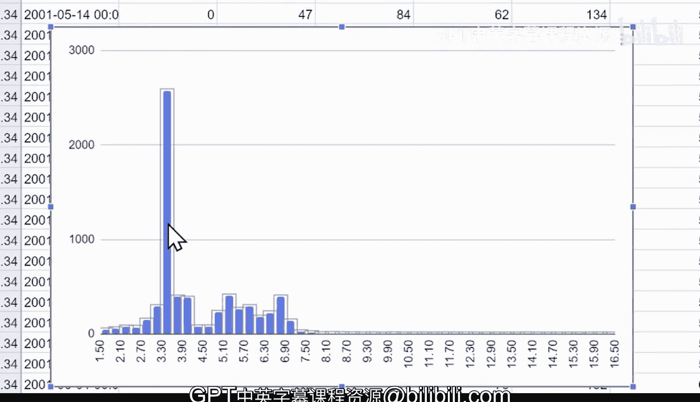

# 杜克大学《应用Python数据工程（3课全）｜Applied Python Data Engineering》中英字幕 p109 10_01_04_在Sheets中创建直方图.zh_en -BV1nz421i7KP_p109-

In this section， we're going to use Google sheetets to make a histogram。

 We're going to make a histogram of the gauge height。

 So let's select the gauge height column come up here to insert。 We're going to say insert a chart。

This is the chart that it created。 We don't want this chart we're going to come over here on the right。

 it says chart type， it says column， we're going to scroll down a little bit。

 and we're going to go click on this histogram。

There we go， there is our histogram， again telling us the same thing that we saw in Excel that the most common value for that cubic feet per second is around that 3。

4 or so value。

