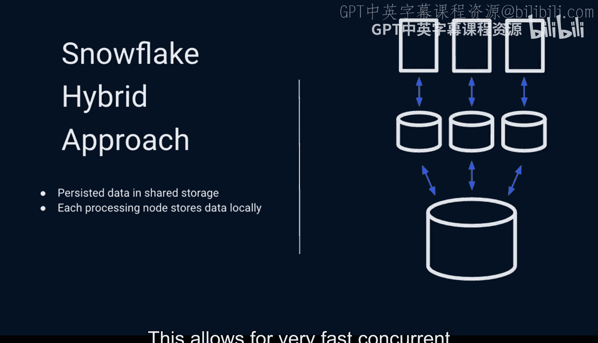

# 杜克大学《应用Python数据工程（3课全）｜Applied Python Data Engineering》中英字幕 p11 11_02_01_什么是Snowflake.zh_en -BV1nz421i7KP_p11-

In this lesson， we're going to talk about snowflake。We'll go over the general Snowflake architecture。

Including the database storage layer。The compute layer。And the cloud services layer， snowflake。

I a storage and computation platform designed for big data。It runs as a service on public clouds。

 including on AWS。Microsoft Azure or Google Cloud。Whichever you prefer for your pre。

And snowflake uses its own。Snowflake S Q L。 So it's not using a version of SQL designed by another data product。

 So in terms of approaches to big data storage， theres are a number of ways things have been done。

The first is what's known as shared everything。This is the traditional approach and the simplest approach。

 it's where you take a database， you install it on a server。

 and any computations or processes you want to run on the data。

 you run on the same server as the database。And this is how。Most non big data solutions work。

 You'll have a relational database。 It sits on a server。 You interact with it。And it's fine。

 and this is certainly the most preferred solution。

Until your data is too big to run effectivelyffectively this way。

Another variation known as a shared disk。In this case。

 computation is done on a number of separate nodes that all。Use the same storage。

 The disadvantage of this is that the computation efficiency of individual computational nodes can be interrupted because they have to wait if they are accessing the same data as another node。

Another solution is what's known as shared nothing。In this case。

 each computational node has its own dedicated storage。

 Snowflake uses a combination of the shared disk and shared nothing architectures， a hybrid approach。

So there's resistant data is stored in a shared storage。With each processing node。

Has its own copy of a subset of the data that it uses during processing。 This allows for very fast。

 concurrent processing。

Along with the simplicity of his shared， persistent storage。

