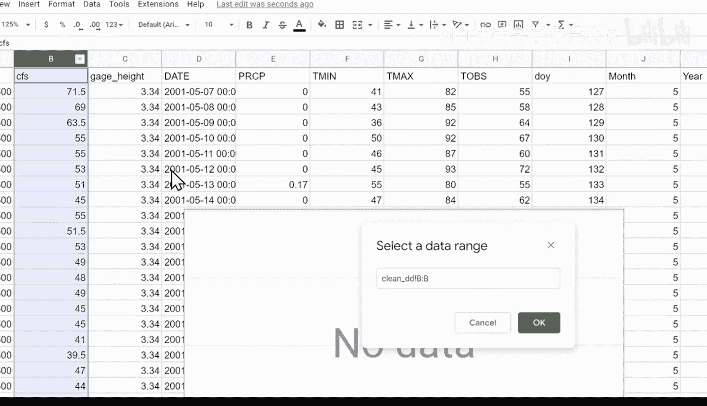
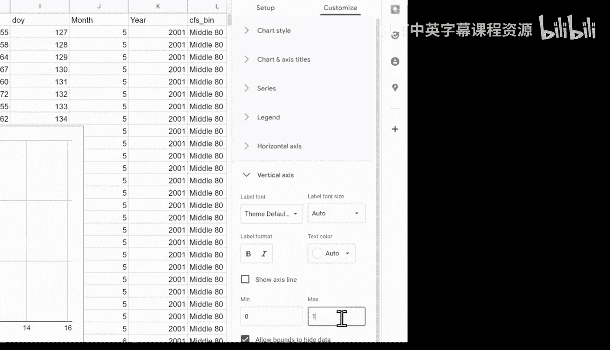

# 杜克大学《应用Python数据工程（3课全）｜Applied Python Data Engineering》中英字幕 p110 11_01_05_在Sheets中创建散点图.zh_en -BV1nz421i7KP_p110-

In this example， we're going to look at making a scatter plot using Google sheetets。

 We're going to scatter the cubic feet per second versus the gauge height。

 What we're going to do is we're going to come up here to insert。

 and we're going to say insert chart。It says no data that's okay over here on the right hand side。

 we're going to click on scatter at this point we now have a data range and an X axis and a series What we care about here is the X axis and the series we're going to click on this X axis and what we want for the X axis。

We're going to select a data range， we'm going to click that box to select the data range。

 and on the X axis， I want the gauge height so we'll come up here and select that column。

Now we need to select the series， let's click over here， I'm going to click this little box here。

 and we want cubic feet per second。 I will click that column and click OK。

There is our scatter plot。Let's customize this because it has those outliers we come over here to vertical access and we'll change the minimum and maximum value。

There we go。 This plot should start looking familiar now again。

 we see that vertical line indicating to me that there's something fishy going on with some of those values。

