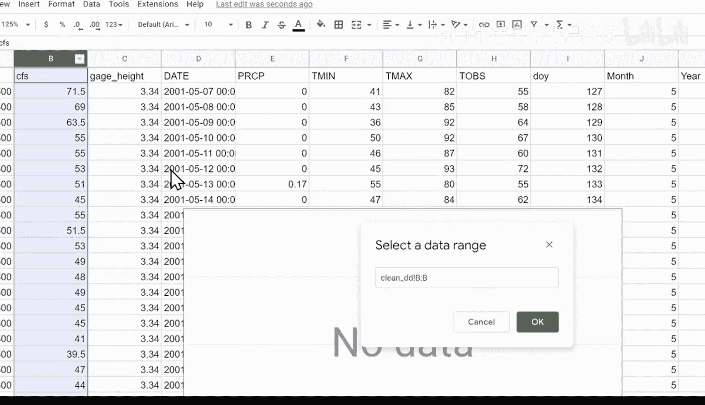
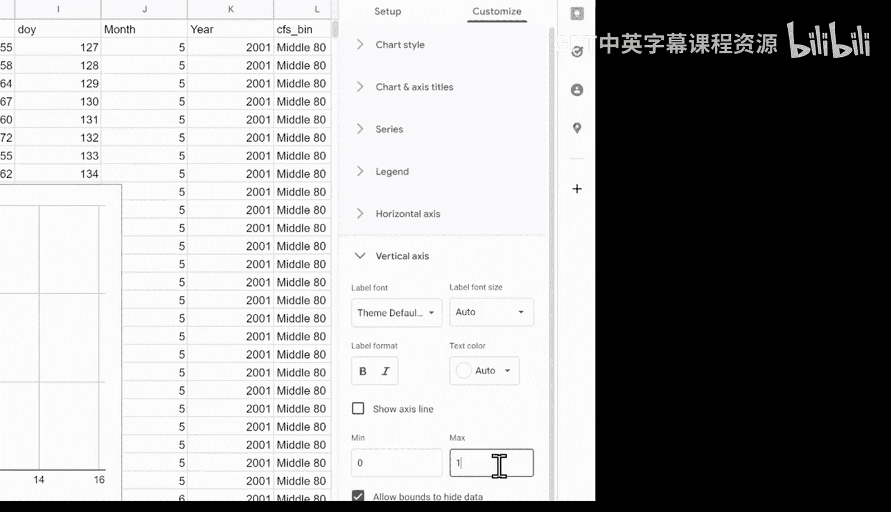

# 应用Python数据工程：3.1.5：在Google Sheets中创建散点图 📊

在本节课程中，我们将学习如何在Google Sheets中创建散点图，以可视化两个变量之间的关系。我们将使用“流量（立方英尺/秒）”与“水位高度”的数据作为示例。

## 概述

散点图是一种强大的数据可视化工具，用于展示两个连续变量之间的关系。通过观察数据点在图表上的分布，我们可以识别出趋势、相关性或异常值。本节将引导您完成在Google Sheets中创建和自定义散点图的完整步骤。

## 创建散点图

首先，我们需要在数据表中插入一个图表。以下是具体操作步骤。

以下是创建图表的基本步骤：
1.  在Google Sheets菜单栏中，点击 **“插入”**。
2.  在下拉菜单中选择 **“图表”**。
3.  此时，工作表右侧会弹出图表编辑器，并且图表区域可能会显示“无数据”的提示，这属于正常情况。

## 配置图表类型与数据

上一节我们插入了图表，本节中我们来看看如何将其设置为散点图并绑定数据。

在右侧的图表编辑器中，我们需要进行以下配置：
*   在 **“图表类型”** 下拉菜单中，选择 **“散点图”**。
*   选择后，编辑器会显示 **“数据范围”**、**“X轴”** 和 **“序列”** 等配置选项。

我们主要关注 **“X轴”** 和 **“序列”** 的设置。首先配置X轴数据。
*   点击 **“X轴”** 下方的数据范围选择框。
*   在弹出的窗口中，选择代表 **“水位高度”** 的数据列。

接下来，我们需要为图表添加数据序列，即Y轴的数据。
*   在图表编辑器的 **“序列”** 部分，点击数据范围选择框。
*   在弹出的窗口中，选择代表 **“流量（立方英尺/秒）”** 的数据列，然后点击 **“确定”**。

完成以上步骤后，一个基础的散点图就生成了。

## 自定义图表以优化视图

基础图表已经创建完成，但为了更清晰地观察核心数据分布，我们通常需要调整坐标轴范围，以排除极端异常值的干扰。

观察初始生成的散点图，可能会发现一些点因数值过大而远离主体，使得主要数据点聚集在图表左下角，难以分析。这时，我们可以通过调整垂直轴（Y轴）的刻度范围来改善视图。
*   在图表编辑器中，找到 **“自定义”** 选项卡下的 **“垂直轴”** 设置。
*   手动修改 **“最小值”** 和 **“最大值”**，将Y轴的显示范围限定在主要数据分布的区间内。

调整后，数据点会更均匀地分布在图表区域内，关系趋势也变得一目了然。此时，图表中可能更明显地出现一些垂直排列的数据点，这通常暗示着这些“流量”值在相同的“水位高度”下出现了多个不同的读数，表明数据可能存在需要进一步检查的异常或特殊情况。

## 总结

本节课中我们一起学习了在Google Sheets中创建散点图的全过程。我们首先通过 **“插入”->“图表”** 创建图表，然后将其类型设置为散点图，并分别指定X轴和序列（Y轴）对应的数据列。最后，为了更有效地展示数据，我们介绍了如何通过调整垂直轴的数值范围来自定义图表视图，从而聚焦于核心数据分布并识别潜在问题。掌握这些步骤，您就能利用散点图初步探索数据集中的变量关系了。