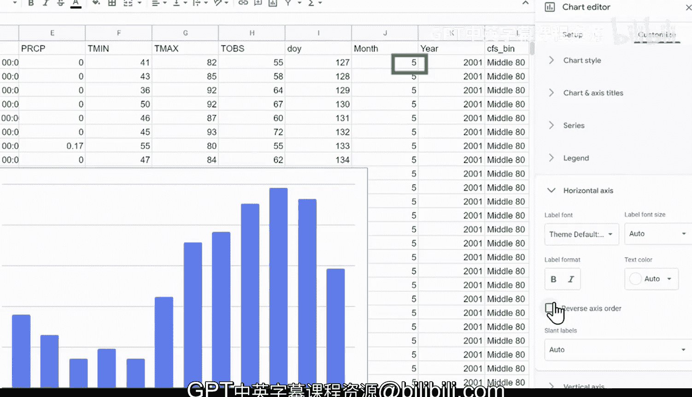

# 杜克大学《应用Python数据工程（3课全）｜Applied Python Data Engineering》中英字幕 p111 12_01_06_在Sheets中创建条形图.zh_en -BV1nz421i7KP_p111-

In this example， we're going to do a bar plot with Google Sheets。

Our barpl is going to be the median cubic feet per second per month， so in order to do that。

 we're going to come up here to insert and say insert chart over here on the chart type。

 we're going to click column chart， which is the default type here along the X access we want the month。

 so we'll come over here and we're going to click on the month column。Again。

 you need to think of this， how we want to summarize this， we want to summarize this by month。

 so we're going to stick that into that column。For the series， we're going to。

Aregate the CFS column here。 So let's click on series here， and I'm going to select the CS column。

We're going to get rid of this G9 column。And I'm going to click the aggregation checkbox here。

There we go。 and now you can see that we are aggregating by month， but we are doing the sum。

 You can see that there's the sum right here。 Let's change this to median。Okay。

 that looks pretty good。 There is one issue。 the order of the X axis。 Saly。

 there is not a way to customize that X axis there。 We can reverse the order。

 but we can't start it from one。 It's starting that way， because if you look at the first entry。

 the first entry has a month of five。 And so it's starting at that value。

