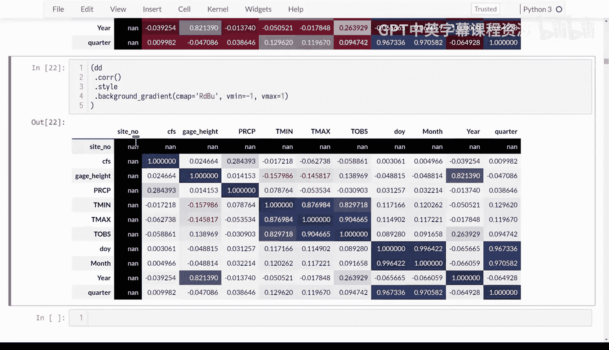

# 杜克大学《应用Python数据工程（3课全）｜Applied Python Data Engineering》中英字幕 p112 13_01_07_优化可视化颜色方案.zh_en -BV1nz421i7KP_p112-

In this section， I want to talk a little bit about color choices。In the examples that we've seen。

 we haven't really used color that much。But again。One of the things you want to consider is what story you're telling。

 the line charts that we've been doing of this yearly dirty devil cubic feet per second。

Reading is a little bit messy。 We've got a bunch of colors going on there。

 It's really hard to make sense of what's going on。 General， when you have a line chart like that。

 people would call that a spaghetti chart because there's just a lot of things going on。

 It's hard to tell what you want to pay attention to。

 So what we want to do generally is focus on a single line。

 Oftentimes that will be a minimum or maximum， but it might be an outlier or some value in the middle。

 You can see an example here of plotting the expect versus life expectancy per country。

 This looks like a spahetti plot。 It's really messy。

One things that we can do is mute all of those other colors and then color one of them。

This is a common technique and if you can leverage this， it really draws attention to certain points。

I'm going to give another example of using color effectively。

 Sometimes you'll do a correlation heat map here。 I've got my dirty devil data。

 and I want to correlate all the numeric columns with each other。 Now。

 if I look at this I can see that， you know along the diagonal we've got ones。

 but it's hard for me to pick out what's highly correlated and what's negatively correlated just by looking at a table of data。

 humans aren't really optimized for looking at tables of data so we can use color to help us。

 Oftentimes I'll see people do something like this where they will throw on a color map on there。

 So here we're just throwing on the default background gradient and now we can see along the diagonal。

 those blues really stick out。 but how do we find the most negative correlation。

 and it's a little bit hard to see we will be looking for in this case is the whitest but really we want to use a different color map。

 Sometimes I'll see people throw on a color map like veritus。 Vertus is a color map that trends。

From various colors kind of like a rainbow， it will go from a yellow to a purple traversing through green and blue along the way。

In this case， we could look for the most yellow and the most purple。

 but because we have these other bright colors in there。

 it doesn't really pull out what we want to look at per se。

 really what we want to use and in correlation heat map is a diverging color map such as this red blue color map。

 This goes from red to white to blue。 Now， in this case， we can look for the bluest and the redest。

 but this is also doing something that I commonly see people doing wrong。

 especially in the case of a correlation color map， we want to pin those values。 Now。

 the positive values are pinned at one， which correlates to the blue value。

 But the most negative values， we don't want in this case， the most negative value to be red。

 we want negative one to be red， because we want values around0 to be white。 And in order to do that。

 at least from pandas， we need to set this V min and v max value。 Now。

 depending on what library you are using， you would set this in different ways。

 But this would be a proper choice。Of a color map for this correlation visualization here。

 we've set the V min to negative1， meaning that if something is negative1， it will be red。

 In this case， we don't have anything that's negative one。

 The smallest values that we have look like they're around negative015。

 So we really don't want those to be dark red because we want the values around  zero to be white。

 and we set the v max to1。 we don't really need to do that because the diagonal on a correlation plot like this will be one but just to be explicit。

 We're going to set it to one。 This is a lot better visualization than the ones we looked at previously because it makes it very clear that we have some strong positive correlations。

 but we have some very light weak correlations。 none of the other plots really showed that to us。

If you are using map plotlib， I've linked to a cheat sheet here。 we've got various color maps。

And you'll want to choose a color map appropriately， for example， we just talked about correlations。

 so if you were doing a correlation， you'd want to use one of these diverging color maps。

If you're looking at categories and you want those categories to be distinct from one another。

 you might want to look at one of these qualitative color maps。

 There are other color maps that we see such as twilight。

 that might be a color map that you want to use that has a special property and that it is cyclic。

 so if you have things that are repeating such as year information you might want to use a cyclic color map to come back to the previous value。

