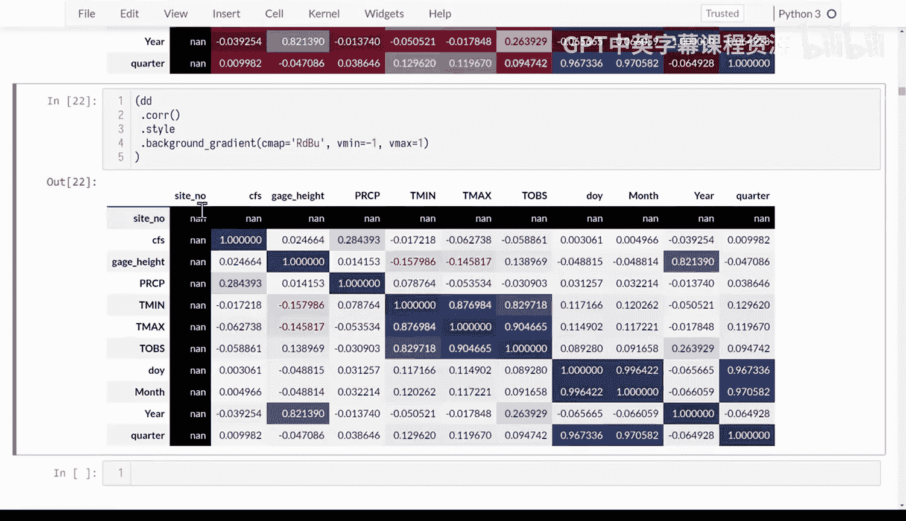

# 数据可视化：13：优化可视化颜色方案 🎨


在本节中，我们将探讨数据可视化中的颜色选择策略。颜色是传达信息、突出重点和增强图表可读性的关键工具。我们将学习如何避免常见的颜色使用误区，并选择适合不同数据类型的配色方案。

## 颜色选择的重要性

在之前的示例中，我们并未过多使用颜色。然而，选择颜色时，需要考虑你想讲述的故事。例如，我们之前绘制的“Dirty Devil”河年径流量（立方英尺/秒）折线图就有些混乱。图中使用了多种颜色，导致难以理解图表内容。

通常，当折线图包含过多线条时，人们会称之为“意大利面条图”，因为信息过于繁杂，难以辨别重点。

## 突出重点线条

因此，我们通常需要聚焦于单条线条。这条线可能是最小值、最大值，也可能是异常值或中间值。以下是一个绘制各国预期寿命的示例，它看起来就像一个杂乱的“意大利面条图”。

我们可以采取的方法是淡化其他所有线条的颜色，只将其中一条线条高亮显示。这是一种常用技巧，若能善用，能有效引导观众关注特定数据点。

## 有效使用颜色的另一个例子

有时，我们会使用相关性热力图。例如，我有“Dirty Devil”数据，并希望计算所有数值列之间的相关性。如果直接看数据表格，虽然能沿对角线看到数值1，但很难一眼看出哪些是高度正相关，哪些是负相关。人类并不擅长直接阅读数据表格，因此我们可以借助颜色来辅助理解。

我常看到人们这样做：直接应用一个默认的配色方案。这里我们应用了默认的背景渐变色，现在可以清楚地看到对角线上的蓝色非常突出。但是，如何找到最强的负相关性呢？这有点困难，我们可能需要寻找最白的区域，但实际上我们应该使用不同的配色方案。

有时，人们会使用像“viridis”这样的配色方案。“viridis”是一种类似彩虹的渐变色系，会从黄色渐变到紫色，中间经过绿色和蓝色。在这种情况下，我们可以寻找最黄和最紫的区域。但由于图中还有其他亮色，它并不能完美地突出我们想关注的重点。

## 正确的配色方案：发散色系

实际上，对于相关性热力图，我们应该使用**发散色系**，例如下面这个红-蓝配色方案。它从红色渐变到白色，再渐变到蓝色。现在，我们可以寻找最蓝和最红的区域。但这里也存在一个我常见到的错误做法。

特别是在相关性热力图中，我们需要固定颜色映射的边界值。目前，正值被固定在1，对应蓝色。但对于负值，我们不希望最负的值显示为红色，我们希望**-1**对应红色，因为**0**附近的数值应该显示为白色。

为了实现这一点，至少在pandas中，我们需要设置`vmin`和`vmax`参数。根据你使用的库，设置方式可能不同，但这是一个正确的做法。

以下是适用于此相关性可视化的正确配色方案示例代码：
```python
# 设置颜色映射的边界，使-1对应红色，0对应白色，1对应蓝色
heatmap = df.corr().style.background_gradient(cmap='RdBu', vmin=-1, vmax=1)
```

我们已将`vmin`设为-1，意味着如果某个值是-1，它将显示为红色。在本例中，我们没有恰好为-1的值，最小的值大约在-0.15左右。我们不希望这些值显示为深红色，因为我们希望0附近的值是白色的。同时，我们将`vmax`设为1。虽然在此类相关性图中对角线本来就是1，但为了明确起见，我们还是设置了它。

这个可视化效果比之前看到的要好得多，因为它清晰地显示了我们有一些强正相关性，同时也有一些非常弱的浅色相关性。其他图表都没有如此清晰地展示这一点。

## 选择合适的配色方案

如果你使用Matplotlib，可以参考这里链接的速查表。我们有各种不同的配色方案，你需要根据情况选择合适的。



例如，我们刚刚讨论了相关性图，因此你应该使用**发散色系**中的一种。

如果你查看的是类别数据，并且希望不同类别之间区分明显，你可能需要查看**定性色系**。

还有其他配色方案，比如“twilight”，它可能具有特殊的**循环**属性。如果你的数据是重复的（例如年份信息），你可能希望使用循环色系来使颜色周期性地回到起始值。

## 总结

本节课我们一起学习了数据可视化中颜色方案的选择与优化。核心要点包括：避免创建混乱的“意大利面条图”，学会通过高亮单一线条来突出重点；理解在相关性热力图中使用**发散色系**（如`RdBu`）并正确设置`vmin`和`vmax`参数的重要性；以及根据数据类型（连续、发散、定性、循环）选择匹配的Matplotlib配色方案。正确的颜色使用能极大提升图表的清晰度和信息传达效率。