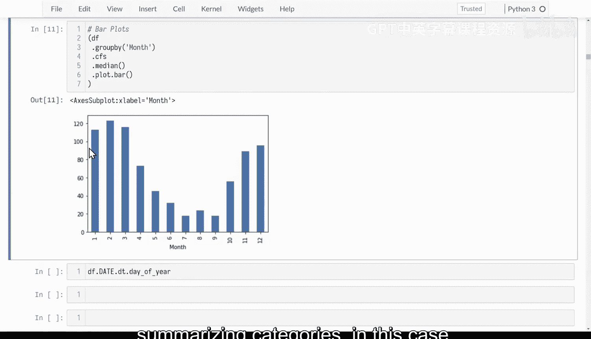

# 杜克大学《应用Python数据工程（3课全）｜Applied Python Data Engineering》中英字幕 p113 14_02_02_探索基础图表类型.zh_en -BV1nz421i7KP_p113-

In this video， I'm going to demo loading some data and looking at some common plots using the pandas library。

 First of all， I'm going to load a dataset set called the Di Devil data set。

 This is a data set that I'll show later on how I created it。

 but it is a dataset set of river flow from a river in southern Utah。

 We've got some things that might be interesting like CFS cubic feet per second。 the gauge height。

 This is how high the water level is。 We've got date。 we've got temperature information。

 We've got a bin for the cubic feet per second。 We've got quarter of the year。

 So we have some interesting time series information about this。

 and we have numeric columns and columns that are more categoric in nature。

Let's look at a common plot that we might want to do and that is a line plot so in pandas this is straightforward we're going to say take that data frame and we're going to plot in the X axis the date column and in the Y axis。

 we're going to plot the CFS or cubic feet per second。Now this plot is easy to make。

 but perhaps not the most compelling。 you can see that we've got a bunch of data there along the bottom and then we've got what looks like some outlier stretching out the data。

 not really letting us see what's going on there。 Also note that the X axis is a little crowded。

 let's try and fix that a little bit， I'm going to instead of plotting all of the years as one single line。

 I'm going to plot each individual year and see if we can compare each individual year to the other ones in order to do that。

 I'm going to pivot my data and then I'll plot it。Okay。

 that looks like it might be a little bit more interesting。

 but we're still seeing that there's some outlier behavior there。

It's a little bit hard to see what's going on。One thing that we can do using the Mapllib library is we can set the Y limit here to zoom into that and when we do that it tells a different story that's starting to look a little bit more interesting。

 but it does look a little bit messy because we have so many colors going on there what story are we trying to tell it's a little bit hard right now just looks like a mess of colors。

What can we do to clean this up a little bit？ Well。

 one of the things that we see here is that we've got a bunch of jaggedy lines， a common technique。

 if you have time series data to smooth those out is to do something like a rolling mean。

 So I'm going to use some pandas code here to do a seven day rolling mean before I plot that。

 let's look at that。Okay， and that's looking a little bit better。Now。

 I could dive into this a little bit more。 generally what I would probably do is mute all of the colors on everything and highlight just one of the years to focus on and tell the story about a single year。

 General， you would want to look at maybe a。Minimum or a maximum。

 or you might want to look at some central tendency as well。Another common plot is a histogram。

 this is really easy to do in pandas we just choose the column that we want to plot and we say hist。

 we can also specify the number of bins there， and this gives us the central tendency of the gauge hide it looks like we have the highest point there the most common point around three or so。

Now， if we want to compare two numeric columns。 a great way to do that is with a correlation。

 we can summarize that here， we're going to summarize gauge height with cubic feet per second。

 and we can see that there is a slight correlation there using the spearing correlation coefficient。

 If you're not familiar with the spearing correlation coefficient。

 It's similar to the piercing correlation coefficient， but it's based on rank。

 it goes from negative one to one， a correlation of one。

 meaning that as the rank of one value goes up， the rank of the other one goes up。

 not necessarily in a linear manner， like the piercing correlation coefficient assumes Also。

 a correlation of0， would mean that you would have random behavior as you progress along one value。

 it wouldn't necessarily go up or down correlation closer to negative one would mean that as the rank of one value goes up。

 the other one goes down。 So we're seeing a slight positive correlation here。 Let's see if we。

Can understand that visually。 We will do a scatter plot to look at that。

 And here you can see that it looks like there is。A slight tendency to go up。

 but we do see some odd behavior again going on around that three gauge height point。

If you have outlier behavior like that， you might want to consider。

 is that what you want to focus on。 or do we want to focus on something else here。

 I'm going to use mapplotlib to zoom in and set the Y limit to zoom into the lower parts and see if we can understand what's going on there。

 I'm also coloring this based on the year。 Now， an interesting thing pops out to me when I do this。

 I can see that vertical line there at the three， that does not look natural。

 So this exploration that I'm doing would probably cause me to jump into that data。

 Look what's going on there。 It looks like it's from a single year。 Maybe the gauge got stuck。

 But that is a little concerning there。 not quite sure what's going on。

We talked about understanding categoryic data， one way to do that is to do a bar plot。

 so in this case I'm going to summarize cubic feet per second by month and I'm going to look at the median value of cubic feet per second by month and I'm going to do a bar plot to understand that。

There we go。 This lets us understand that relatively easily。 We can see that in February。

 we have the highest median value， and it looks like in July。

 we tend to have the lowest median value。 This plot lets us quickly see that and is a great illustration of summarizing categories。

 In this case， we are treating months as categories。

In this video I showed you some common data types and some common plots to examine those data types again。

 when you get your data， you want to understand what the data represents and then choose a plot that might tell the story that you want to tell。

