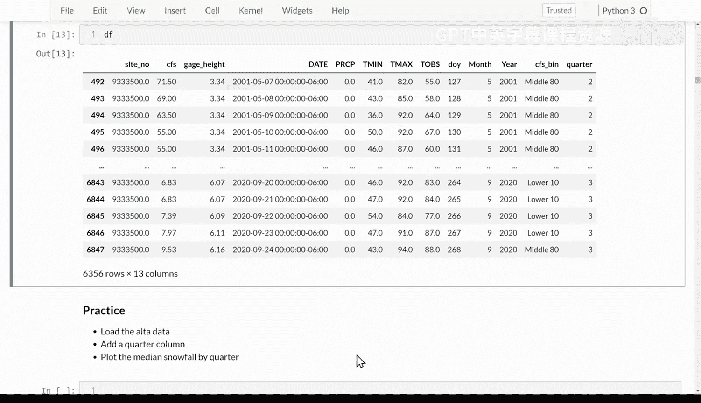

# 杜克大学《应用Python数据工程（3课全）｜Applied Python Data Engineering》中英字幕 p114 15_02_03_数据清洗技术.zh_en -BV1nz421i7KP_p114-

In this section， we're going to look at cleaning your data using Python。

 I recommend that you check out the book Effective Padas chapterpts 1617，21，25 and 27。

 those will have some great information for cleaning your data。In this example。

 I'm going to pull data from GitHub。 I pulled this from the NOAA website， which has。

Meteorological data about Dity Devil River。 And I also have temperature data about Hanksville。

 Hanksville is nearby the Dity Devil River。And we're going to merge this data together using Python。

 So the first part， what we are doing is we are loading the river data set there。

 You can see that I'm telling pandas we want to skip a few rows using that lambda function。

At that point we have the RA CFS data set， and then later on we are going to load the temperature data that is also available on my GitHub。

Once we've got these two data sets。We're going to merge them together。 So let's look at the code。

 What the code is doing down here。 The first thing I'm going to do is call tweakak River。

And if you look at that I'm passing in the raw River data into that I've got a chain in the Tweak River function first what I'm going need to do is make a column called date time with the assigned method。

 we are taking the current datetime column but using some pandas code to convert it to the proper date time in this case we're using the Denver time zone there。

Briefly， I'll jump into what this Denver code is doing。

 I am saying I want to take out the datetime column and also use the TZ CDd column as a time zone column What I'm going to do then is I'm going to replace the values in that column I'm going to replace MDt with MST7 MDt。

 Then I'm going to group by that time zone column。 This will allow me to call transform and what transform is going to do is it's going to allow me to do operations on each group but keep the data in the original indexes rather than doing grouped indexes and you can see inside of the transform I'm saying take my series that I'm passing into this called the Tz localized function to localize to the name of the group and then we're going to。

Invert that into the America Denver time zone。This is a little bit messier than I'd like it to be。

 but that's how we have to do it with the pandas library。 At that point。

 we will have this column here that has time zone information in it Back to our tweak River function After we've created the date time column。

 we are going to rename two columns， one is the CFS column and the other one is the gauge height column。

 They have numeric values。 So we're to make them So they're more illegible。

Okay now we're back to our main chain。 we just called Tweak River。

 which cleans up our original river data set。 What we're going to do now is we're run a group by the datetime column and we are going to group it at the day frequency and calculate the medium values for the numeric values This gives us data at the day level At this point。

 we're going to merge it with the result of cleaning up the temperature data。

 let's look at what the temperature data cleanup looks like。

 and what we're doing with temperature data is we are making a new column called date just using PDd2 date time In this case。

 it's a lot easier to convert it to the America Denver time zone and then we're pulling off certain columns。

 we're going to pull off the date column precipitation that fell during that day。

 the minimum temperature during that day， the maximum temperature during that day and the temperature during which the precipitation was measured at this point。

 we are going to merge the result of this。With our river data。

 we're going to merge the river data on the index， and we're going to merge the temperature data on the date column。

After we've merged that， we're going to make some new columns。

 I'm going to make the day of the year column。 we're going to make a month column。

 a year column we're going to make a gauge height column by interpolating the gauge height values that fills in missing values and then any values that are missing at the front。

 we're going to backfi， push the first values that we see。Back in time。 we're also making a bin。

 So the bin is going to be the first 10% of cubic feet per second。 the middle 80% and the last 10%。

 we're putting some labels in there so that we can understand that better than the default labels that Pans will provide。

 and we're also sticking in a quarter in there。Finally， we're going to save this as a CSV file。

 Let's look at what this looks like when we are done with it。

And you can see that we have a site number that represents the river。

 we have CFS cubic feet per second， we have a gauge height， we have a date。

 note that the date column is at the day level， we have precipitation temperature。

 minimum maximum observation temperature， the day of the year， the month， the year。

 a bin for the cubic feet per second， and a quarter。

