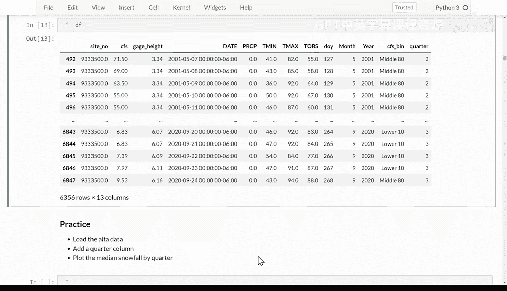

# 应用Python数据工程：3：数据清洗技术 🧹


在本节中，我们将学习如何使用Python清洗数据。我们将通过一个具体示例，演示如何从GitHub加载两个数据集（河流流量数据和温度数据），对它们进行清理、转换和合并，最终生成一个可用于分析的整洁数据集。

上一节我们介绍了数据加载的基础知识，本节中我们来看看如何将这些原始数据转化为干净、可用的格式。

## 概述

我们将处理两个来自美国国家海洋和大气管理局（NOAA）的数据集：关于“Dirty Devil River”的河流流量数据，以及附近“Hanksville”的温度数据。目标是合并这两个数据集，并在此过程中进行一系列数据清洗操作，包括处理日期时间、重命名列、分组聚合、处理缺失值以及创建新的分类变量。

## 数据加载

首先，我们需要加载原始数据。以下是加载河流数据集的代码示例。请注意，我们使用了一个lambda函数来跳过文件开头的几行无关信息。

```python
import pandas as pd

# 加载河流数据，跳过文件开头的几行
river_data = pd.read_csv('river_data.csv', skiprows=lambda x: x in [0, 1, 2])
```

加载完成后，我们得到了原始的河流数据集。接下来，我们以类似的方式加载温度数据，该数据同样可以从GitHub获取。

```python
# 加载温度数据
temperature_data = pd.read_csv('temperature_data.csv')
```

现在，我们手头有了两个独立的数据集。下一步是将它们清理并合并在一起。

## 清洗河流数据

我们定义一个名为 `tweak_river` 的函数来处理河流数据。清洗过程是一个链式操作。

首先，我们需要创建一个正确的 `datetime` 列。原始数据中的日期时间信息需要被转换为Pandas的日期时间格式，并指定时区为美国丹佛时间（‘America/Denver’）。

```python
def tweak_river(df):
    # 创建日期时间列并转换时区
    df['datetime'] = (pd.to_datetime(df['datetime'])
                      .dt.tz_localize('UTC')
                      .dt.tz_convert('America/Denver'))
    return df
```

上述代码中的时区转换过程可以更详细地解释。其核心步骤是：
1.  将字符串转换为无时区信息的 `datetime` 对象。
2.  将其本地化为UTC时间。
3.  再转换为目标时区（‘America/Denver’）。

创建好日期时间列后，我们重命名两个数值列，使它们的名称更清晰易懂。

```python
def tweak_river(df):
    # ...（之前的日期时间转换代码）
    # 重命名列
    df = df.rename(columns={'flow_cfs': 'CFS', 'gauge_height_ft': 'gauge_height'})
    return df
```

至此，河流数据的基本清洗就完成了。回到主流程，我们调用 `tweak_river` 函数处理原始数据。

```python
cleaned_river = tweak_river(river_data)
```

## 聚合与合并温度数据

现在，让我们看看温度数据的清洗过程。对于温度数据，我们同样需要处理日期，并选择相关的列。

```python
def tweak_temp(df):
    # 创建日期列并转换时区
    df['date'] = pd.to_datetime(df['DATE']).dt.tz_localize('America/Denver')
    # 选择需要的列
    df = df[['date', 'PRCP', 'TMIN', 'TMAX', 'TOBS']]
    # 重命名列以使其含义明确
    df = df.rename(columns={'PRCP': 'precipitation',
                            'TMIN': 'temp_min',
                            'TMAX': 'temp_max',
                            'TOBS': 'temp_observed'})
    return df
```

温度数据清洗完成后，我们将其与之前处理过的河流数据合并。合并的依据是日期：河流数据按天聚合后的日期索引，与温度数据的日期列。

在合并之前，我们需要对河流数据进行按日聚合，计算每日流量的中位数等统计值。

```python
# 将河流数据按天聚合，计算数值列的中位数
daily_river = cleaned_river.groupby(pd.Grouper(key='datetime', freq='D')).median()
```

现在，合并两个数据集：

```python
# 合并数据
merged_data = pd.merge(daily_river, cleaned_temp,
                       left_index=True, # 使用daily_river的日期索引
                       right_on='date') # 使用cleaned_temp的‘date’列
```

## 创建衍生特征

数据合并后，我们可以创建一些新的特征列，以便进行更深入的分析。

以下是需要创建的新列：
*   **年积日**：一年中的第几天。
*   **月份**：提取日期中的月份。
*   **年份**：提取日期中的年份。
*   **处理后的水位高度**：使用插值法填充缺失的水位值，并对前端的缺失值进行后向填充。
*   **流量分级**：根据立方英尺每秒（CFS）的值，将其分为“低流量”（前10%）、“中流量”（中间80%）和“高流量”（后10%）三个等级。
*   **季度**：提取日期所属的季度。

```python
# 创建衍生特征
merged_data['day_of_year'] = merged_data['date'].dt.dayofyear
merged_data['month'] = merged_data['date'].dt.month
merged_data['year'] = merged_data['date'].dt.year

# 插值并填充水位高度
merged_data['gauge_height_filled'] = merged_data['gauge_height'].interpolate().bfill()

# 创建流量分级
bins = merged_data['CFS'].quantile([0, 0.1, 0.9, 1.0]).tolist()
labels = ['低流量', '中流量', '高流量']
merged_data['CFS_bin'] = pd.cut(merged_data['CFS'], bins=bins, labels=labels, include_lowest=True)

# 创建季度
merged_data['quarter'] = merged_data['date'].dt.quarter
```

## 保存结果

所有清洗和转换步骤完成后，我们将最终的数据集保存为CSV文件，供后续分析使用。

```python
merged_data.to_csv('cleaned_merged_data.csv', index=False)
```

最终的数据集包含以下列：站点编号、日立方英尺每秒流量、水位高度、日期、降水量、日最低温、日最高温、观测温度、年积日、月份、年份、流量分级和季度。这个整洁的数据集现在已准备好用于可视化、建模或其他分析任务。

## 总结



本节课中我们一起学习了使用Pandas进行数据清洗的完整流程。我们通过一个实例，演示了如何从加载原始数据开始，逐步进行时区转换、列重命名、数据聚合、表合并、缺失值处理以及创建衍生特征。关键点在于将复杂的清洗任务分解为一个个小的、可管理的函数或步骤，并通过链式调用保持代码的清晰。掌握这些技术，你就能将杂乱的真实世界数据转化为结构清晰、可用于分析的高质量数据集。